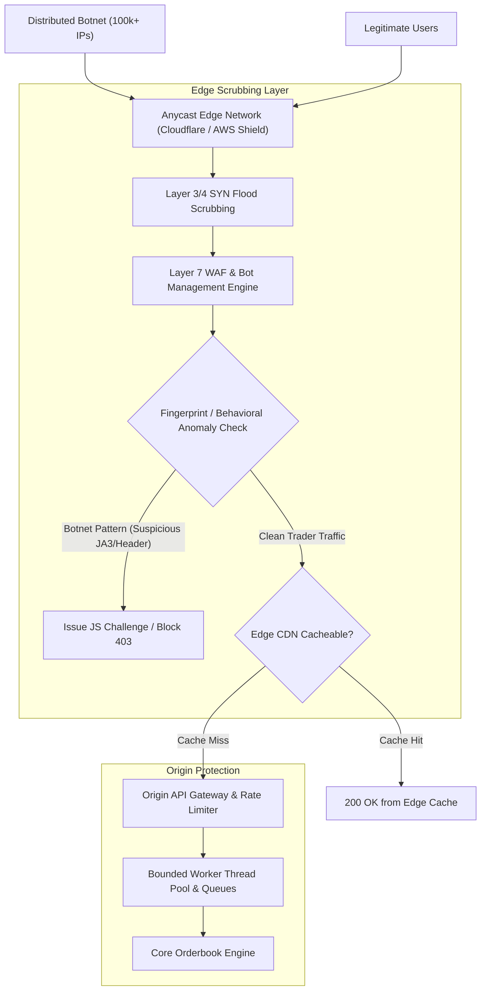

## Fast Revision (10-Second Recall)
Defend against API floods and DDoS by offloading traffic to Anycast edge scrubbing networks (Cloudflare/AWS Shield), enforcing Managed WAF challenges (CAPTCHA/JS challenge), applying aggressive edge rate-limits, and shedding non-critical load via circuit breakers and queue-based backpressure.

## The 30-Second Spoken Script
> "When an API is bombarded by thousands or millions of malicious requests per second, attempting to filter the traffic at the backend application server is a recipe for failure—the TCP connection table and thread pools will saturate before application code can even run. The architectural solution is pushing defense to the edge. First, we route public DNS traffic through an Anycast globally distributed Content Delivery Network like Cloudflare or AWS CloudFront with AWS Shield, which absorbs multi-terabit Layer 3 and Layer 4 volumetric floods across hundreds of edge data centers. Second, for Layer 7 HTTP floods, we deploy Web Application Firewall rules that evaluate request anomalies—such as missing user-agent headers, unusual JA3 TLS fingerprints, or abnormal request frequencies—and automatically issue invisible JavaScript challenges or Turnstile captchas to bot traffic. Finally, on our origin servers, we configure aggressive reverse proxy timeouts, enable connection limits, and shed non-essential background tasks to ensure core transactions remain operational."

## Scenario / Problem Context
A cryptocurrency trading platform suffered an extortion Layer 7 DDoS attack sending 450,000 requests per second to `/api/v1/orderbook`. Application servers ran out of file descriptors and CPU spiked to 100%, causing total service unavailability for legitimate traders. The infrastructure team must design an edge-to-origin defense architecture to absorb and filter flood attacks.

## Architectural Workflow / Sequence


## Deep-Dive Analysis & Root Causes

### 1. Layer 4 vs Layer 7 Attacks
- **Layer 4 (Transport / Volumetric)**: SYN floods, UDP amplification, NTP reflection. The goal is to saturate network bandwidth or firewall state tables.
  - *Defense*: Anycast routing spreads incoming packets across hundreds of global PoPs (Points of Presence), where hardware scrubbing centers discard non-TCP/malformed packets.
- **Layer 7 (Application / HTTP Flood)**: Legitimate-looking `GET` or `POST` requests targeting expensive application routes (e.g., search, report generation, login).
  - *Defense*: Cryptographic challenges, bot heuristics, and Layer 7 behavioral rate limiting.

### 2. TLS Fingerprinting (JA3 / JA4)
Attack tools (like custom Python scripts, Golang bots, or curl loops) present different TLS Client Hello parameters than genuine consumer browsers (supported ciphers, extensions, elliptic curves).
- Modern WAFs calculate a **JA3/JA4 fingerprint** from the Client Hello.
- If an endpoint expects consumer browsers but receives thousands of requests with a known botnet JA3 hash, the WAF can instantly block or challenge the traffic without relying on spoofable `User-Agent` strings.

### 3. Graceful Degradation and Shedding Non-Critical Load
When origin capacity is threatened:
- **Load Shedding**: Use an admission controller. If queue latency exceeds 500 ms, reject new incoming requests immediately with `503 Service Unavailable` before they consume database connections.
- **Static Degradation**: Serve cached, stale data for public endpoints (`/orderbook`) directly from Redis or edge cache with `stale-while-revalidate`.

## Practical Debugging Commands & Code

#### Nginx Origin Connection Limiting & Flood Shield
```nginx
# Define memory zone for rate limiting by binary IP (10MB holds ~160k IPs)
limit_req_zone $binary_remote_addr zone=api_flood_limit:10m rate=30r/s;
limit_conn_zone $binary_remote_addr zone=addr_conn_limit:10m;

server {
    listen 443 ssl http2;
    server_name api.exchange.com;

    # Protect against Slowloris: aggressive header and body timeouts
    client_body_timeout 5s;
    client_header_timeout 5s;
    keepalive_timeout 15s;
    send_timeout 5s;

    location /api/ {
        # Limit concurrent connections per IP to 10
        limit_conn addr_conn_limit 10;

        # Enforce rate limit with small burst allowance
        limit_req zone=api_flood_limit burst=20 nodelay;

        proxy_pass http://backend_pool;
        proxy_set_header Host $host;
        proxy_set_header X-Real-IP $remote_addr;
        
        # Immediate error return without keeping socket open
        limit_req_status 429;
    }
}
```

#### Real-Time Log Analysis Command for Triage During Flood
```bash
# Identify top 20 attacking IP addresses from access logs in real time
tail -n 50000 /var/log/nginx/access.log | awk '{print $1}' | sort | uniq -c | sort -nr | head -20

# Identify top targeted request URIs
tail -n 50000 /var/log/nginx/access.log | awk '{print $7}' | sort | uniq -c | sort -nr | head -10

# Block offending subnet immediately via Linux iptables
sudo iptables -I INPUT -s 192.0.2.0/24 -j DROP
```

## Prevention & Senior Best Practices

### 1. Architectural Guardrails
- **Origin Cloaking**: Never expose the true IP address of origin servers to the public internet. Lock down origin security groups to accept traffic exclusively from Cloudflare or CloudFront IP ranges.
- **Aggressive Edge Caching**: Configure edge cache headers (`Cache-Control: public, max-age=5, stale-while-revalidate=30`) on expensive read endpoints to absorb 95%+ of traffic at the edge.

### 2. Operational Playbooks
- **Automated Under-Attack Mode**: Pre-configure one-click WAF rules or Cloudflare "Under Attack Mode" that injects interactive challenges across all non-whitelisted traffic during active emergencies.
- **Game Day Simulations**: Conduct simulated Layer 7 flood exercises using chaos engineering tools to verify that auto-scaling groups, WAF rules, and alert thresholds fire correctly.

