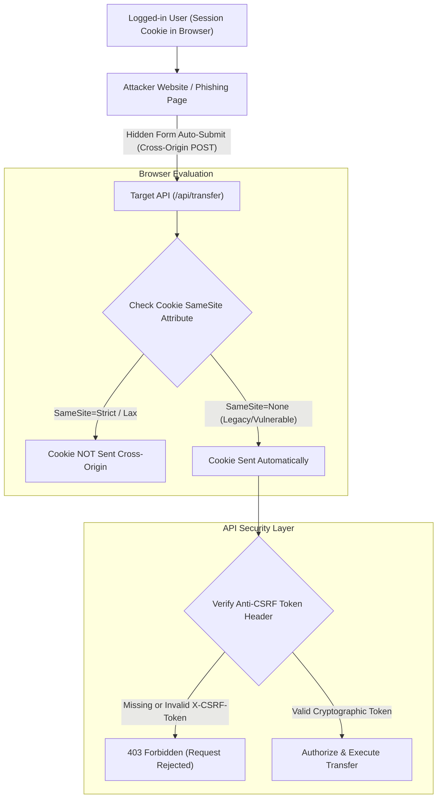

## Fast Revision (10-Second Recall)
CSRF exploits ambient browser authentication where cookies are sent automatically with cross-site requests. Prevent it using SameSite=Lax/Strict cookie attributes, Anti-CSRF Synchronizer Tokens or Double-Submit Cookies, and validating Origin/Referer request headers on state-changing methods.

## The 30-Second Spoken Script
> "CSRF exploits the fundamental browser behavior where cookies are automatically attached to cross-origin requests. An attacker tricks an authenticated user into clicking a link or loading a page that submits an unauthorized request to your API. To eliminate this vulnerability, our primary defense is setting `SameSite=Lax` or `SameSite=Strict` on session cookies, which instructs modern browsers not to attach cookies on cross-site state-changing POST or PUT requests. For APIs serving legacy clients or multi-domain architectures, we enforce the Synchronizer Token Pattern or Double-Submit Cookie pattern, where the frontend must supply a cryptographically random, unpredictable token in a custom header like `X-CSRF-Token`. Because cross-origin sites cannot read or forge custom headers under the Same-Origin Policy, the attack is rendered completely ineffective."

## Scenario / Problem Context
A banking web portal noticed unauthorized funds transfers originating from external websites. An attacker hosted a webpage with a hidden HTML form that automatically submitted when a logged-in user visited the attacker's blog. The bank's backend accepted the cookie and processed the transaction. The team must implement robust CSRF protections across all state-changing endpoints.

## Architectural Workflow / Sequence


## Deep-Dive Analysis & Root Causes

### 1. Anatomy of a CSRF Attack
For a CSRF attack to succeed, three conditions must align:
1. **A Relevant Action**: A state-changing action exists (e.g., password change, email update, funds transfer).
2. **Cookie-Based Session Handling**: The API relies solely on ambient credentials (cookies) sent automatically by the browser.
3. **No Unpredictable Request Parameters**: The request payload has no unpredictable tokens that the attacker cannot guess or forge.

### 2. SameSite Cookie Attribute
Modern browsers provide first-class defense via the `SameSite` attribute:
- **`SameSite=Strict`**: The cookie is never sent in cross-site requests (even following a regular top-level link). Highest security, but degrades UX for external links.
- **`SameSite=Lax` (Modern Default)**: The cookie is withheld on cross-site subrequests (images, iframes, cross-site POST forms), but sent when the user navigates directly via top-level GET links. This effectively prevents standard cross-site form POST attacks.
- **`SameSite=None; Secure`**: The cookie is sent on all cross-site requests. Requires explicit `Secure` flag (HTTPS only). Requires additional token defense!

### 3. Synchronizer Token Pattern (STP) vs Double-Submit Cookie
- **Synchronizer Token Pattern**: The server generates a cryptographically strong, random token tied to the user's current session and embeds it in the HTML form or returns it via a dedicated GET endpoint. On state-changing requests (POST, PUT, DELETE), the server compares the submitted token against the stored session token.
- **Double-Submit Cookie Pattern (Stateless)**: For stateless or SPA applications, the server sends a random token in an unforgeable cookie. The client reads this token (or receives it in an initial response) and sends the identical value in a custom header (e.g., `X-CSRF-Token`). The server verifies that `cookie.csrf_token === header.csrf_token`. Under the Same-Origin Policy (SOP), an attacker site cannot read cookies from another domain to populate the header.

## Practical Debugging Commands & Code

#### Double-Submit CSRF Middleware Implementation
```typescript
import { Request, Response, NextFunction } from 'express';
import crypto from 'crypto';

const CSRF_COOKIE_NAME = 'csrf_token';
const CSRF_HEADER_NAME = 'x-csrf-token';

export function csrfProtection(req: Request, res: Response, next: NextFunction) {
  // Safe HTTP methods do not change state
  if (['GET', 'HEAD', 'OPTIONS'].includes(req.method)) {
    // Generate token if not already present
    if (!req.cookies[CSRF_COOKIE_NAME]) {
      const token = crypto.randomBytes(32).toString('hex');
      res.cookie(CSRF_COOKIE_NAME, token, {
        secure: true,
        sameSite: 'lax',
        path: '/',
      });
    }
    return next();
  }

  // State-changing methods (POST, PUT, PATCH, DELETE)
  const clientToken = req.headers[CSRF_HEADER_NAME];
  const cookieToken = req.cookies[CSRF_COOKIE_NAME];

  if (!clientToken || !cookieToken || clientToken !== cookieToken) {
    return res.status(403).json({
      error: 'CSRF token mismatch or missing. Request blocked.',
    });
  }

  next();
}
```

#### Frontend API Client Attaching CSRF Token
```typescript
// Axios / Fetch interceptor in frontend SPA
function getCookie(name: string): string | null {
  const match = document.cookie.match(new RegExp('(^| )' + name + '=([^;]+)'));
  return match ? match[2] : null;
}

export async function secureFetch(url: string, options: RequestInit = {}) {
  const csrfToken = getCookie('csrf_token');

  const headers = new Headers(options.headers || {});
  if (csrfToken && !['GET', 'HEAD'].includes(options.method?.toUpperCase() || 'GET')) {
    headers.set('X-CSRF-Token', csrfToken);
  }

  return fetch(url, {
    ...options,
    headers,
  });
}
```

## Prevention & Senior Best Practices

### 1. Architectural Rules
- **Idempotent GET Requests**: Strictly forbid GET requests from executing state-changing operations. A GET request must never transfer funds, delete records, or update state.
- **JSON Content-Type Requirement**: Require `Content-Type: application/json` on state-changing endpoints. Browsers cannot send cross-origin JSON payloads without triggering a CORS preflight (`OPTIONS`), which prevents simple HTML form attacks.

### 2. Verification & Testing
- **Verify SameSite Configuration**: Audit all authentication cookies using browser DevTools or automated scripts to verify that `SameSite=Lax` or `SameSite=Strict` is explicitly set.
- **Origin / Referer Header Validation**: In your API gateway or middleware, verify that the `Origin` or `Referer` header matches your expected domain whitelist for all mutative requests.

