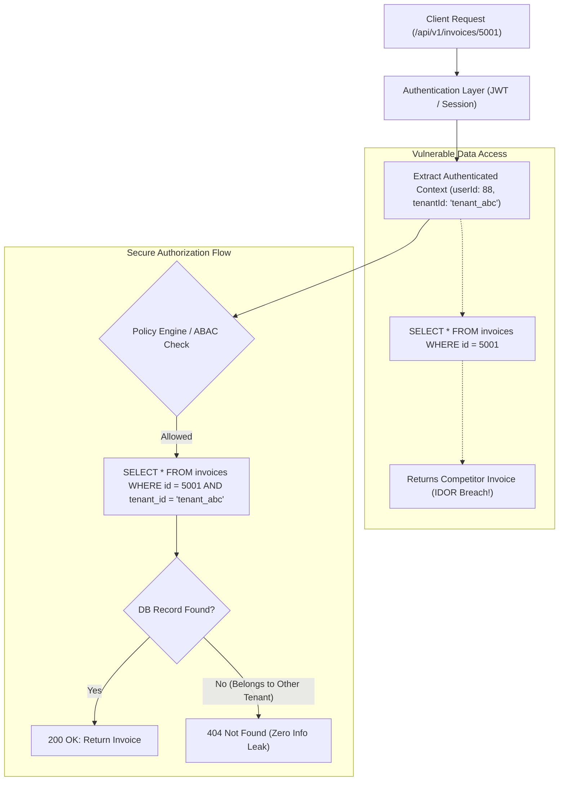

## Fast Revision (10-Second Recall)
IDOR (or BOLA) happens when an API endpoint uses an untrusted user-supplied identifier to access a resource without verifying whether the authenticated user owns or has permission for that object. Prevent it by enforcing tenant-scoped database queries (`WHERE id = ? AND tenant_id = ?`), policy-based authorization middleware, and using non-sequential UUIDs.

## The 30-Second Spoken Script
> "Insecure Direct Object Reference, or Broken Object Level Authorization, is ranked number one on the OWASP API Security Top 10. It happens when an endpoint like `/api/documents/1052` takes an object ID directly from the client request and fetches the record without checking if the authenticated user has permission to view that specific record. An attacker simply increments the integer ID to access every customer's private data. We prevent this by enforcing context-bound, tenant-scoped queries at the data access layer—always appending the authenticated user's tenant or account ID to every query. On top of that, we use policy-based authorization gates in our controller layers and replace predictable sequential primary keys with UUIDv4 or encrypted indirect tokens."

## Scenario / Problem Context
A SaaS invoicing application allows users to download PDF invoices at `/api/v1/invoices/:invoiceId`. A user discovered that by simply changing `:invoiceId` from `5001` to `5000` or `5002` in the URL, they could view invoices, company names, and payment details belonging to competitor companies. The engineering team must redesign object authorization across all endpoints.

## Architectural Workflow / Sequence


## Deep-Dive Analysis & Root Causes

### 1. Root Cause: Broken Object Level Authorization (BOLA)
Authentication answers *"Who are you?"* (identifying user `88`), but Authorization answers *"Are you allowed to perform this action on this specific object?"*.
When developers assume that having a valid login token is sufficient to access any endpoint, they omit the object-ownership check:
```sql
-- VULNERABLE: Only checks if the invoice exists, not who owns it
SELECT * FROM invoices WHERE id = :id;
```

### 2. Tenant-Scoped Database Queries
The most robust defense is enforcing tenancy directly in the SQL `WHERE` clause:
```sql
-- SECURE: Guarantees cross-tenant boundary isolation
SELECT * FROM invoices WHERE id = :id AND tenant_id = :authenticatedTenantId;
```
If user `88` attempts to query invoice `5001` belonging to `tenant_xyz`, the query simply returns 0 rows. The API returns `404 Not Found`, giving zero indication to an attacker that the object even exists.

### 3. UUIDs vs Sequential IDs
- **Sequential IDs (`1, 2, 3`...)**: Trivially predictable. An attacker can write a 5-line bash loop with `curl` to scrape an entire database.
- **UUIDv4 / NanoID**: 128-bit random identifiers (e.g., `f47ac10b-58cc-4372-a567-0e02b2c3d479`). UUIDs make brute-force enumeration mathematically impossible ($2^{122}$ random possibilities).
- *Crucial caveat*: UUIDs prevent enumeration, but **do not prevent IDOR**. If an attacker obtains a victim's UUID (via shared link, referrer header, or log leak), authorization checks must still enforce access control.

### 4. Policy-Based Access Control (PBAC / ABAC)
In complex enterprise systems, a resource may have shared ownership (e.g. delegated team permissions). Policy engines (e.g., CASL, Oso, Open Policy Agent) evaluate policies against subject attributes, resource attributes, and action verbs:
```text
can(user, 'read', 'Invoice', { organizationId: user.organizationId })
```

## Practical Debugging Commands & Code

#### Secure Repository Pattern with Tenant Scope
```typescript
import { Request, Response } from 'express';
import { db } from '../database';

interface AuthenticatedRequest extends Request {
  user: {
    userId: string;
    organizationId: string;
    role: string;
  };
}

export async function getInvoiceHandler(req: AuthenticatedRequest, res: Response) {
  const { invoiceId } = req.params;
  const { organizationId } = req.user;

  // SECURE: Tenant-scoped retrieval prevents IDOR at the query layer
  const invoice = await db.invoice.findFirst({
    where: {
      id: invoiceId,
      organizationId: organizationId, // Mandatory tenant constraint
    },
  });

  if (!invoice) {
    // Return 404 rather than 403 to prevent resource enumeration
    return res.status(404).json({ error: 'Invoice not found' });
  }

  return res.json({ data: invoice });
}
```

#### Global ORM Tenant Isolation Filter (Prisma Extension)
```typescript
import { PrismaClient } from '@prisma/client';

export function getTenantPrismaClient(tenantId: string) {
  const prisma = new PrismaClient();

  return prisma.$extends({
    query: {
      $allModels: {
        async findMany({ args, query }) {
          args.where = { ...args.where, tenantId };
          return query(args);
        },
        async findFirst({ args, query }) {
          args.where = { ...args.where, tenantId };
          return query(args);
        },
        async update({ args, query }) {
          args.where = { ...args.where, tenantId };
          return query(args);
        },
      },
    },
  });
}
```

## Prevention & Senior Best Practices

### 1. Architectural Guardrails
- **Automate Tenant Context in ORM**: Leverage ORM middleware or Prisma client extensions that automatically inject the tenant context into every query, preventing individual developers from forgetting the `where` clause.
- **Return 404 Instead of 403**: When a user queries an object they do not own, return `404 Not Found`. Returning `403 Forbidden` reveals that the ID is valid, enabling resource enumeration.

### 2. Verification & Automated Testing
- **Matrix-Based Authorization Tests**: Write integration tests where User A explicitly attempts to access, update, and delete resources created by User B, verifying that every endpoint responds with `404` or `403`.
- **API Security Fuzzing**: Use automated DAST tools like OWASP ZAP or specialized API security scanners to test for parameter tampering on all object identifiers.

