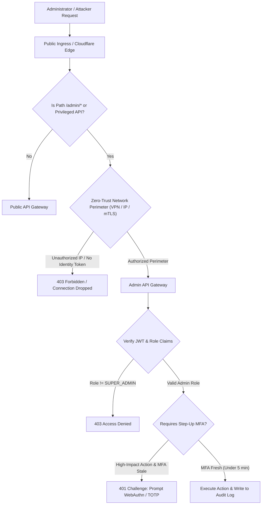

## Fast Revision (10-Second Recall)
Secure admin APIs using defense-in-depth: isolate admin routes behind private networks/VPNs or Cloudflare Access, enforce strict cryptographic RBAC/ABAC middleware, require step-up Multi-Factor Authentication (MFA) for privileged operations, and maintain immutable, tamper-evident audit logs.

## The 30-Second Spoken Script
> "Admin APIs represent the keys to the kingdom, so securing them requires defense-in-depth rather than relying solely on a user role check in code. First, at the network layer, admin routes like `/admin/*` should never be exposed to the public internet; they should be restricted to private VPCs, VPNs, or protected by zero-trust identity gateways like Cloudflare Access or AWS Verified Access. Second, at the application layer, we enforce strict Role-Based Access Control and Attribute-Based Access Control where every route verifies signed JWT claims. Third, for high-impact mutations—like changing billing or deleting users—we mandate step-up authentication, requiring the administrator to provide a fresh TOTP or WebAuthn MFA token within the last 5 minutes. Finally, every single administrative read and write is captured in an append-only, tamper-evident audit log."

## Scenario / Problem Context
A fintech startup experienced an incident where a standard customer discovered `/api/v1/admin/users/promote` was accessible over the public internet. The endpoint verified that the user was logged in, but failed to check if the caller possessed the `SUPER_ADMIN` role, allowing the attacker to grant themselves administrative privileges. The infrastructure and security teams must lock down all administrative capabilities.

## Architectural Workflow / Sequence


## Deep-Dive Analysis & Root Causes

### 1. Common Pitfalls in Admin API Design
1. **Security Through Obscurity**: Hiding admin endpoints behind obscure URLs (e.g., `/api/internal_secret_99/manage`) without implementing robust authorization.
2. **Missing Function-Level Access Control (Broken Object/Function Authorization)**: Verifying that an authorization token is valid, but omitting the role check on the specific controller method.
3. **Horizontal vs Vertical Privilege Escalation**:
   - *Vertical*: Standard user invokes admin actions.
   - *Horizontal*: Admin of Organization A accesses or modifies Organization B's configuration.
4. **Token Replay / Stolen Sessions**: An admin session token stolen via XSS or packet capture used hours later without re-authenticating.

### 2. Network-Level Isolation
Public APIs and Admin APIs should have distinct perimeters:
- **Internal Domain Separation**: Host admin APIs on a separate subdomain (`admin-internal.company.net`) that only resolves via internal DNS within an AWS VPC or tailscale/WireGuard mesh.
- **Zero-Trust Reverse Proxy**: Place routes behind Cloudflare Access, Google BeyondCorp, or Okta Access Gateway. Users must authenticate with corporate SSO and pass device posture checks before a packet even touches the web server.

### 3. Step-Up Authentication (MFA on Demand)
Privileged actions must not rely on passive session tokens:
- Normal actions: Standard session token valid.
- Critical actions (`DELETE /admin/tenants/:id`, `POST /admin/payouts`): Require an `X-MFA-Code` or WebAuthn signature in the request header. If the MFA timestamp is older than 5 minutes, reject the request with `401 MFA_REQUIRED`.

## Practical Debugging Commands & Code

#### Role-Based and Step-Up MFA Authorization Middleware
```typescript
import { Request, Response, NextFunction } from 'express';

interface AdminAuthRequest extends Request {
  user?: {
    id: string;
    roles: string[];
    mfaVerifiedAt: number; // Unix timestamp in seconds
  };
}

export function requireAdminRole(allowedRoles: string[]) {
  return (req: AdminAuthRequest, res: Response, next: NextFunction) => {
    const user = req.user;

    if (!user) {
      return res.status(401).json({ error: 'Unauthenticated' });
    }

    const hasRole = user.roles.some((r) => allowedRoles.includes(r));
    if (!hasRole) {
      return res.status(403).json({ error: 'Forbidden: Insufficient privileges' });
    }

    next();
  };
}

export function requireStepUpMfa(maxAgeSeconds = 300) {
  return (req: AdminAuthRequest, res: Response, next: NextFunction) => {
    const user = req.user!;
    const now = Math.floor(Date.now() / 1000);

    // Verify MFA was verified within the last 5 minutes
    if (!user.mfaVerifiedAt || (now - user.mfaVerifiedAt) > maxAgeSeconds) {
      return res.status(403).json({
        error: 'STEP_UP_MFA_REQUIRED',
        message: 'Action requires recent multi-factor authentication',
      });
    }

    next();
  };
}
```

#### Nginx Configuration Restricting Admin Paths to Internal Subnet
```nginx
server {
    listen 443 ssl http2;
    server_name api.example.com;

    # Public endpoints
    location /api/v1/public/ {
        proxy_pass http://backend_upstream;
    }

    # Administrative endpoints restricted strictly to corporate VPN CIDR
    location /api/v1/admin/ {
        # Allow corporate VPN and internal office IP range
        allow 10.200.0.0/16;
        allow 198.51.100.42/32;
        
        # Deny everyone else
        deny all;

        proxy_pass http://admin_backend_upstream;
        proxy_set_header X-Forwarded-For $remote_addr;
    }
}
```

## Prevention & Senior Best Practices

### 1. Architectural Guardrails
- **Separate Microservices / Deployments**: Split admin endpoints into a distinct `admin-service` deployment with its own internal load balancer, rather than packaging admin routes inside the public-facing customer service.
- **Fail-Closed Default**: Implement global authorization middleware that denies all requests by default unless an explicit public decorator (`@Public()`) is present.

### 2. Operational Hardening
- **Immutable Audit Logging**: Write every administrative action (user ID, timestamp, IP address, resource ID, before-and-after diff) directly to write-once storage (e.g. AWS CloudTrail or an S3 bucket with Object Lock).
- **Automated Alerting on Privilege Changes**: Trigger immediate PagerDuty alerts to security teams whenever an admin account is created or an existing user is elevated.

