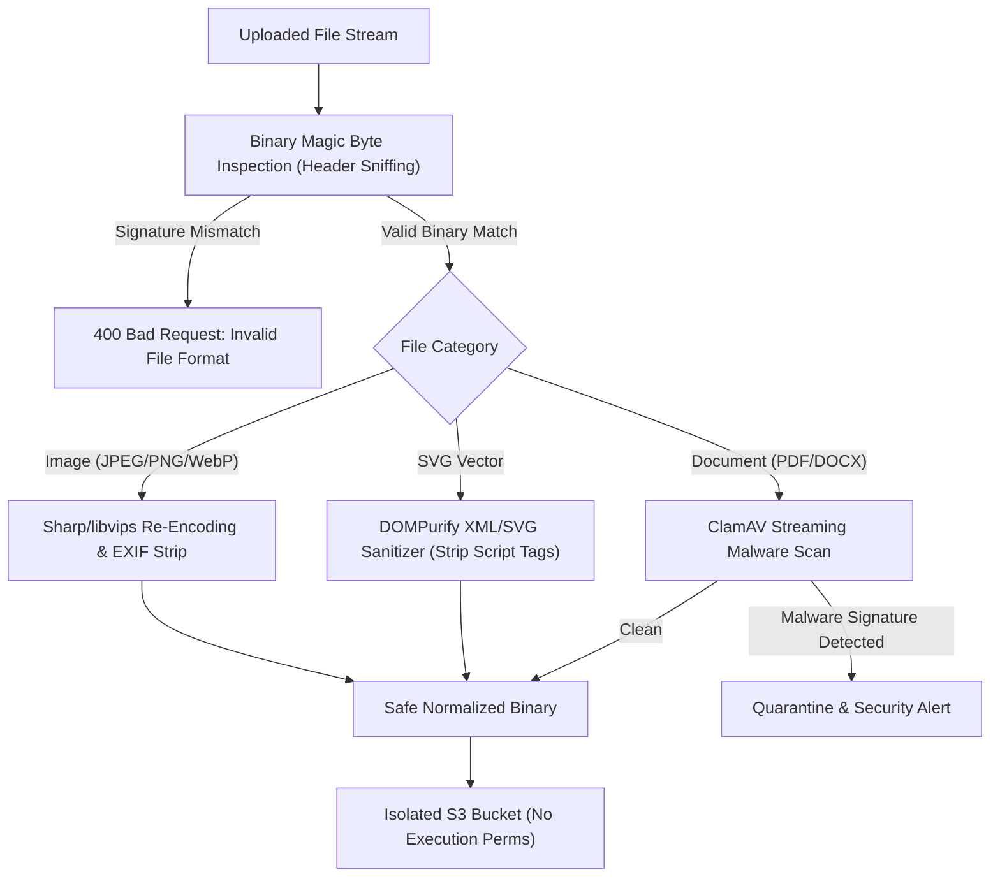

## Fast Revision (10-Second Recall)
Never rely on client-supplied Content-Type headers or file extensions. Inspect magic bytes at the binary level, scan uploads asynchronously using ClamAV or VirusTotal, strip metadata and re-encode images through Sharp/libvips, and neutralize SVG scripts or serve files strictly as attachments from isolated domains.

## The 30-Second Spoken Script
> "Preventing malicious file uploads requires assuming that every uploaded file is an active attack payload until proven otherwise. Attackers routinely disguise webshells and executable malware by faking the file extension to `.png` or spoofing the HTTP `Content-Type` header to `image/jpeg`. To prevent this, we never trust client metadata. First, we inspect the file's raw binary magic bytes to verify that its signature matches its claimed type. Second, for image uploads, we pass the file through a re-encoding pipeline like Sharp or libvips, which reconstructs the pixel data into a brand-new image, stripping out embedded EXIF payloads and malicious PHP or polyglot code. Third, we run asynchronous anti-malware scanners like ClamAV on newly ingested files before making them accessible. Finally, we sanitize SVGs to eliminate embedded JavaScript and serve all user files with `Content-Disposition: attachment`."

## Scenario / Problem Context
A recruitment portal allowed job seekers to upload resumes and profile pictures. An attacker uploaded a valid JPEG image file containing an embedded PHP webshell payload (`shell.php.jpeg`). Another uploaded an SVG file containing embedded script tags that triggered XSS when viewed by recruiters. The platform needs a defense pipeline to inspect, sanitize, and neutralize malicious files.

## Architectural Workflow / Sequence


## Deep-Dive Analysis & Root Causes

### 1. Deceptive File Upload Techniques
- **Extension Spoofing & Null-Byte Injection**: Uploading `shell.php.jpg` or `shell.php%00.jpg` to trick naive extension checkers while web servers run it as PHP.
- **Polyglot Files**: A valid JPEG file whose EXIF comment header or metadata contains valid PHP or JavaScript. When executed by an improperly configured server, the script runs.
- **SVG with Stored XSS**: SVG is an XML-based vector format. Attackers embed `<script>alert(document.cookie)</script>` or `<svg onload=...>`. When rendered directly in the browser, it executes scripts in the host domain context.

### 2. Magic Byte Binary Inspection
The client-provided `Content-Type` header and file extension can be freely modified by attackers using Postman or Burp Suite. Magic bytes are the unique leading hexadecimal signatures present at the start of binary files:
- **JPEG**: `FF D8 FF`
- **PNG**: `89 50 4E 47 0D 0A 1A 0A`
- **PDF**: `25 50 44 46` (`%PDF`)
- **GIF**: `47 49 46 38` (`GIF8`)
- **ZIP/JAR/DOCX**: `50 4B 03 04` (`PK..`)

### 3. Image Re-Encoding and Pixel Normalization
The most secure way to handle user images is destructive re-encoding:
1. Read the raw buffer.
2. Decode pixel bitmap data using an image processing library (Sharp/libvips).
3. Strip all EXIF, IPTC, and XMP metadata (which often contain GPS coordinates or embedded payloads).
4. Re-encode the pixel data into a fresh WebP or PNG binary. Any embedded malware payload outside pixel bounds is permanently destroyed.

### 4. ClamAV Async Malware Scanning
For documents (PDFs, spreadsheets) that cannot be easily re-encoded, pass the file stream through a ClamAV daemon via the `INSTREAM` socket protocol to detect known trojans, viruses, and macro exploits.

## Practical Debugging Commands & Code

#### Magic Byte Inspection & Image Sanitization Pipeline
```typescript
import sharp from 'sharp';
import { fileTypeFromBuffer } from 'file-type';

export async function processProfileImage(rawBuffer: Buffer): Promise<Buffer> {
  // 1. Inspect binary magic bytes (do NOT trust Content-Type header)
  const detectedType = await fileTypeFromBuffer(rawBuffer);
  
  const ALLOWED_MIME = ['image/jpeg', 'image/png', 'image/webp'];
  if (!detectedType || !ALLOWED_MIME.includes(detectedType.mime)) {
    throw new Error('Security Violation: File binary signature does not match allowed image formats');
  }

  // 2. Destructive Re-encoding: Decodes pixels, strips metadata/EXIF payloads, outputs clean WebP
  try {
    const sanitizedBuffer = await sharp(rawBuffer)
      .resize(800, 800, { fit: 'inside', withoutEnlargement: true })
      .rotate() // Auto-rotates based on EXIF before stripping it
      .webp({ quality: 85 }) // Converts to standardized WebP format
      .toBuffer();

    return sanitizedBuffer;
  } catch (error) {
    throw new Error('Corrupt or malformed image data');
  }
}
```

#### Streaming ClamAV Antivirus Scanner
```typescript
import NodeClam from 'clamscan';

let clamScanInstance: NodeClam | null = null;

async function getScanner() {
  if (!clamScanInstance) {
    clamScanInstance = await new NodeClam().init({
      clamdscan: {
        host: process.env.CLAMAV_HOST || 'localhost',
        port: 3310,
        timeout: 60000,
      },
      preference: 'clamdscan',
    });
  }
  return clamScanInstance;
}

export async function scanFileStream(filePathOrStream: string): Promise<boolean> {
  const scanner = await getScanner();
  const { isInfected, viruses } = await scanner.scanFile(filePathOrStream);

  if (isInfected) {
    console.error(`Malware detected: ${viruses.join(', ')}`);
    return false; // Infected!
  }

  return true; // Clean file
}
```

## Prevention & Senior Best Practices

### 1. Architectural Guardrails
- **Neutralize SVG Files**: If SVG uploads are allowed, sanitize them using DOMPurify with strict XML configurations, or enforce `Content-Type: text/plain` or force download via `Content-Disposition: attachment`.
- **Sandbox Processing Workers**: Run file conversion, image manipulation, and PDF parsing in sandboxed container environments with minimal CPU/RAM limits to prevent resource exhaustion vulnerabilities.

### 2. Operational Hardening
- **Daily Antivirus Definitions Update**: Schedule automated `freshclam` cron jobs to update ClamAV signature databases with zero-day definitions multiple times daily.
- **Strict Content Sniffing Prevention**: Always serve file downloads with `X-Content-Type-Options: nosniff` header to prevent older browsers from executing scripts disguised as images.

