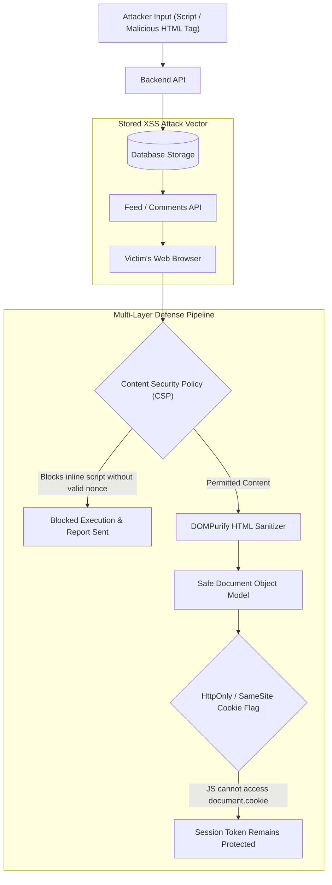

## Fast Revision (10-Second Recall)
XSS occurs when untrusted input executes as JavaScript in the browser. Prevent it by contextual output encoding, strict Content Security Policy (CSP), sanitizing user HTML with DOMPurify, storing session tokens in HttpOnly and SameSite cookies, and avoiding dangerous sinks like innerHTML or eval.

## The 30-Second Spoken Script
> "Cross-Site Scripting boils down to the browser mistaking untrusted user data for executable JavaScript. We defend against it using a layered approach. First, modern frontend frameworks like React and Vue automatically encode text rendered in JSX, preventing straightforward script injections. Second, when we intentionally accept user-authored rich text or Markdown, we pass it through DOMPurify with strict HTML sanitization rules before rendering. Third, we establish a defense-in-depth perimeter using a robust Content Security Policy with nonces and strict `script-src` directives to prevent untrusted inline code from executing. Finally, we store sensitive session identifiers strictly in `HttpOnly` cookies, ensuring that even if an XSS flaw exists, credentials cannot be exfiltrated via `document.cookie`."

## Scenario / Problem Context
A social collaboration workspace allows users to write markdown notes, post comments, and embed shared links. A security researcher submitted a bug bounty showing that commenting `` stole active authentication tokens of viewers. The platform needs an end-to-end strategy to eradicate Stored, Reflected, and DOM-based XSS vectors.

## Architectural Workflow / Sequence


## Deep-Dive Analysis & Root Causes

### 1. Three Primary Forms of XSS
1. **Stored (Persistent) XSS**: The malicious script is permanently stored on the server (database, forum post, comment) and served to every user who requests that page.
2. **Reflected (Non-Persistent) XSS**: The payload arrives in the immediate HTTP request (URL query parameter or form post) and is reflected back into the response without sanitization.
3. **DOM-Based XSS**: The vulnerability lives entirely in client-side JavaScript. The app reads data from an untrusted source (like `location.hash` or `window.name`) and writes it to an unsafe execution sink (like `element.innerHTML`, `document.write`, or `eval`).

### 2. Context-Aware Output Encoding
HTML escaping (`&lt;` instead of `<`) is not universal. Encoding must match the destination context:
- **HTML Body**: Convert `&` to `&amp;`, `<` to `&lt;`, `>` to `&gt;`.
- **HTML Attribute**: Double quote attributes and encode quotes: `"foo" onfocus="alert(1)"`.
- **JavaScript Variable**: Use `JSON.stringify()` and encode JSON payloads: raw interpolation inside `<script>let data = ${userData};</script>` allows breakouts.
- **URI Context**: Use `encodeURIComponent()` to prevent `javascript:alert(1)` schemes in `<a href="...">`.

### 3. Content Security Policy (CSP)
A strong CSP is the single most effective runtime mitigation against XSS:
```http
Content-Security-Policy: default-src 'self'; script-src 'self' 'nonce-rAnd0m123' https://trusted-cdn.com; object-src 'none'; base-uri 'self'; require-trusted-types-for 'script';
```
- Blocks unauthorized external script sources.
- Blocks inline `<script>` tags and inline event handlers (`onclick`, `onerror`) unless signed with a matching cryptographic per-request `nonce`.
- Blocks dangerous primitives like `eval()` (`'unsafe-eval'` omitted).

## Practical Debugging Commands & Code

#### Safe HTML Sanitization with DOMPurify
```typescript
import DOMPurify from 'dompurify';
import { JSDOM } from 'jsdom';

// Server-side or client-side HTML sanitization
export function sanitizeUserHtml(untrustedInput: string): string {
  // If running in Node.js backend
  const window = new JSDOM('').window;
  const purify = DOMPurify(window as unknown as Window);

  return purify.sanitize(untrustedInput, {
    ALLOWED_TAGS: ['b', 'i', 'em', 'strong', 'a', 'p', 'ul', 'ol', 'li', 'code', 'pre'],
    ALLOWED_ATTR: ['href', 'title', 'target'],
    ALLOW_DATA_ATTR: false,
    SAFE_FOR_TEMPLATES: true,
  });
}
```

#### Helmet CSP Configuration in Express / Node.js
```typescript
import express from 'express';
import helmet from 'helmet';
import crypto from 'crypto';

const app = express();

app.use((req, res, next) => {
  // Generate unique cryptographic nonce per request
  res.locals.cspNonce = crypto.randomBytes(16).toString('base64');
  next();
});

app.use((req, res, next) => {
  helmet({
    contentSecurityPolicy: {
      directives: {
        defaultSrc: ["'self'"],
        scriptSrc: ["'self'", `'nonce-${res.locals.cspNonce}'`],
        styleSrc: ["'self'", "'unsafe-inline'"],
        imgSrc: ["'self'", "data:", "https://images.example.com"],
        objectSrc: ["'none'"],
        baseUri: ["'self'"],
        formAction: ["'self'"],
        frameAncestors: ["'none'"], // Prevent clickjacking
      },
    },
  })(req, res, next);
});
```

#### Secure Session Cookie Setting
```typescript
res.cookie('auth_session', sessionToken, {
  httpOnly: true,  // Prevents document.cookie JS access
  secure: true,    // Requires HTTPS
  sameSite: 'lax', // Mitigates CSRF
  path: '/',
  maxAge: 1000 * 60 * 60 * 24 * 7 // 7 days
});
```

## Prevention & Senior Best Practices

### 1. Architectural Guardrails
- **Ban Danger Sinks**: Strictly prohibit `dangerouslySetInnerHTML`, `v-html`, and `innerHTML` via ESLint rules (`react/no-danger`). Mandate peer review for any exceptions.
- **Trusted Types API**: Enable `require-trusted-types-for 'script'` in CSP, enforcing that strings must pass through a validated sanitizer policy before reaching the DOM.

### 2. Operational Hardening
- **CSP Reporting**: Configure `report-uri /api/csp-report` or `report-to` endpoint in CSP to receive immediate telemetry when an injection attempt triggers a browser policy block.
- **Zero Raw Cookie Secrets**: Never store JWTs or sensitive credentials in `localStorage` or `sessionStorage`, as they are trivially exfiltrated by any arbitrary JavaScript execution.

