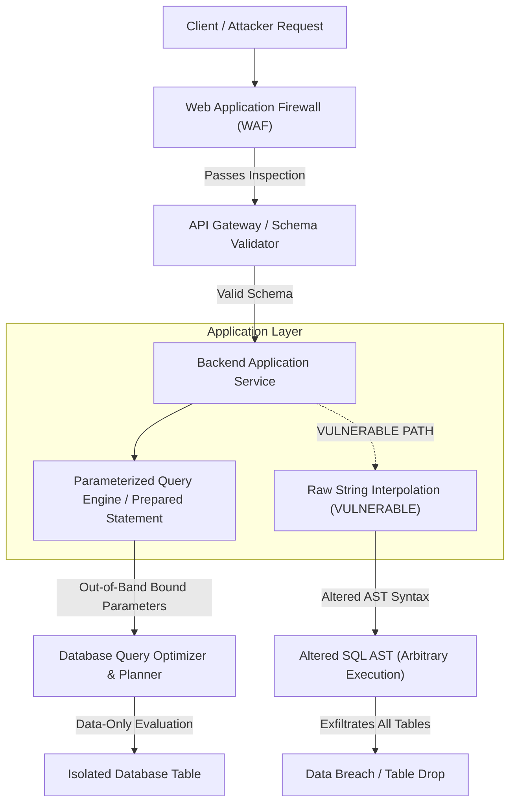

## Fast Revision (10-Second Recall)
Never concatenate untrusted user input into raw SQL strings. Always use parameterized queries (prepared statements) where parameters are sent out-of-band to the database query planner. Complement this with Object-Relational Mappers (ORMs), input validation schemas, database least-privilege user grants, and automated Static Application Security Testing (SAST).

## The 30-Second Spoken Script
> "When protecting an API against SQL injection, the golden architectural standard is strictly enforcing parameterized queries and prepared statements across all data-access layers. In a prepared statement, the database engine compiles the SQL query structure first, treating any subsequent inputs strictly as literal data values rather than executable syntax, rendering payload injections like `' OR '1'='1` completely benign. On top of that, we enforce least-privilege database roles so our web service cannot execute administrative commands like `DROP TABLE` or access sensitive audit tables, validate all inputs via strict runtime schemas (like Zod), and audit ORM queries where developers might carelessly fall back to raw string interpolation."

## Scenario / Problem Context
A multi-tenant e-commerce platform experienced anomalous database CPU spikes and unauthorized data exfiltration. Attackers targeted a search endpoint `/api/v1/products?search=` by supplying nested SQL payloads. The backend endpoint constructed queries using manual string formatting. To secure the system, the engineering team must eliminate injection vectors across legacy and new microservices, audit existing database privileges, and install runtime defensive guardrails.

## Architectural Workflow / Sequence


## Deep-Dive Analysis & Root Causes

### 1. Root Cause: Conflation of Code and Data
SQL Injection (SQLi) occurs when an application fails to distinguish between the developer's executable query instructions and user-supplied data strings. When strings are concatenated directly:
```sql
-- Vulnerable Dynamic Query
SELECT * FROM users WHERE email = '' OR '1'='1' --' AND active = 1;
```
The SQL lexical analyzer treats the attacker's single quote as a token delimiter, rewriting the query's Abstract Syntax Tree (AST) to bypass authentication or dump unauthorized records.

### 2. Prepared Statements and Parameterized Queries
Prepared statements solve SQL injection mathematically:
1. **Prepare Phase**: The application sends the query template with positional placeholders (e.g., `$1, $2` in Postgres, `?` in MySQL/SQLite) to the database engine.
2. **Compile Phase**: The database parses, compiles, and optimizes the execution plan without any input parameters.
3. **Execute Phase**: The application passes the actual parameter values across the wire in a separate binary protocol frame. Even if a parameter contains `' OR '1'='1 --`, the query engine evaluates it purely as an exact string literal match against the column.

### 3. ORM Pitfalls and Second-Order SQLi
While ORMs like Prisma, Hibernate, or Entity Framework parameterize by default, severe vulnerabilities still arise:
- **Raw SQL Escape Hatches**: Methods like `db.$queryRawUnsafe(sql)` or `EntityManager.createNativeQuery(rawStr)` bypass parameterization.
- **Dynamic Identifiers**: Table names, column names, and sorting directions (`ORDER BY ${col}`) cannot be parameterized in standard SQL engines. They must be validated against a strict compile-time whitelist.
- **Second-Order SQLi**: Malicious strings are safely stored in the database first, but later read by a batch worker or reporting job and concatenated into dynamic SQL without parameterization.

### 4. Defense-in-Depth Measures
- **Principle of Least Privilege**: The application DB user should only have `SELECT, INSERT, UPDATE, DELETE` on required tables. It must NEVER hold `DROP, ALTER, CREATE`, or access system tables like `pg_shadow` or `mysql.user`.
- **Read-Only Replicas**: Direct all search and reporting endpoints to read-only database connections with read-only roles.

## Practical Debugging Commands & Code

#### Safe Parameterized Query (Node.js pg Driver)
```typescript
import { Pool } from 'pg';
import { z } from 'zod';

const pool = new Pool();

const SearchSchema = z.object({
  search: z.string().max(100),
  limit: z.coerce.number().min(1).max(50).default(20),
});

export async function searchProducts(rawParams: unknown) {
  const { search, limit } = SearchSchema.parse(rawParams);

  // SAFE: Bound parameters ($1, $2) parsed out-of-band by PostgreSQL engine
  const query = `
    SELECT id, name, price, stock 
    FROM products 
    WHERE name ILIKE $1 AND is_active = true 
    ORDER BY created_at DESC 
    LIMIT $2;
  `;

  const values = [`%${search}%`, limit];
  const result = await pool.query(query, values);
  return result.rows;
}
```

#### Dynamic Column Sorting via Safe Whitelisting
```typescript
const ALLOWED_SORT_COLUMNS = {
  price: 'price',
  created: 'created_at',
  name: 'name',
} as const;

type SortKey = keyof typeof ALLOWED_SORT_COLUMNS;

export async function getSortedProducts(sortParam: string, direction: 'ASC' | 'DESC') {
  const safeCol = ALLOWED_SORT_COLUMNS[sortParam as SortKey];
  if (!safeCol) {
    throw new Error('Invalid sort field');
  }

  const safeDir = direction === 'ASC' ? 'ASC' : 'DESC';

  // Identifiers cannot be bound parameters; whitelisting guarantees safety
  const query = `SELECT * FROM products ORDER BY ${safeCol} ${safeDir} LIMIT 20;`;
  return pool.query(query);
}
```

#### Database User Least-Privilege Provisioning
```sql
-- Revoke all default privileges from public schema
REVOKE ALL ON SCHEMA public FROM PUBLIC;

-- Create dedicated web application user
CREATE USER web_api_user WITH PASSWORD 'Sup3rS3cur3R4nd0m!';

-- Grant minimal permissions strictly on required application tables
GRANT USAGE ON SCHEMA public TO web_api_user;
GRANT SELECT, INSERT, UPDATE, DELETE ON ALL TABLES IN SCHEMA public TO web_api_user;
ALTER DEFAULT PRIVILEGES IN SCHEMA public GRANT SELECT, INSERT, UPDATE, DELETE ON TABLES TO web_api_user;
```

## Prevention & Senior Best Practices

### 1. Architectural Guardrails
- **Ban Unsafe Raw Query Methods**: Add ESLint rules (`no-restricted-syntax`) or SonarQube quality gates to block raw string concatenation in database calls.
- **Strict Input Validation**: Validate and sanitize all user input before it reaches the data layer using schema libraries like Zod, Joi, or Pydantic.
- **Enforce SAST in CI/CD**: Integrate Semgrep, CodeQL, or Snyk into pull request workflows to detect dynamic SQL string patterns before merge.

### 2. Operational & Runtime Hardening
- **Web Application Firewall (WAF)**: Deploy AWS WAF or Cloudflare WAF with OWASP Core Rule Set (CRS) SQLi detection rules at the ingress layer to drop obvious attack probes.
- **Database Query Logging & Anomaly Detection**: Monitor database slow logs and query logs for syntax error spikes (`syntax error at or near`), which indicate automated SQLi fuzzers like sqlmap.

