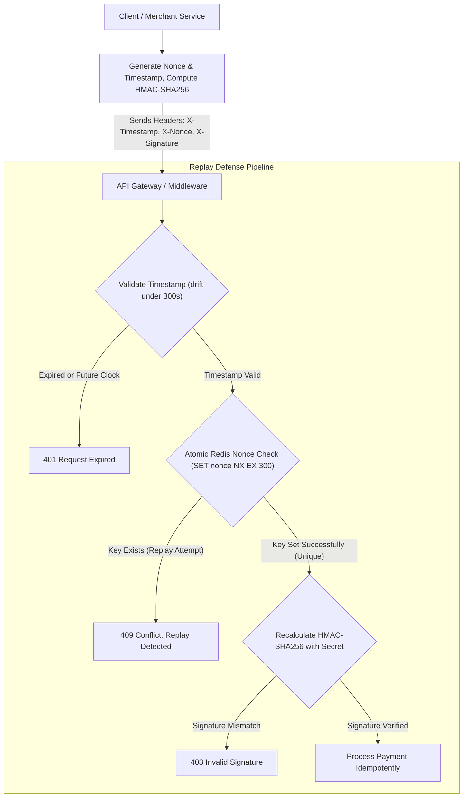

## Fast Revision (10-Second Recall)
Replay attacks occur when an attacker intercepts a valid API request and resends it to duplicate transactions. Prevent it by requiring request signing with HMAC-SHA256, strict timestamp validation (e.g. within 5 minutes), and a unique single-use Nonce tracked in Redis with a matching TTL.

## The 30-Second Spoken Script
> "Replay attacks happen when a network eavesdropper or malicious actor captures a legitimate, authenticated API request—such as a fund transfer or password reset—and transmits it repeatedly to duplicate the effect. Transport Layer Security (TLS) encrypts traffic in transit, but cannot protect against scenarios where an attacker captures payloads at compromised proxies or client environments. To make an API replay-proof, we implement cryptographic request signing. Each request must include three critical headers: a current UNIX timestamp, a cryptographically random Nonce (number used once), and an HMAC-SHA256 signature calculated over the HTTP method, URI, timestamp, nonce, and request body using a shared secret. When the server receives the request, it first verifies that the timestamp is within an acceptable clock-drift window (like within 300 seconds). Next, it checks Redis using an atomic `SET key nonce NX EX 300` command. If the nonce already exists, the server rejects the request immediately as a replay. Finally, it recalculates the HMAC signature to verify that no headers or body fields were altered."

## Scenario / Problem Context
A payment gateway processed merchant webhooks for card payments. A malicious actor intercepted a legitimate callback `POST /api/webhooks/payment-success { transactionId: 'tx_99', amount: 500 }` and replayed it 15 times, causing the merchant system to credit the user's wallet balance 15 times. The engineering team must implement replay-proof webhook and API protection.

## Architectural Workflow / Sequence


## Deep-Dive Analysis & Root Causes

### 1. Why TLS Alone Is Not Always Sufficient
While TLS encrypts traffic between client and server, replay attacks can occur when:
- Webhooks travel across multiple public internet hops or intermediary reverse proxies.
- Attackers compromise a client machine, mobile app, or browser extension that has access to raw request generation.
- Network devices or load balancers mishandle automated HTTP retries.

### 2. The Three Pillars of Anti-Replay Defense
1. **Timestamp**: Prevents old requests from being replayed indefinitely. The server checks the time drift between server time and request timestamp. If the difference exceeds 300 seconds (5 minutes), the request is rejected. This bounds the window during which the server must track state.
2. **Nonce (Number Used ONCE)**: A cryptographically random UUID or hexadecimal string generated by the client per request.
3. **Atomic Nonce Cache**: The server stores each observed nonce in Redis with a Time-To-Live (TTL) matching the timestamp window (e.g., 300 seconds). By using Redis `SET key 1 NX EX 300`, the check and store happen in a single atomic operation. If the key already exists, `SET` returns null and the request is aborted.
4. **HMAC Signature**: Ensures an attacker cannot tamper with the timestamp or nonce to bypass the window without invalidating the cryptographic signature.

### 3. Canonical Request Representation
To prevent whitespace or header ordering differences from breaking signatures:
```text
StringToSign = HTTP_METHOD + "\n" +
               PATH + "\n" +
               TIMESTAMP + "\n" +
               NONCE + "\n" +
               SHA256(REQUEST_BODY)
```
Both client and server compute `HMAC_SHA256(StringToSign, SharedSecret)`.

## Practical Debugging Commands & Code

#### Replay Protection & HMAC Middleware (Express & Redis)
```typescript
import { Request, Response, NextFunction } from 'express';
import crypto from 'crypto';
import Redis from 'ioredis';

const redis = new Redis();
const SHARED_SECRET = process.env.API_HMAC_SECRET!;
const MAX_CLOCK_DRIFT_SEC = 300; // 5 minutes

export async function verifyReplayProtection(req: Request, res: Response, next: NextFunction) {
  const timestamp = req.headers['x-timestamp'] as string;
  const nonce = req.headers['x-nonce'] as string;
  const clientSignature = req.headers['x-signature'] as string;

  if (!timestamp || !nonce || !clientSignature) {
    return res.status(400).json({ error: 'Missing security headers' });
  }

  // 1. Validate Timestamp Window
  const reqTime = parseInt(timestamp, 10);
  const now = Math.floor(Date.now() / 1000);
  if (isNaN(reqTime) || Math.abs(now - reqTime) > MAX_CLOCK_DRIFT_SEC) {
    return res.status(401).json({ error: 'Request timestamp expired or outside clock drift tolerance' });
  }

  // 2. Atomic Nonce Verification in Redis
  const nonceKey = `nonce:${nonce}`;
  // SET with NX (set if not exists) and EX (expiration in seconds)
  const setResult = await redis.set(nonceKey, '1', 'EX', MAX_CLOCK_DRIFT_SEC, 'NX');
  if (!setResult) {
    // Nonce was already seen within the active TTL window
    return res.status(409).json({ error: 'Replay attack detected: Nonce already consumed' });
  }

  // 3. Verify HMAC Signature
  const rawBody = JSON.stringify(req.body || {});
  const bodyHash = crypto.createHash('sha256').update(rawBody).digest('hex');
  const stringToSign = `${req.method}\n${req.originalUrl}\n${timestamp}\n${nonce}\n${bodyHash}`;

  const expectedSignature = crypto
    .createHmac('sha256', SHARED_SECRET)
    .update(stringToSign)
    .digest('hex');

  // Constant-time comparison to prevent timing attacks
  const isValid = crypto.timingSafeEqual(
    Buffer.from(clientSignature, 'hex'),
    Buffer.from(expectedSignature, 'hex')
  );

  if (!isValid) {
    return res.status(403).json({ error: 'Invalid HMAC signature' });
  }

  next();
}
```

#### Client-Side HMAC Request Signer
```typescript
import crypto from 'crypto';

export function signRequest(method: string, urlPath: string, body: object, secret: string) {
  const timestamp = Math.floor(Date.now() / 1000).toString();
  const nonce = crypto.randomUUID();
  const rawBody = JSON.stringify(body);
  const bodyHash = crypto.createHash('sha256').update(rawBody).digest('hex');

  const stringToSign = `${method}\n${urlPath}\n${timestamp}\n${nonce}\n${bodyHash}`;
  const signature = crypto.createHmac('sha256', secret).update(stringToSign).digest('hex');

  return {
    'X-Timestamp': timestamp,
    'X-Nonce': nonce,
    'X-Signature': signature,
    'Content-Type': 'application/json',
  };
}
```

## Prevention & Senior Best Practices

### 1. Architectural Guardrails
- **Idempotency Keys for Business Logic**: Combine anti-replay headers with application-level idempotency keys (`Idempotency-Key: uuid`) so that even if network retries slip past, duplicate database records cannot be created.
- **NTP Time Synchronization**: Synchronize all API server clocks using Network Time Protocol (NTP / Amazon Time Sync) to ensure server timestamps do not drift and falsely reject legitimate requests.

### 2. Verification & Testing
- **Automated Replay Test**: In CI/CD test suites, capture a signed API request and attempt to replay it twice in rapid succession, verifying that the second request returns `409 Conflict`.

