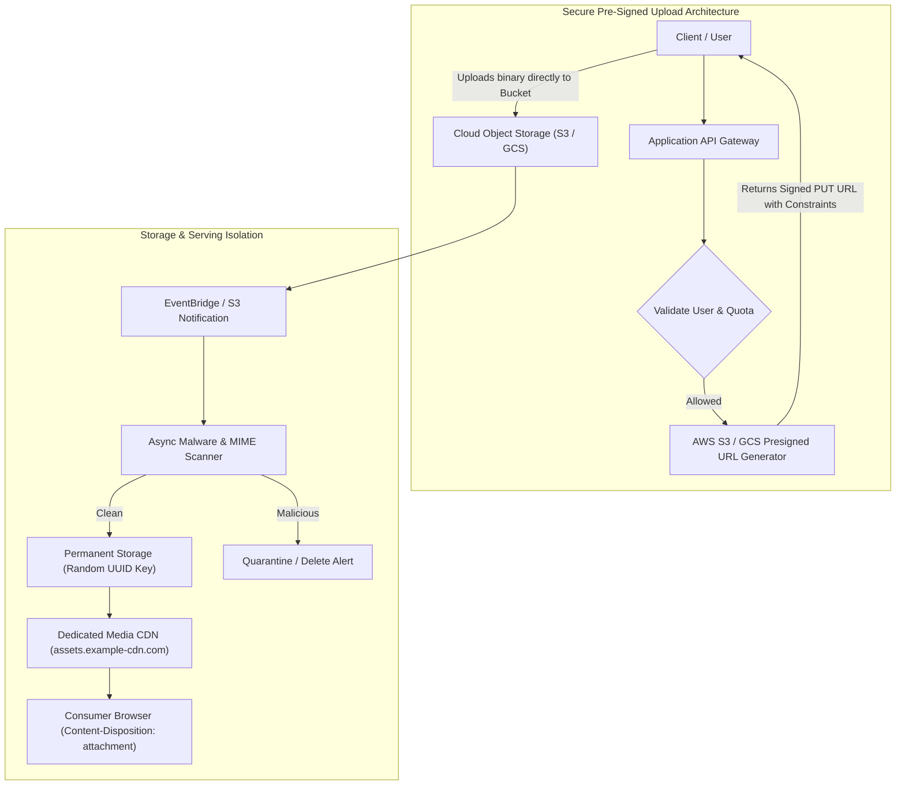

## Fast Revision (10-Second Recall)
Secure file upload APIs by streaming uploads directly to cloud object storage (S3/GCS Presigned URLs) rather than buffering on application servers, strictly enforcing byte-level size limits, sanitizing file paths to prevent directory traversal, and storing files on non-executable isolated storage.

## The 30-Second Spoken Script
> "Protecting file upload APIs requires keeping untrusted user bytes as far away from application server execution runtimes as possible. First, rather than allowing clients to upload multi-megabyte payloads directly to application servers—which risks thread pool starvation, memory exhaustion, and zip bomb attacks—we generate short-lived, pre-signed upload URLs that stream files directly to cloud object storage like Amazon S3. Second, we enforce strict payload size limits at the edge or gateway. Third, we never trust the original client filename; we rename all uploaded files to cryptographically random UUIDs to eliminate directory traversal attacks like `../../etc/passwd`. Finally, we configure cloud buckets as non-executable and serve user files through a dedicated Content Delivery Network domain with strict download headers."

## Scenario / Problem Context
A document management platform allowed customers to upload PDF contracts and profile avatars. An attacker uploaded a 10 GB file via a chunked transfer request that consumed all server RAM and disk space, crashing the API nodes. Another attacker passed a filename of `../../var/www/shell.jsp`, attempting to overwrite server files. The system needs a hardened file ingestion architecture.

## Architectural Workflow / Sequence


## Deep-Dive Analysis & Root Causes

### 1. Primary Attack Vectors on File Upload APIs
1. **Denial of Service (DoS) & Resource Exhaustion**: Uploading massive files or zip bombs (a 42 KB zip file expanding to 4.5 petabytes) that exhaust disk space, inodes, or memory.
2. **Directory Traversal**: Using path manipulation characters (`../`, `..\\`) in the filename to overwrite critical system configuration files (`/etc/passwd`, web root).
3. **Server-Side Request Forgery (SSRF)**: Upload endpoints that accept a URL to "fetch an image from web" can be abused to probe internal metadata services (`http://169.254.169.254`).
4. **Local File Inclusion (LFI) / Webshell Execution**: Uploading executable code into a web-accessible directory where the web server executes it as PHP, JSP, or ASP.

### 2. Pre-Signed URL Architecture
Instead of routing large file streams through web application nodes:
```text
Client -> [Large File Stream] -> Web Server App -> [Write File] -> Disk / S3
```
The application server acts solely as a permission broker:
1. Client requests upload ticket: `POST /api/uploads/request-url { filename, size, mimeType }`.
2. API validates file size quota, permissions, and returns a pre-signed S3 URL with strict conditions:
   - `Content-Length-Range`: Exactly enforces min and max byte size.
   - `Content-Type`: Locked to the requested MIME type.
   - Expiration: Valid for only 5 minutes.
3. Client streams bytes directly to S3. The application server incurs zero memory or disk overhead.

### 3. File Path and Name Sanitization
Never store a file on disk using the user-provided filename:
- Discard client filename completely for storage: use `crypto.randomUUID() + safeExtension`.
- Store the original client filename only in database metadata for display purposes.
- If saving locally, strictly resolve absolute paths and verify they do not escape the designated upload directory.

## Practical Debugging Commands & Code

#### Generating Secure S3 Presigned Upload URL (AWS SDK v3)
```typescript
import { S3Client } from '@aws-sdk/client-s3';
import { createPresignedPost } from '@aws-sdk/s3-presigned-post';
import crypto from 'crypto';

const s3Client = new S3Client({ region: 'us-east-1' });

export async function generateUploadUrl(userId: string, requestedMimeType: string) {
  const allowedMimeTypes = ['image/jpeg', 'image/png', 'application/pdf'];
  if (!allowedMimeTypes.includes(requestedMimeType)) {
    throw new Error('Unsupported media type');
  }

  // Generate collision-resistant random key; never trust user filename
  const fileKey = `uploads/${userId}/${crypto.randomUUID()}`;

  // Maximum allowed size: 10 Megabytes (10 * 1024 * 1024 bytes)
  const MAX_FILE_SIZE = 10 * 1024 * 1024;

  const presignedPost = await createPresignedPost(s3Client, {
    Bucket: process.env.S3_BUCKET_NAME!,
    Key: fileKey,
    Conditions: [
      ['content-length-range', 1024, MAX_FILE_SIZE], // Min 1KB, Max 10MB
      ['eq', '$Content-Type', requestedMimeType],
    ],
    Expires: 300, // 5 minutes expiration
  });

  return presignedPost;
}
```

#### Preventing Directory Traversal for Local Disk Storage
```typescript
import path from 'path';
import crypto from 'crypto';

const UPLOAD_ROOT = path.resolve('/var/app/storage/uploads');

export function getSafeLocalPath(extension: string): string {
  // Whitelist extensions
  const ALLOWED_EXT = ['.jpg', '.png', '.pdf'];
  if (!ALLOWED_EXT.includes(extension.toLowerCase())) {
    throw new Error('Forbidden extension');
  }

  const safeFilename = `${crypto.randomUUID()}${extension}`;
  const resolvedPath = path.resolve(UPLOAD_ROOT, safeFilename);

  // Guard against directory traversal
  if (!resolvedPath.startsWith(UPLOAD_ROOT)) {
    throw new Error('Directory traversal attempt detected');
  }

  return resolvedPath;
}
```

## Prevention & Senior Best Practices

### 1. Architectural Guardrails
- **Separate Serving Domain**: Always serve user-uploaded assets from a dedicated untrusted domain (e.g., `user-content.cdn-example.com`) rather than your primary application domain (`app.example.com`). This prevents scripts in files from reading session cookies.
- **Set Protective Download Headers**: When serving files, return `Content-Disposition: attachment; filename="safe_name.ext"` and `X-Content-Type-Options: nosniff` to prevent browsers from executing files inline.

### 2. Operational Hardening
- **Disable Execution Permissions**: Ensure upload storage mount points are mounted with `noexec` flags in Linux (`mount -o noexec,nosuid`).
- **Quota Enforcement**: Enforce per-user and per-organization storage quotas in the database before granting pre-signed upload tickets.

