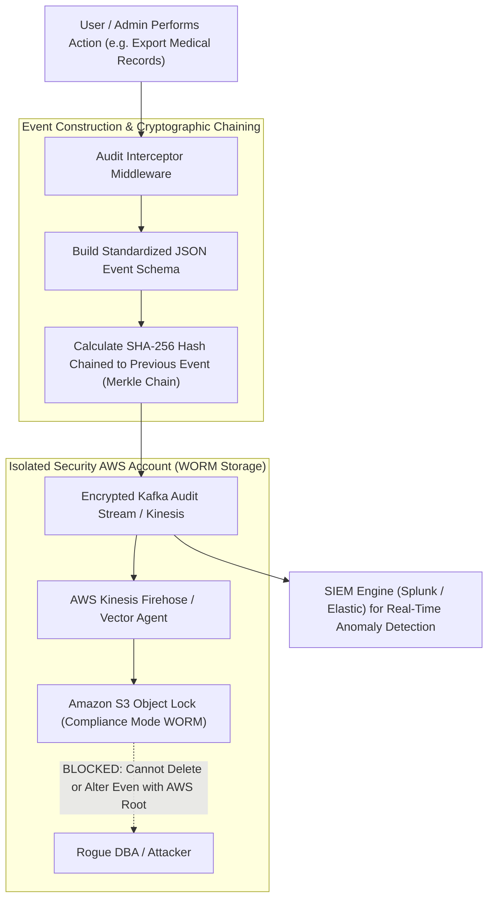

## Fast Revision (10-Second Recall)
Build enterprise audit logging systems using structured, non-repudiable event schemas (Who, What, When, Where, Outcome). Ship logs asynchronously to tamper-evident, write-once storage (WORM / S3 Object Lock) using cryptographic hash chaining, ensuring logs cannot be modified or deleted even by compromised root accounts.

## The 30-Second Spoken Script
> "Auditing user and administrator activities is fundamental for security forensics, regulatory compliance (SOC 2, ISO 27001, HIPAA), and insider threat detection. A reliable audit trail must be distinct from transient application debug logs. We design audit logging around the non-repudiation principle: every high-impact event—such as permission changes, data exports, password resets, or payment transactions—is captured with a standardized schema containing actor ID, tenant ID, action verb, target resource ID, before-and-after diffs, IP address, and cryptographic timestamp. To guarantee that a rogue administrator or compromised backend service cannot delete evidence of an intrusion, we stream audit logs to an isolated AWS account with an S3 Object Lock bucket configured in Compliance Mode (Write-Once, Read-Many) and link log entries using SHA-256 cryptographic hash chains."

## Scenario / Problem Context
A hospital healthcare management platform suffered an insider threat: a database administrator illegally exported and sold confidential celebrity medical records, subsequently running `DELETE FROM audit_logs WHERE actor_id = 'admin_9'` to erase all evidence of the access. Because the audit records resided in the same mutable relational database as the application data, the intrusion was unprovable in court. The engineering team must build an immutable, tamper-evident audit logging architecture.

## Architectural Workflow / Sequence


## Deep-Dive Analysis & Root Causes

### 1. The Principle of Non-Repudiation
Non-repudiation ensures that a party to a transaction or event cannot deny the authenticity of their signature or action.
For an audit log to hold up in regulatory audits and legal forensics:
- **Completeness**: The log must record every critical state change.
- **Accuracy**: Timestamps must be synchronized across servers via NTP.
- **Immutability**: Logs must be cryptographically or physically impossible to alter or purge.

### 2. Standardized Audit Event Schema
An enterprise audit log must answer the canonical 5 Ws:
- **Who**: Actor ID, username, authenticated role, session ID, client certificate fingerprint.
- **What**: Action verb (`user.role.updated`, `patient.record.exported`, `billing.payout.initiated`).
- **When**: ISO 8601 UTC timestamp with microsecond precision.
- **Where**: Client IP address, GeoIP location, User-Agent, Service name.
- **Outcome**: `SUCCESS`, `FAILURE`, `DENIED`, along with HTTP response code.
- **Diff / Changes**: Redacted before-and-after state snapshot.

### 3. Tamper-Evident Hash Chaining
Similar to a blockchain or Git tree:
$$\text{Hash}_i = \text{SHA256}(\text{Event}_i + \text{Hash}_{i-1})$$
If an adversary attempts to modify or delete Event 4, all subsequent hashes ($5, 6, 7\dots$) become cryptographically invalid, immediately revealing tampering during verification sweeps.

### 4. Write-Once, Read-Many (WORM) Storage
Cloud providers offer hardware-enforced retention locks:
- **AWS S3 Object Lock (Compliance Mode)**: Objects cannot be overwritten, modified, or deleted by any IAM user or even the AWS root account until the retention period (e.g. 7 years) expires.

## Practical Debugging Commands & Code

#### Tamper-Evident Audit Event Generator with Hash Chaining
```typescript
import crypto from 'crypto';
import { S3Client, PutObjectCommand } from '@aws-sdk/client-s3';

interface AuditEvent {
  eventId: string;
  previousHash: string;
  currentHash?: string;
  timestamp: string;
  actor: {
    userId: string;
    organizationId: string;
    ipAddress: string;
    userAgent: string;
  };
  action: string;
  resource: {
    type: string;
    id: string;
  };
  outcome: 'SUCCESS' | 'FAILURE' | 'DENIED';
  metadata?: Record<string, unknown>;
}

let lastEventHash = '0000000000000000000000000000000000000000000000000000000000000000';

export function createAuditEvent(event: Omit<AuditEvent, 'eventId' | 'previousHash' | 'timestamp' | 'currentHash'>): AuditEvent {
  const eventId = crypto.randomUUID();
  const timestamp = new Date().toISOString();

  const auditPayload: AuditEvent = {
    eventId,
    previousHash: lastEventHash,
    timestamp,
    ...event,
  };

  // Compute deterministic SHA-256 hash chain
  const serialized = JSON.stringify(auditPayload);
  const currentHash = crypto.createHash('sha256').update(serialized).digest('hex');

  auditPayload.currentHash = currentHash;
  lastEventHash = currentHash; // Update state for next event

  return auditPayload;
}
```

#### Express Audit Logging Middleware for Critical Routes
```typescript
import { Request, Response, NextFunction } from 'express';
import { logger } from './logger';

export function auditAction(actionName: string, resourceExtractor: (req: Request) => { type: string; id: string }) {
  return (req: Request, res: Response, next: NextFunction) => {
    const originalSend = res.send;

    res.send = function (body) {
      const outcome = res.statusCode >= 200 && res.statusCode < 400 ? 'SUCCESS' : 'FAILURE';

      const event = createAuditEvent({
        actor: {
          userId: (req as any).user?.id || 'ANONYMOUS',
          organizationId: (req as any).user?.organizationId || 'NONE',
          ipAddress: req.ip || '0.0.0.0',
          userAgent: req.headers['user-agent'] || 'UNKNOWN',
        },
        action: actionName,
        resource: resourceExtractor(req),
        outcome,
      });

      // Ship asynchronously to audit logging pipeline (e.g. Kafka or CloudWatch)
      process.nextTick(() => {
        logger.info({ audit_event: event }, 'AUDIT_RECORD');
      });

      return originalSend.apply(res, arguments as any);
    };

    next();
  };
}
```

#### Verifying Hash Chain Integrity via CLI
```bash
# Verify cryptographic hash chain across raw JSONL audit archive
node -e '
const fs = require("fs");
const crypto = require("crypto");

const lines = fs.readFileSync("audit_events_2026_10.jsonl", "utf8").trim().split("\n");
let expectedPrev = "0000000000000000000000000000000000000000000000000000000000000000";

for (let i = 0; i < lines.length; i++) {
  const event = JSON.parse(lines[i]);
  if (event.previousHash !== expectedPrev) {
    console.error(`TAMPER DETECTED at event index ${i}! Broken hash chain.`);
    process.exit(1);
  }
  expectedPrev = event.currentHash;
}
console.log("Audit log integrity verified: 0 modifications detected.");
'
```

## Prevention & Senior Best Practices

### 1. Architectural Guardrails
- **Separate AWS/Cloud Accounts**: Maintain audit logs in a dedicated, isolated "Security & Audit" cloud account. No production application developer or operations administrator should have write access to that account.
- **Asynchronous Decoupling**: Publish audit events asynchronously via message brokers (Kafka/Kinesis) so that audit logging overhead never blocks user-facing HTTP request latencies.

### 2. Operational Hardening
- **Alert on Failed Admin Actions**: Configure SIEM alerts on repeated `DENIED` actions on admin resources, which indicate credential probing or insider threat activity.
- **Automated Verification Crons**: Schedule daily automated jobs to verify hash chain integrity across all archived audit files, alerting SecOps immediately if any record is altered.

