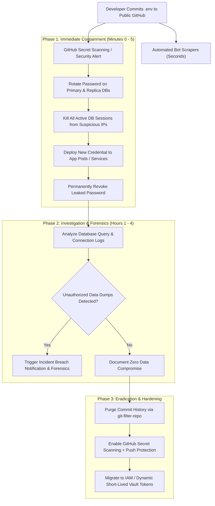

## Fast Revision (10-Second Recall)
Assume the credential is breached within seconds of push. Immediately rotate and revoke the credential in the database, terminate active suspicious sessions, inspect connection and query audit logs, rewrite Git history using git-filter-repo, invalidate pre-commit bypasses, and install automated secret scanning with push protection.

## The 30-Second Spoken Script
> "The instant a database credential or secret is pushed to a public repository, you must assume automated bot scrapers have already captured it. Step one is immediate containment: do not waste time rewriting Git history first. Instead, log directly into the database or cloud console, provision a new credential, deploy it to application instances, and revoke the compromised password immediately. Step two is threat investigation: examine database connection logs, network telemetry, and audit logs for unknown IP addresses or unauthorized data dumps during the exposure window. Step three is eradication: purge the secret from Git history using `git-filter-repo` or BFG Repo-Cleaner and force-push. Finally, install pre-commit hooks like Gitleaks, enable GitHub Secret Scanning with Push Protection, and migrate all database credentials to dynamic IAM authentication or AWS Secrets Manager with automated rotation."

## Scenario / Problem Context
A junior software engineer mistakenly committed an unencrypted `.env` file containing the production PostgreSQL root password to a public GitHub repository. Within 4 minutes, automated bots discovered the repository and attempted thousands of brute-force connections from foreign IP addresses. The on-call engineering lead must execute an emergency incident response playbook to contain the breach, assess exposure, and permanently secure secrets.

## Architectural Workflow / Sequence


## Deep-Dive Analysis & Root Causes

### 1. The Bot Window Reality
Public GitHub commits are indexed by internet crawlers within 2 to 5 seconds. Simply making the repository private or deleting the commit with `git reset HEAD~1` does not remove the secret from cached clones, commit archives, or scraping databases (like GitHub Archive or public APIs).
- **Rule of Thumb**: Any secret pushed to public GitHub must be treated as completely compromised from the millisecond it left the developer's laptop.

### 2. The Containment Anti-Pattern
The most common junior mistake is spending 45 minutes trying to squash or rewrite Git history while the compromised password remains 100% active on the live production database.
- **Correct Order of Operations**:
  1. Revoke / Rotate credential on the target system first.
  2. Terminate rogue connections.
  3. Update application configurations.
  4. Purge Git history last.

### 3. Log Forensics and Blast Radius Assessment
Once the credential is dead, examine database connection logs for the exposure timeframe:
- Check connection attempts: Look for connections from IP addresses outside your known application VPC CIDR range (`10.0.0.0/16`).
- Review `pg_stat_activity` (Postgres) or `INFORMATION_SCHEMA.PROCESSLIST` (MySQL).
- Audit data volume: Did total egress bandwidth or disk reads spike abnormally, indicating a `pg_dump` or `SELECT * FROM users` exfiltration?

### 4. Git History Sanitization: BFG vs git-filter-repo
Standard `git rm` leaves the file in the `.git` packfile history.
- `git-filter-repo` (the official Git-recommended tool) rewrites commits, trees, and tags to completely scrub the file or literal strings from all branches.

## Practical Debugging Commands & Code

#### Emergency Database Credential Rotation (PostgreSQL)
```sql
-- 1. Check for active rogue sessions
SELECT pid, usename, client_addr, state, query_start, query 
FROM pg_stat_activity 
WHERE usename = 'app_user';

-- 2. Create replacement application user to avoid application downtime
CREATE USER app_user_v2 WITH PASSWORD 'NewCryptographicRandomP@ssw0rd2026!';
GRANT app_role TO app_user_v2;

-- 3. Once applications are reloaded with app_user_v2, terminate rogue connections
SELECT pg_terminate_backend(pid) 
FROM pg_stat_activity 
WHERE usename = 'app_user' AND client_addr != '10.0.1.50'; -- Exclude known worker

-- 4. Invalidate compromised user password
ALTER USER app_user WITH PASSWORD 'PermanentlyDisabledInvalidRevoked999!';
ALTER USER app_user NOLOGIN;
```

#### Purging Secret from Git History via git-filter-repo
```bash
# Install git-filter-repo
pip install git-filter-repo

# Create fresh mirror clone to avoid reference corruption
git clone --bare git@github.com:company/repo.git repo-cleanup
cd repo-cleanup

# Completely remove .env file from all branches, tags, and commits
git filter-repo --invert-paths --path .env

# Alternatively replace specific leaked string across all files
echo "OldCompromisedPassword123==>REMOVED_SECRET" > replace.txt
git filter-repo --replace-text replace.txt

# Force push scrubbed history back to remote
git push origin --force --all
git push origin --force --tags
```

#### Pre-Commit Protection via Gitleaks
```bash
# Install gitleaks
brew install gitleaks # macOS
# or choco install gitleaks / winget install gitleaks (Windows)

# Run secret scan on entire repo
gitleaks detect --source . --verbose

# Add pre-commit hook in .pre-commit-config.yaml
# repos:
#   - repo: https://github.com/gitleaks/gitleaks
#     rev: v8.18.0
#     hooks:
#       - id: gitleaks
```

## Prevention & Senior Best Practices

### 1. Architectural Guardrails
- **Eliminate Static Database Passwords**: Migrate database authentication to cloud IAM roles (e.g., AWS RDS IAM Authentication, GCP Cloud SQL IAM). Pods authenticate using temporary, automatically refreshed short-lived tokens valid for only 15 minutes.
- **Push Protection**: Enable GitHub Secret Scanning Push Protection organization-wide. Commits containing recognized private keys, tokens, or passwords are automatically rejected at the `git push` barrier.

### 2. Operational Playbooks
- **Automated Secrets Managers**: Store secrets in HashiCorp Vault, AWS Secrets Manager, or Doppler. Inject secrets into containers as environment variables at runtime via Kubernetes secrets or CSI drivers, never checking them into Git.
- **Pre-Commit Enforcement**: Mandate tools like `husky` and `gitleaks` on developer workstations to prevent accidental staging of `.env` files.

