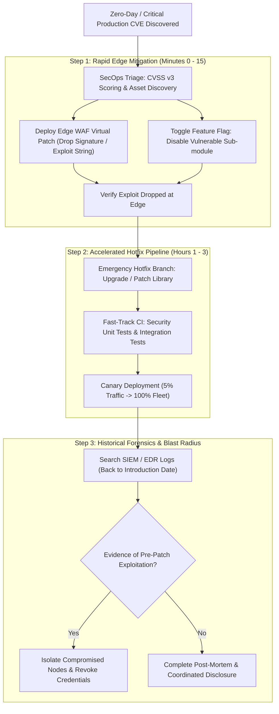

## Fast Revision (10-Second Recall)
Triage production vulnerabilities using standardized CVSS v3/v4 scoring. Implement immediate temporary edge mitigations (WAF virtual patching / feature flags) to neutralize exploitation, develop and canary-test a permanent hotfix, conduct thorough blast radius forensics for prior exploitation, and publish transparent post-mortem disclosures under responsible coordinated vulnerability disclosure guidelines.

## The 30-Second Spoken Script
> "When a critical vulnerability or zero-day is discovered in production—such as Log4Shell or an unauthenticated Remote Code Execution flaw—our incident protocol prioritizes fast edge mitigation before waiting for lengthy code builds. Step one is rapid triage: we calculate the CVSS score, determine whether the flaw is actively being exploited, and identify exposed internet-facing assets. Step two is deploying immediate temporary containment: we activate Web Application Firewall (WAF) virtual patching rules or toggle feature flags to disable the vulnerable module within minutes, buying time for engineering. Step three is hotfix development: we isolate the root cause, write regression tests, bump vulnerable dependencies, and deploy the hotfix through an accelerated emergency CI/CD pipeline with canary rollout. Step four is historical log forensics: we query SIEM logs back to the deployment date of the vulnerable code to determine if adversaries previously exploited the flaw. Finally, we document the root cause and complete coordinated disclosure."

## Scenario / Problem Context
A zero-day Remote Code Execution (RCE) vulnerability was published for a widely used open-source imaging library embedded in your production media processing microservice. Automated scanning bots across the internet began spraying exploit payloads to public endpoints. The on-call engineering and security response teams must triage, mitigate, patch, and audit the production fleet against active compromise without disrupting customer image uploads.

## Architectural Workflow / Sequence


## Deep-Dive Analysis & Root Causes

### 1. CVSS Scoring and Prioritization Matrix
Not all vulnerabilities require 2:00 AM wakeups. We prioritize using CVSS v3.1 / v4.0 metrics:
- **Critical (CVSS 9.0 - 10.0)**: Remotely exploitable without privileges, unauthenticated, widespread internet scanning (e.g., Log4Shell, OpenSSL RCE). Mitigation SLA: under 2 hours.
- **High (CVSS 7.0 - 8.9)**: Privileged RCE, high-impact SQLi, or authentication bypass. Mitigation SLA: under 24 hours.
- **Medium / Low**: Requires local access, unusual user interaction, or theoretical impact. Scheduled in regular sprint cycles.

### 2. Virtual Patching via WAF
Compiling, testing, and safely deploying code across 200 microservices takes hours.
- **Virtual Patch**: An inspection rule configured at the edge (Cloudflare WAF, AWS WAF, Nginx) that matches the exploit payload's signature and drops requests before they touch backend application runtimes.
- Buys the development team critical time to write, review, and test the proper software patch without exposure to automated scanners.

### 3. Historical Exploit Hunting (Forensics)
A patch only secures future requests. You must investigate the past:
- Determine git commit date when the vulnerable code was introduced ($T_{\text{intro}}$).
- Query Web Application Firewall logs, reverse proxy access logs, and Endpoint Detection & Response (EDR) telemetry between $T_{\text{intro}}$ and $T_{\text{patch}}$.
- Check for unexpected shell execution, outbound network sockets created by container runtimes, or file system modifications in `/tmp`.

## Practical Debugging Commands & Code

#### Deploying Emergency AWS WAF Rule for Exploit Mitigation (Terraform / JSON)
```json
{
  "Name": "Block-Log4j-RCE-Exploit",
  "Priority": 1,
  "Action": {
    "Block": {}
  },
  "VisibilityConfig": {
    "SampledRequestsEnabled": true,
    "CloudWatchMetricsEnabled": true,
    "MetricName": "Log4jRCEBlocked"
  },
  "Statement": {
    "RegexMatchStatement": {
      "FieldToMatch": {
        "AllQueryArguments": {}
      },
      "RegexString": "\\$\\{(jndi|ldap|rmi|dns):",
      "TextTransformations": [
        {
          "Priority": 1,
          "Type": "URL_DECODE"
        },
        {
          "Priority": 2,
          "Type": "LOWERCASE"
        }
      ]
    }
  }
}
```

#### EDR / Linux Host Investigation for Post-Exploitation Sockets
```bash
# Check if container or host processes spawned unexpected outbound connections
sudo ss -tupn | grep -E '(:4444|:1337|:9001)'

# Inspect active processes running from temporary writable directories
ps aux | grep -E '(/tmp/|/dev/shm/)'

# Audit recently modified executable files in container overlay filesystem
find / -type f -executable -mtime -1 2>/dev/null | grep -v -E '(/proc|/sys)'
```

## Prevention & Senior Best Practices

### 1. Architectural Guardrails
- **Automated Software Bill of Materials (SBOM)**: Generate and store SBOMs (using Syft or CycloneDX) for every container build to instantly query if a newly announced CVE affects your deployed artifacts.
- **Immutable & Read-Only Container Filesystems**: Run containers with `readOnlyRootFilesystem: true` in Kubernetes, mounting only ephemeral volumes for temporary scratch space. If an RCE occurs, the attacker cannot drop webshells or download secondary binaries.

### 2. Operational Playbooks
- **Dependency Automation**: Use Dependabot or Renovate with automated test suites to keep dependencies up-to-date weekly, avoiding massive multi-major-version security migrations during active incidents.
- **Coordinated Vulnerability Disclosure (CVD)**: Maintain a clear `security.txt` file and public bug bounty program (HackerOne/Bugcrowd) to receive reports from security researchers before public zero-day drops.

