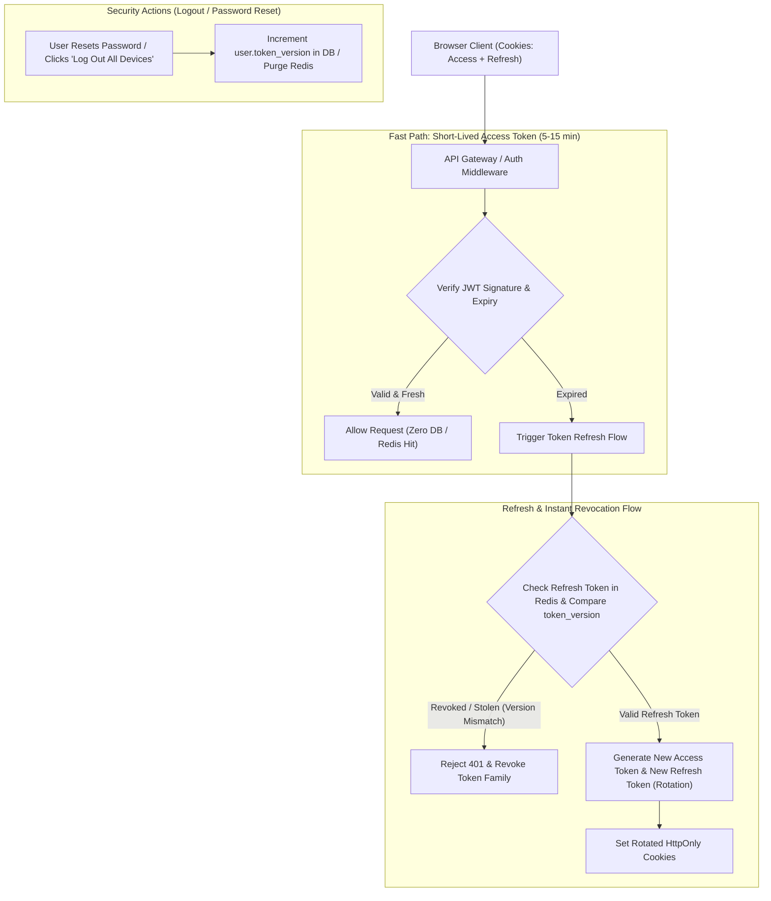

## Fast Revision (10-Second Recall)
Implement secure session management using cryptographically random session IDs (128+ bits) stored in HttpOnly, Secure, SameSite cookies. Back sessions with distributed Redis caches to support instant revocation. For JWT architectures, keep access tokens short-lived (5-15 min) with rotating refresh tokens and centralized revocation lists. Always regenerate session IDs upon authentication to prevent session fixation.

## The 30-Second Spoken Script
> "Session management is the cornerstone of web security, and choosing between stateful sessions and stateless JWTs involves critical security tradeoffs. In purely stateless JWT systems, an access token cannot be revoked before its expiration, creating severe exposure if a token is stolen or a user changes their password. The production-proven approach is a hybrid architecture: short-lived access tokens valid for 5 to 15 minutes paired with stateful, rotating refresh tokens stored in Redis. On the browser side, tokens must never live in `localStorage` where XSS attacks can extract them; they must reside in `HttpOnly`, `Secure`, `SameSite=Lax` cookies. Crucially, to prevent session fixation attacks, we regenerate the session identifier the exact moment a user transitions from anonymous to authenticated state, and implement instant single-click 'Log out of all devices' by incrementing a `token_version` in the database."

## Scenario / Problem Context
A SaaS analytics platform used long-lived (30-day) stateless JWTs stored in browser `localStorage`. A disgruntled former employee whose company account was terminated retained an active token on their personal laptop and continued accessing sensitive financial dashboards for three weeks because the backend had no mechanism to revoke valid signed JWTs. The platform must implement secure, revocable session management.

## Architectural Workflow / Sequence


## Deep-Dive Analysis & Root Causes

### 1. The Myth of Purely Stateless JWTs
While stateless JWTs avoid database lookups, they introduce severe operational and security liabilities:
- **No Instant Revocation**: If an employee is fired, an account is hijacked, or permissions change from Admin to User, the JWT remains completely valid until `exp` elapses.
- **Token Size Overhead**: JWTs can easily reach 1 KB to 2 KB, sent on every single HTTP request.
- **Storage Risk**: Storing JWTs in `localStorage` or `sessionStorage` allows any minor XSS vulnerability to exfiltrate the token.

### 2. Session Fixation Defense
Session fixation occurs when an attacker obtains an anonymous session ID (e.g., visiting a site), tricks a victim into authenticating using that same ID (via phishing link), and then uses the now-authenticated session.
- **Remediation**: The session identifier must be destroyed and regenerated with a brand-new ID immediately upon successful login.

### 3. Refresh Token Rotation with Reuse Detection
To detect stolen refresh tokens:
1. Client presents Refresh Token $R_1$.
2. Server validates $R_1$, invalidates $R_1$, and issues new pair: Access Token $A_2$ + Refresh Token $R_2$.
3. If an attacker later attempts to use the already-consumed $R_1$, the server detects **reuse anomaly**!
4. Action: The server immediately revokes all active refresh tokens for that user family, forcing all devices to re-authenticate.

### 4. The Token Version Pattern
Instead of storing millions of active access tokens in Redis:
- Embed `token_version: 3` inside the JWT payload.
- Store `user_token_version: 3` in the user's database or Redis profile.
- When the user resets their password or logs out everywhere, increment `user_token_version` to `4`.
- On subsequent access token validation, if `jwt.token_version < user.token_version`, reject immediately.

## Practical Debugging Commands & Code

#### Secure Refresh Token Rotation Middleware (Node.js & Redis)
```typescript
import { Request, Response, NextFunction } from 'express';
import jwt from 'jsonwebtoken';
import crypto from 'crypto';
import Redis from 'ioredis';

const redis = new Redis();
const ACCESS_SECRET = process.env.JWT_ACCESS_SECRET!;
const REFRESH_SECRET = process.env.JWT_REFRESH_SECRET!;

export async function handleTokenRefresh(req: Request, res: Response) {
  const oldRefreshToken = req.cookies.refresh_token;
  if (!oldRefreshToken) {
    return res.status(401).json({ error: 'Refresh token missing' });
  }

  try {
    const payload = jwt.verify(oldRefreshToken, REFRESH_SECRET) as { userId: string; familyId: string };
    const redisKey = `refresh_family:${payload.familyId}`;

    // Fetch the currently active token for this token family from Redis
    const currentActiveToken = await redis.get(redisKey);

    // REUSE DETECTION: If token does not match the latest issued token, family was compromised!
    if (currentActiveToken !== oldRefreshToken) {
      console.warn(`[Security Alert] Refresh token reuse detected for user ${payload.userId}! Revoking family.`);
      await redis.del(redisKey); // Invalidate entire family immediately
      res.clearCookie('access_token');
      res.clearCookie('refresh_token');
      return res.status(401).json({ error: 'Session compromised. Please log in again.' });
    }

    // Generate new token pair (Rotation)
    const newAccessToken = jwt.sign({ userId: payload.userId }, ACCESS_SECRET, { expiresIn: '15m' });
    const newRefreshToken = jwt.sign(
      { userId: payload.userId, familyId: payload.familyId },
      REFRESH_SECRET,
      { expiresIn: '7d' }
    );

    // Update active token in Redis with 7-day TTL
    await redis.set(redisKey, newRefreshToken, 'EX', 7 * 24 * 60 * 60);

    // Set secure HttpOnly cookies
    res.cookie('access_token', newAccessToken, {
      httpOnly: true,
      secure: true,
      sameSite: 'lax',
      maxAge: 15 * 60 * 1000, // 15 mins
    });

    res.cookie('refresh_token', newRefreshToken, {
      httpOnly: true,
      secure: true,
      sameSite: 'lax',
      path: '/api/v1/auth/refresh', // Restrict path to refresh endpoint only
      maxAge: 7 * 24 * 60 * 60 * 1000, // 7 days
    });

    return res.json({ status: 'Tokens rotated successfully' });
  } catch (err) {
    return res.status(401).json({ error: 'Invalid refresh token' });
  }
}
```

#### Regenerating Session ID on Login to Prevent Fixation
```typescript
export async function loginHandler(req: Request, res: Response) {
  // Validate credentials ...
  const user = await authenticateUser(req.body.email, req.body.password);

  // Critical: Destroy old anonymous session and regenerate ID
  req.session.regenerate((err) => {
    if (err) return res.status(500).json({ error: 'Session initialization failed' });

    // Store authenticated user in fresh session ID
    req.session.userId = user.id;
    req.session.authenticatedAt = Date.now();
    
    res.json({ success: true });
  });
}
```

## Prevention & Senior Best Practices

### 1. Architectural Guardrails
- **Enforce Strict Cookie Scoping**: Restrict refresh cookies to `path: '/api/v1/auth/refresh'` so the browser never transmits large refresh tokens on ordinary API requests.
- **Idle vs Absolute Session Timeout**: Implement both: an idle timeout (e.g. 30 minutes of inactivity) and an absolute hard timeout (e.g. 12 hours) requiring full re-authentication.

### 2. Operational Hardening
- **Single-Click Universal Logout**: Expose an endpoint `POST /api/v1/auth/logout-all` that revokes all active session keys in Redis for the user and increments `user.token_version`.
- **Session Geolocation & Device Anomaly Detection**: Flag sessions where consecutive requests within 5 minutes originate from geographically impossible locations (e.g. London and Singapore).

