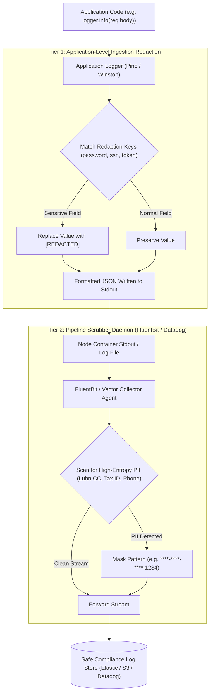

## Fast Revision (10-Second Recall)
Never log raw credentials, Social Security Numbers, credit card numbers, or sensitive PII. Intercept log events using custom logger formatters (Pino/Winston serializers), apply regex and deterministic key redaction, and deploy centralized log-pipeline scrubbing (FluentBit/Logstash/Datadog Sensitive Data Scanner) before events hit permanent log storage.

## The 30-Second Spoken Script
> "Protecting Personally Identifiable Information (PII) and payment data in logs is both a critical security requirement and a strict regulatory mandate under GDPR, CCPA, and PCI-DSS. Our architecture enforces a two-tier redaction strategy. First, at the application logging boundary, we configure structured JSON loggers like Pino or Winston with field-level redaction rules that strip or mask known sensitive keys—such as `password`, `ssn`, `creditCard`, and `authorization` headers—before strings are formatted. Second, because developers inevitably make mistakes like logging raw request objects or query parameters, we place a centralized redaction filter in our log collection daemon (like FluentBit or Logstash) and observability ingress (like Datadog Sensitive Data Scanner). This secondary layer uses high-performance regular expressions to detect Luhn-valid credit card numbers, email patterns, and national IDs, replacing them with irreversible hashes or masked asterisks."

## Scenario / Problem Context
During a routine compliance audit, security auditors discovered over 1.2 million plain text credit card numbers, CVVs, and user passwords stored in unencrypted Elasticsearch log indexes. A backend developer had added `logger.info('Checkout Payload:', req.body)` to debug a payment issue and left the log line running in production for six months. The organization faces massive regulatory fines and must remediate all logging pipelines immediately.

## Architectural Workflow / Sequence


## Deep-Dive Analysis & Root Causes

### 1. The Blast Radius of Logging PII
- **PCI-DSS Compliance Breach**: Storing primary account numbers (PAN) or Card Verification Values (CVV) in logs can result in immediate revocation of payment processing privileges.
- **GDPR / CCPA Fines**: Exposing EU/California citizen names, phone numbers, or emails to internal employees via logging platforms violates the "Right to be Forgotten" and data minimization mandates.
- **Insider Threat**: Hundreds of engineers, QA testers, and support agents often have read access to Datadog or Kibana dashboards. If logs contain plaintext passwords, internal accounts are compromised.

### 2. Two-Tier Defense Strategy
1. **Application-Layer Serialization**:
   - Structured JSON logging: Every log is an object, not a raw string: `logger.info({ userId, event: 'purchase' })`.
   - Field key blacklists: Automatically mask properties matching `/(password|token|secret|cvv|ssn|authorization|cookie)/i`.
2. **Log Collector Ingress Layer**:
   - Application-layer filters can be bypassed if a developer uses `console.log()` or string concatenation.
   - Central collectors (FluentBit, Vector, or cloud log filters) apply regex pattern recognition across all incoming log streams before indexing.

### 3. Masking vs Tokenization vs Pseudonymization
- **Full Masking**: Replace sensitive data with `[REDACTED]`. Best for passwords and CVVs.
- **Partial Masking**: Preserve last 4 characters for debugging: `****-****-****-4242` or `j***@example.com`.
- **Deterministic Hashing (Pseudonymization)**: Replace `userId: "jane@company.com"` with `userIdHash: HMAC_SHA256("jane@company.com", Pepper)`. Allows tracing logs belonging to the same user without revealing real identities.

## Practical Debugging Commands & Code

#### Structured Logger with Automatic Redaction (Pino in Node.js)
```typescript
import pino from 'pino';

export const logger = pino({
  redact: {
    paths: [
      'password',
      '*.password',
      'confirmPassword',
      'creditCard',
      '*.creditCard',
      'card.number',
      'card.cvv',
      'cvv',
      'ssn',
      'taxId',
      'headers.authorization',
      'headers.cookie',
      'req.headers.authorization',
      'req.headers.cookie',
    ],
    censor: '[REDACTED_PII]', // Replacement string
  },
  formatters: {
    level: (label) => ({ level: label }),
  },
  serializers: {
    req(req) {
      // Custom serializer: strictly select non-sensitive HTTP request fields
      return {
        method: req.method,
        url: req.url,
        path: req.path,
        remoteAddress: req.ip,
      };
    },
    res(res) {
      return {
        statusCode: res.statusCode,
      };
    },
  },
});
```

#### Centralized FluentBit Log Redaction Filter Configuration
```ini
[FILTER]
    Name          rewrite_tag
    Match         app.*
    Rule          $log "(password|secret|token)" sensitive.$TAG false

[FILTER]
    Name          modify
    Match         sensitive.*
    # Replace Credit Card Numbers with Mask
    Condition     Key_Value_Matches log ([0-9]{4}[- ]?){3}[0-9]{4}
    Set           log [REDACTED_CREDIT_CARD]

[FILTER]
    Name          modify
    Match         sensitive.*
    # Replace US Social Security Numbers
    Condition     Key_Value_Matches log \b(?!000|666|9\d{2})\d{3}-(?!00)\d{2}-(?!0000)\d{4}\b
    Set           log [REDACTED_SSN]
```

#### Auditing Existing Elasticsearch Indexes for Leaked PII
```bash
# Query Elasticsearch to search for potential credit card patterns in last 7 days of logs
curl -X GET "http://elasticsearch:9200/app-logs-*/_search" -H 'Content-Type: application/json' -d'
{
  "query": {
    "regexp": {
      "message": ".*([0-9]{4}[- ]?){3}[0-9]{4}.*"
    }
  },
  "_source": ["@timestamp", "service", "message"]
}'
```

## Prevention & Senior Best Practices

### 1. Architectural Guardrails
- **Ban `console.log` in Production**: Configure ESLint rules (`no-console: "error"`) and CI/CD quality gates to prevent unformatted stdout logging.
- **Log Retention Policies**: Enforce strict Time-To-Live (TTL) on log storage (e.g. 30 days maximum for application debug logs, 365 days for tamper-evident audit logs).

### 2. Operational Hardening
- **Access Control on Observability Tools**: Implement strict Role-Based Access Control in Kibana and Datadog. Restrict raw log search access to on-call engineers actively responding to incidents.
- **Continuous Secret Scanning on Logs**: Run automated scanners (e.g., AWS Macie, Datadog Sensitive Data Scanner) that continuously audit indexed log entries and alert security teams upon detecting unredacted PII patterns.

