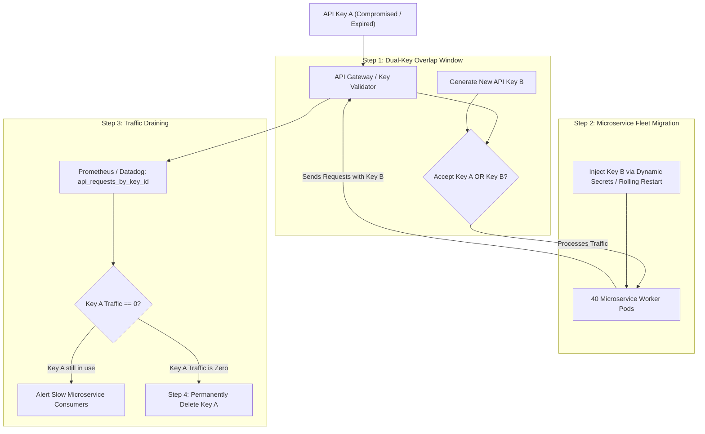

## Fast Revision (10-Second Recall)
Rotate exposed API keys without downtime using a Dual-Key (Active-Secondary) overlap strategy. Provision the new key as secondary, update upstream callers/consumers to migrate to the new key, monitor telemetry until the old key traffic drops to zero, and permanently revoke the old key.

## The 30-Second Spoken Script
> "When an API key is exposed or reaches its expiration lifecycle, revoking it immediately without coordination causes instant production outages. The senior engineering approach is an Active-Secondary Dual-Key rotation workflow. First, we generate a new cryptographic key alongside the existing active key in our identity provider or API gateway, marking both keys as valid simultaneously. Second, we deploy the new key to clients, backend microservices, or partner webhooks. Third, we observe Prometheus metrics and access logs, monitoring the exact request volume tagged with Key ID until the old key registers zero incoming traffic. Finally, once all consumers have migrated, we permanently delete the old key. If the key was actively compromised by an adversary, we compress this window by blocking unauthorized IP ranges at the WAF or forcing urgent synchronized rollout across affected pods."

## Scenario / Problem Context
A third-party payment partner informed your enterprise that an API key with read/write access to payment processing was exposed in a diagnostic pastebin dump. The key processes $300,000 in customer transactions hourly across 40 distributed microservices. Simply revoking the key instantly halts all checkout transactions globally. The team must rotate the credential immediately with zero customer impact.

## Architectural Workflow / Sequence


## Deep-Dive Analysis & Root Causes

### 1. The Single-Key Dilemma
In a naive single-key system:
- Updating the server first causes existing clients to fail (`401 Unauthorized`).
- Updating clients first causes new clients to fail because the server does not recognize the new key.
- Result: Scheduled downtime or unpredictable error bursts during rolling deployments.

### 2. Dual-Key (Active / Standby) Architecture
Modern API providers (Stripe, GitHub, Twilio, AWS) support concurrent API keys per account or service account:
1. **Primary / Active Key**: Handles current traffic.
2. **Secondary / Rotating Key**: Valid for incoming authentication, allowing clients time to update.
3. **Grace Period**: Typically 24 hours to 7 days for scheduled rotations; compressed to minutes/hours during emergency incidents.

### 3. Key ID (KID) Tagging in HMAC / JWT / API Tokens
To know which key was used without trying multiple keys in brute-force loops:
- Format keys with a visible prefix and ID:
  ```text
  sk_live_kid9921_7f8a9b2c3d4e5f...
  ```
- The gateway parses `kid9921`, fetches that specific key hash from Redis or memory cache, and validates the signature in $O(1)$ time.
- Emits metrics: `http_requests_total{key_id="kid9921"}`.

### 4. Emergency Triage When Key is Under Active Attack
If an attacker is actively using the leaked key:
- Add a temporary IP whitelist rule at the WAF, permitting the old key only from your verified egress NAT gateway IPs.
- Attacker requests with the old key get dropped at the edge; internal workloads continue functioning until migration is complete.

## Practical Debugging Commands & Code

#### Dual-Key Verification Middleware (Express & TypeScript)
```typescript
import { Request, Response, NextFunction } from 'express';
import crypto from 'crypto';

interface KeyRecord {
  id: string;
  hashedSecret: string;
  status: 'ACTIVE' | 'RETIRING' | 'REVOKED';
  expiresAt: number;
}

// Simulated active key repository (loaded from Redis / DB)
const VALID_KEYS: Record<string, KeyRecord> = {
  'key_v1': {
    id: 'key_v1',
    hashedSecret: 'e3b0c44298fc1c149afbf4c8996fb92427ae41e4649b934ca495991b7852b855',
    status: 'RETIRING', // Leaked key scheduled for revocation
    expiresAt: Date.now() + 1000 * 60 * 60 * 2, // 2-hour grace period
  },
  'key_v2': {
    id: 'key_v2',
    hashedSecret: '2c26b46b68ffc68ff99b453c1d30413413422d706483bfa0f98a5e886266e7ae',
    status: 'ACTIVE',
    expiresAt: Date.now() + 1000 * 60 * 60 * 24 * 90, // 90 days
  },
};

export function dualKeyAuthenticator(req: Request, res: Response, next: NextFunction) {
  const authHeader = req.headers['authorization'];
  if (!authHeader || !authHeader.startsWith('Bearer ')) {
    return res.status(401).json({ error: 'Missing or malformed Authorization header' });
  }

  const rawToken = authHeader.split(' ')[1];
  const [keyId, secret] = rawToken.split(':');

  const keyMeta = VALID_KEYS[keyId];
  if (!keyMeta || keyMeta.status === 'REVOKED' || Date.now() > keyMeta.expiresAt) {
    return res.status(401).json({ error: 'Invalid or revoked API key' });
  }

  // Hash provided secret and verify in constant time
  const hashedInput = crypto.createHash('sha256').update(secret).digest('hex');
  const isValid = crypto.timingSafeEqual(
    Buffer.from(hashedInput),
    Buffer.from(keyMeta.hashedSecret)
  );

  if (!isValid) {
    return res.status(401).json({ error: 'Authentication failed' });
  }

  // Track telemetry for migration monitoring
  console.log(`[Metrics] Authenticated via key_id=${keyId}, status=${keyMeta.status}`);

  (req as any).keyId = keyId;
  next();
}
```

#### Monitoring Key Drain via Prometheus / CLI
```bash
# Query Prometheus for active requests by key ID over the last 15 minutes
curl -G http://prometheus:9090/api/v1/query \
  --data-urlencode 'query=sum(rate(http_requests_total[5m])) by (key_id)'

# Shell one-liner checking access logs for remaining old key usage
grep 'key_id=key_v1' /var/log/api-gateway/access.log | tail -n 10
```

## Prevention & Senior Best Practices

### 1. Architectural Guardrails
- **Automated Lifecycle Expiration**: Every newly minted API key must carry a mandatory expiration date (e.g., 90 or 180 days). Systems should issue warning notifications 30 days prior to expiry.
- **Support Multiple Keys Natively**: When designing internal and partner APIs, always build key management endpoints to support at least 2 active concurrent keys per identity.

### 2. Operational Playbooks
- **Emergency Revocation Switch**: Implement an immediate kill-switch (`REVOKED` state in Redis) that bypasses cache TTLs to invalidate a key globally across all edge nodes in under 1 second during critical breaches.
- **Automated Rotation via Secrets Manager**: Use AWS Secrets Manager rotation Lambda functions to execute the 4-step dual-key rotation process on an automated schedule without manual human intervention.

