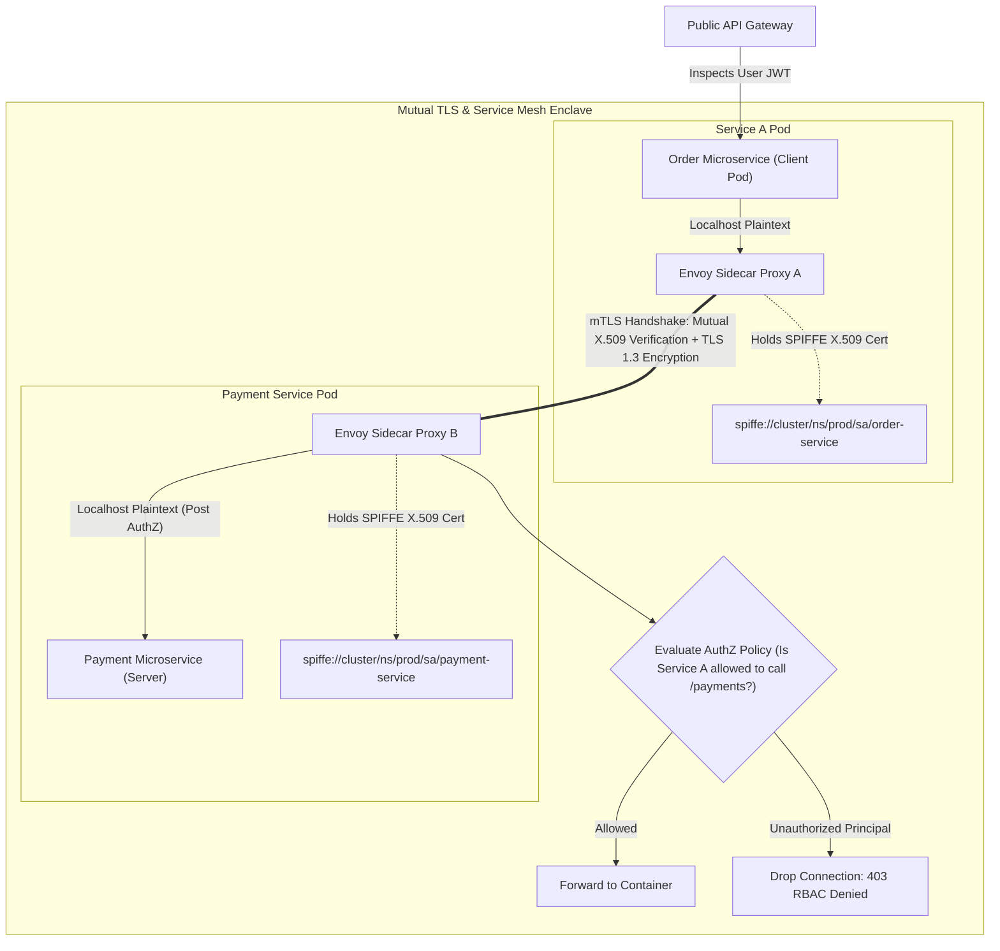

## Fast Revision (10-Second Recall)
Never trust internal network boundaries. Secure inter-service communication with Zero-Trust principles: enforce mutual TLS (mTLS) for cryptographic identity verification and in-transit encryption, manage certificates automatically via service meshes (Istio/Linkerd) or SPIFFE/SPIRE, and enforce service-to-service authorization using Open Policy Agent (OPA) or signed JWT access tokens.

## The 30-Second Spoken Script
> "The legacy security model of treating the internal network perimeter as trusted is dead. Once an attacker compromises a single public container or developer laptop, unencrypted internal traffic allows lateral movement and packet sniffing. To achieve true Zero-Trust architecture between microservices, we implement mutual TLS (mTLS). With mTLS, both client and server microservices present cryptographically signed X.509 certificates to authenticate each other's identity before any application bytes flow. In Kubernetes, we offload this certificate management to a service mesh like Istio or Linkerd with SPIFFE identities, which automatically issues and rotates short-lived certificates without application code changes. On top of transport encryption, we layer application authorization: enforcing that Service A can only call designated endpoints on Service B via declarative authorization policies."

## Scenario / Problem Context
A fintech platform suffered a lateral movement breach: an attacker exploited an SSRF vulnerability in a public PDF generation service and used it to send unauthenticated, plaintext HTTP requests to the internal `/internal/v1/payments/process` service, transferring customer funds. Because internal microservices assumed that 'anything inside the VPC is trusted', no authentication or transport encryption was enforced. The engineering team must implement zero-trust inter-service security.

## Architectural Workflow / Sequence


## Deep-Dive Analysis & Root Causes

### 1. The Perils of the Castle-and-Moat Architecture
The traditional "castle-and-moat" assumption:
- Outside perimeter = Untrusted.
- Inside VPC = 100% Trusted.
Why it fails:
- **SSRF Exploitation**: Public services tricked into issuing internal requests.
- **Compromised Dependencies**: A malicious npm or Maven package in an internal worker can sniff VPC subnet traffic (`tcpdump`).
- **Container Breakouts**: A compromised pod can scan the flat Kubernetes cluster network (`10.244.0.0/16`).

### 2. Mutual TLS (mTLS) vs Standard TLS
- **Standard TLS**: Only the server proves its identity (via CA-signed certificate). The client remains unauthenticated at the transport layer.
- **Mutual TLS (mTLS)**:
  1. Client validates Server's certificate.
  2. Server requests Client's certificate and validates it against the trusted Root Certificate Authority (CA).
  3. Encryption keys are negotiated; identity is cryptographically proven before application headers are exchanged.

### 3. SPIFFE and SPIRE Standards
- **SPIFFE (Secure Production Identity Framework for Everyone)**: An open standard defining cryptographic identity strings:
  ```text
  spiffe://prod.example.com/ns/billing/sa/billing-worker
  ```
- **SPIRE**: An agent that automatically mints short-lived (e.g. 1-hour) X.509 SVIDs (SPIFFE Verifiable Identity Documents) and injects them into container memory without requiring developers to manage TLS keys.

### 4. Service Mesh Architecture (Istio / Envoy)
Managing mTLS keys inside every microservice codebase is brittle.
- **Sidecar Proxy Pattern**: Envoy proxies run alongside every service container.
- Envoy intercepts all ingress and egress network traffic.
- Envoy executes mTLS handshakes and validates peer identities in C++, completely transparent to application code.

## Practical Debugging Commands & Code

#### Istio Strict mTLS PeerAuthentication Policy
```yaml
apiVersion: security.istio.io/v1beta1
kind: PeerAuthentication
metadata:
  name: default
  namespace: prod
spec:
  # Enforce STRICT mTLS across entire production namespace
  # Plaintext connections are rejected at the TCP handshake layer
  mtls:
    mode: STRICT
---
apiVersion: security.istio.io/v1beta1
kind: AuthorizationPolicy
metadata:
  name: payment-rbac-policy
  namespace: prod
spec:
  selector:
    matchLabels:
      app: payment-service
  action: ALLOW
  rules:
    - from:
        - source:
            # Strictly allow requests ONLY from order-service SPIFFE principal
            principals: ["cluster.local/ns/prod/sa/order-service-sa"]
      to:
        - operation:
            methods: ["POST"]
            paths: ["/internal/v1/payments/*"]
```

#### Node.js Native HTTPS Server Enforcing mTLS Without Mesh
```typescript
import https from 'https';
import fs from 'fs';

const options: https.ServerOptions = {
  key: fs.readFileSync('/certs/server-key.pem'),
  cert: fs.readFileSync('/certs/server-cert.pem'),
  ca: fs.readFileSync('/certs/ca-root.pem'), // Internal CA bundle
  requestCert: true,                         // Request client certificate
  rejectUnauthorized: true,                  // Reject handshake if client cert is missing or invalid
};

const server = https.createServer(options, (req, res) => {
  // Extract client identity from verified X.509 certificate
  const clientCert = (req.socket as any).getPeerCertificate();
  const subjectName = clientCert.subject?.CN;

  console.log(`[mTLS Verified] Client Authenticated: ${subjectName}`);

  if (subjectName !== 'order-service.internal') {
    res.writeHead(403, { 'Content-Type': 'application/json' });
    return res.end(JSON.stringify({ error: 'Unauthorized microservice principal' }));
  }

  res.writeHead(200, { 'Content-Type': 'application/json' });
  res.end(JSON.stringify({ status: 'Payment processed securely' }));
});

server.listen(8443, () => console.log('mTLS Microservice listening on 8443'));
```

## Prevention & Senior Best Practices

### 1. Architectural Guardrails
- **Strict NetworkPolicies**: Enforce Kubernetes `NetworkPolicy` objects that drop default inter-pod communication at the CNI layer (Calico/Cilium), explicitly allowing only declared source-destination pairs.
- **Short Certificate Lifetimes**: Restrict service certificate lifespans to between 1 and 24 hours. Automated rotation eliminates the operational risk of certificate revocation lists (CRLs).

### 2. Operational Hardening
- **Disable Permissive Mode in Production**: Avoid Istio `mode: PERMISSIVE` in production, which permits unencrypted fallback connections. Always lock down to `STRICT`.
- **Egress Gateways**: Route all microservice egress traffic through controlled, monitored egress gateways to block unauthorized data exfiltration or malware command-and-control calls.

