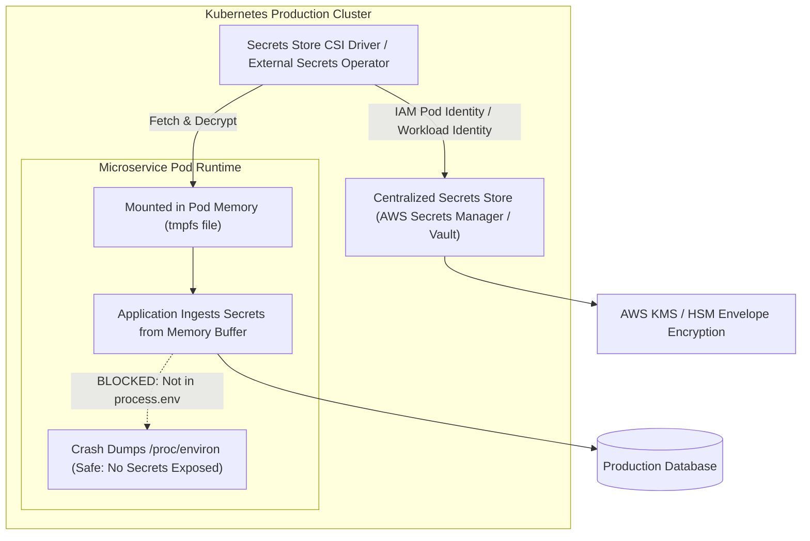

## Fast Revision (10-Second Recall)
Never store production secrets in `.env` files or Git repositories. Use centralized secrets managers (HashiCorp Vault, AWS Secrets Manager, GCP Secret Manager), inject secrets into application processes via memory mounts or Kubernetes CSI drivers, encrypt secrets at rest using envelope encryption (KMS), and enforce least-privilege IAM access.

## The 30-Second Spoken Script
> "Securing sensitive environment variables requires decoupling configuration from credentials. While non-sensitive settings like log level or port belong in standard config maps, secrets like database passwords, private keys, and API tokens must live in a centralized, hardware-backed secrets vault like AWS Secrets Manager or HashiCorp Vault. In Kubernetes, we avoid plain `ConfigMap` or static `Secret` YAMLs stored in Git. Instead, we use the Kubernetes External Secrets Operator or Secrets Store CSI Driver to mount secrets directly into ephemeral memory-backed volumes (`tmpfs`), preventing secrets from ever touching persistent container disk storage or appearing in process environment dumps like `/proc/$PID/environ`. Finally, we configure automated rotation with zero downtime and audit all secret read requests using AWS CloudTrail or Vault audit logs."

## Scenario / Problem Context
A microservices backend deployed on Kubernetes stored API keys and database credentials inside base64-encoded Kubernetes Secret YAML files committed to a private GitLab repository. An unauthorized contractor gained repository read access and extracted the production Stripe secret key and database credentials. Furthermore, during a crash incident, the Node.js process dumped all `process.env` variables into Datadog logs. The engineering team must overhaul secrets management.

## Architectural Workflow / Sequence


## Deep-Dive Analysis & Root Causes

### 1. The Fallacy of Kubernetes Plain Secrets
Kubernetes `Secret` objects are encoded in **base64**, not encrypted:
```bash
echo "c3VwZXJzZWNyZXQ=" | base64 --decode # outputs "supersecret"
```
If etcd is not configured with encryption at rest, anyone with cluster admin access or etcd backups can read all credentials in plain text. Storing these YAML files in Git (GitOps) creates an ongoing leakage risk.

### 2. Environment Variables vs Memory-Mounted Files
Historically, the Twelve-Factor App recommended storing config in environment variables. However, environment variables have significant security drawbacks in modern runtimes:
- They leak into child processes spawned via `exec()` or `fork()`.
- They appear in `/proc/$PID/environ` on Linux, accessible to any process running as root or with `CAP_SYS_PTRACE`.
- Application error loggers and APM agents (Sentry, Datadog) frequently serialize `process.env` during unhandled exceptions.
- **Modern Best Practice**: Mount secrets as read-only files inside an in-memory `tmpfs` filesystem (e.g., `/var/run/secrets/`). The application reads the file once on startup into memory.

### 3. Envelope Encryption & Hardware Security Modules (HSM)
Secrets stored in Vault or AWS Secrets Manager use envelope encryption:
- A local **Data Encryption Key (DEK)** encrypts the plaintext secret string.
- A **Key Encryption Key (KEK)** residing in a FIPS 140-2 Level 3 Hardware Security Module (AWS KMS) encrypts the DEK.
- The plaintext DEK is never stored on disk.

### 4. Dynamic Secrets and Just-In-Time Tokens
Rather than static passwords that live for years:
- HashiCorp Vault can generate ephemeral database users with 1-hour TTLs on demand.
- When a pod dies, Vault automatically revokes the database user, neutralizing stolen credentials.

## Practical Debugging Commands & Code

#### Secure Secrets Retrieval from AWS Secrets Manager (TypeScript)
```typescript
import { SecretsManagerClient, GetSecretValueCommand } from '@aws-sdk/client-secrets-manager';

const client = new SecretsManagerClient({ region: 'us-east-1' });

interface AppSecrets {
  DATABASE_URL: string;
  STRIPE_SECRET_KEY: string;
  JWT_SIGNING_KEY: string;
}

let cachedSecrets: AppSecrets | null = null;
let lastFetched = 0;
const CACHE_TTL_MS = 1000 * 60 * 15; // Refresh every 15 minutes to support rotation

export async function getAppSecrets(): Promise<AppSecrets> {
  const now = Date.now();
  if (cachedSecrets && (now - lastFetched) < CACHE_TTL_MS) {
    return cachedSecrets;
  }

  const response = await client.send(
    new GetSecretValueCommand({
      SecretId: 'prod/app/secrets',
    })
  );

  if (!response.SecretString) {
    throw new Error('SecretString missing from Secrets Manager response');
  }

  cachedSecrets = JSON.parse(response.SecretString) as AppSecrets;
  lastFetched = now;
  return cachedSecrets;
}
```

#### Mounting Secrets as tmpfs Volume in Kubernetes
```yaml
apiVersion: apps/v1
kind: Deployment
metadata:
  name: billing-service
spec:
  replicas: 3
  template:
    spec:
      containers:
        - name: app
          image: company/billing:v2.4
          volumeMounts:
            - name: secrets-volume
              mountPath: "/var/run/secrets/app"
              readOnly: true
      volumes:
        - name: secrets-volume
          csi:
            driver: secrets-store.csi.k8s.io
            readOnly: true
            volumeAttributes:
              secretProviderClass: "aws-secrets-provider"
```

## Prevention & Senior Best Practices

### 1. Architectural Guardrails
- **GitOps Secret Encryption**: If using GitOps (ArgoCD/Flux), encrypt secret manifests using Mozilla SOPS or Bitnami Sealed Secrets before committing to Git. The private key resides exclusively inside the Kubernetes cluster.
- **Audit Secret Reads**: Configure CloudTrail alarms to detect unusual surges in `GetSecretValue` calls, indicating credential scraping activity.

### 2. Operational Hardening
- **Zero Secrets in Docker Images**: Never bake secrets into Docker image layers via `ENV` or `ARG`. Use multi-stage builds and BuildKit secret mounts (`--mount=type=secret`) for compile-time dependencies.
- **Process Memory Protection**: In languages like Go or C, zero out sensitive memory buffers (`memzero`) after parsing credentials to prevent them from surviving in garbage-collected heaps.

