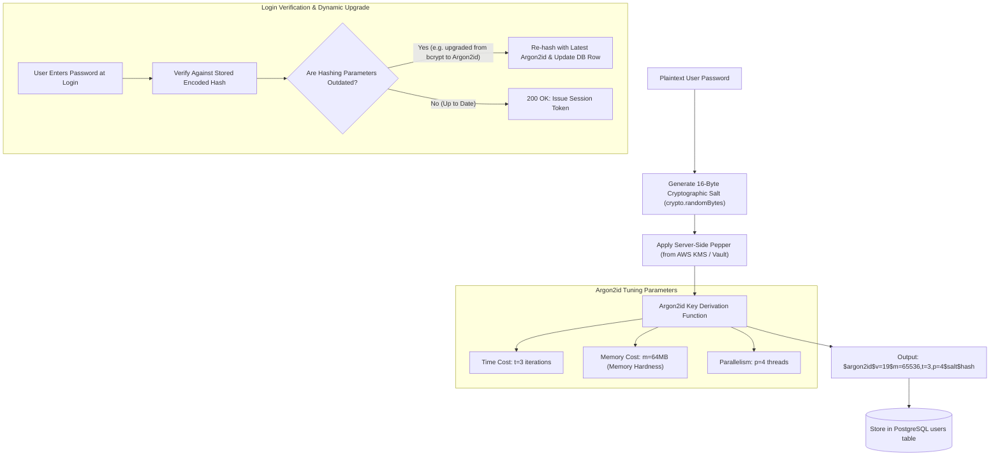

## Fast Revision (10-Second Recall)
Never use general-purpose hash functions (MD5, SHA-256) for passwords. Always use modern memory-hard adaptive hashing algorithms—specifically Argon2id (recommended) or bcrypt—with unique per-user cryptographically random salts (16+ bytes) and an optional server-side HSM pepper. Continuously calibrate cost work factors against hardware capabilities.

## The 30-Second Spoken Script
> "Storing user passwords securely requires understanding why fast cryptographic hashes like SHA-256 or SHA-512 are dangerous for passwords: modern GPUs and ASICs can calculate billions of SHA-256 hashes per second, making offline dictionary and brute-force attacks trivial once a database dump leaks. Instead, we mandate memory-hard, computationally expensive adaptive hashing algorithms. The industry gold standard is Argon2id—the winner of the Password Hashing Competition—or bcrypt. These algorithms require both significant CPU time and large amounts of RAM (memory-hardness), which completely cripples GPU and ASIC cracking rigs. We combine this with a unique, cryptographically random salt per user to defeat precomputed rainbow tables, and optionally apply a server-side pepper stored in a Hardware Security Module. Finally, we design password verification to rehash and upgrade the work factor dynamically whenever calibration parameters increase."

## Scenario / Problem Context
A legacy user database using unsalted MD5 hashes was leaked on the dark web following an SQL injection vulnerability. Within 3 hours, attackers reversed 85% of customer passwords using precomputed rainbow tables and high-speed GPU cracking rigs. The engineering team must migrate all customer accounts to a modern, future-proof password hashing architecture without forcing an immediate bulk password reset.

## Architectural Workflow / Sequence


## Deep-Dive Analysis & Root Causes

### 1. Fast Hashes vs Slow Password KDFs
- **General-Purpose Hashes (MD5, SHA-1, SHA-256)**: Designed for maximum throughput (verifying multi-gigabyte file integrity). A modern Nvidia RTX 4090 GPU can calculate over **8.5 billion** SHA-256 hashes per second.
- **Password Hashes / KDFs (Argon2id, bcrypt, scrypt, PBKDF2)**: Intentionally slow and resource-intensive. Designed to consume measurable milliseconds and megabytes per hash, reducing GPU cracking rates from billions to a few thousand per second.

### 2. Why Argon2id Is the Gold Standard
Argon2 won the Password Hashing Competition (PHC) and is recommended by OWASP:
- **Argon2d**: Fast and memory-hard, but vulnerable to side-channel cache timing attacks.
- **Argon2i**: Optimized to resist side-channel timing attacks, but less resistant to GPU memory-tradeoff attacks.
- **Argon2id**: A hybrid that provides both resistance to side-channel timing attacks and resistance to GPU-accelerated brute-force attacks.

### 3. Salt vs Pepper
- **Salt**: Cryptographically random unique string (at least 16 bytes) generated per user and stored in plaintext alongside the hash. Defeats rainbow tables and ensures two users with identical passwords produce totally different hashes.
- **Pepper**: A global high-entropy secret key stored completely outside the database (e.g. in AWS KMS or HashiCorp Vault) and mixed into the hash. If the database leaks alone, the attacker cannot crack hashes without also breaching the KMS.

### 4. Transparent Migration Pattern (Upgrading Legacy Hashes)
To migrate from MD5 or bcrypt to Argon2id without forcing user resets:
1. When user logs in with password $P$:
2. Verify $P$ using legacy validator (e.g. MD5 or old bcrypt).
3. If correct, immediately compute new Argon2id hash of $P$ using current work factors.
4. Overwrite database row with new Argon2id hash.
5. Inactive accounts can be forced to reset via email after a 6-month grace window.

## Practical Debugging Commands & Code

#### Secure Password Hashing and Dynamic Rehash (Argon2 in Node.js)
```typescript
import argon2 from 'argon2';

// OWASP Recommended Minimum Parameters for Argon2id
const ARGON2_OPTIONS: argon2.Options = {
  type: argon2.argon2id,
  memoryCost: 65536, // 64 MB of RAM
  timeCost: 3,       // 3 iterations
  parallelism: 4,    // 4 concurrent threads
};

export async function hashPassword(plainText: string): Promise<string> {
  // Argon2 automatically generates cryptographically secure salt and formats output string
  return argon2.hash(plainText, ARGON2_OPTIONS);
}

export async function verifyAndUpgradePassword(
  plainText: string,
  storedHash: string
): Promise<{ isValid: boolean; updatedHash?: string }> {
  // 1. Verify password against stored hash
  const isValid = await argon2.verify(storedHash, plainText);
  if (!isValid) {
    return { isValid: false };
  }

  // 2. Check if hashing parameters or algorithm need an upgrade
  const needsRehash = argon2.needsRehash(storedHash, ARGON2_OPTIONS);
  if (needsRehash) {
    console.log('[Security] Work factor outdated. Automatically upgrading hash in background.');
    const newHash = await argon2.hash(plainText, ARGON2_OPTIONS);
    return { isValid: true, updatedHash: newHash };
  }

  return { isValid: true };
}
```

#### Transparent Migration from Legacy Bcrypt / MD5
```typescript
import bcrypt from 'bcrypt';
import argon2 from 'argon2';

export async function authenticateLegacyOrModernUser(
  passwordInput: string,
  storedHash: string
): Promise<{ authenticated: boolean; newHashToSave?: string }> {
  // Check if hash is legacy bcrypt ($2b$, $2a$)
  if (storedHash.startsWith('$2a$') || storedHash.startsWith('$2b$')) {
    const isBcryptMatch = await bcrypt.compare(passwordInput, storedHash);
    if (isBcryptMatch) {
      // User successfully logged in with legacy password -> Upgrade to Argon2id immediately!
      const modernHash = await argon2.hash(passwordInput, ARGON2_OPTIONS);
      return { authenticated: true, newHashToSave: modernHash };
    }
    return { authenticated: false };
  }

  // Default: Verify modern Argon2id
  const isMatch = await argon2.verify(storedHash, passwordInput);
  return { authenticated: isMatch };
}
```

## Prevention & Senior Best Practices

### 1. Architectural Guardrails
- **Benchmark Work Factors**: Benchmark hash duration on your actual production server hardware. Target between 200 ms and 500 ms per hash calculation—fast enough for user UX, but disastrously slow for offline brute-force cracking.
- **Enforce Password Complexity & Length**: Mandate minimum password length of 12-16 characters and check passwords against the *Have I Been Pwned* API (using k-Anonymity) to block compromised passwords.

### 2. Operational Hardening
- **Never Log Passwords**: Ensure log sanitizers redact keys named `password`, `pwd`, `passphrase`, `token`, and `secret` across all request and response bodies.
- **Rate Limit Login Attempts**: Implement strict IP and username rate limiting to prevent online brute-force attacks on login endpoints.

