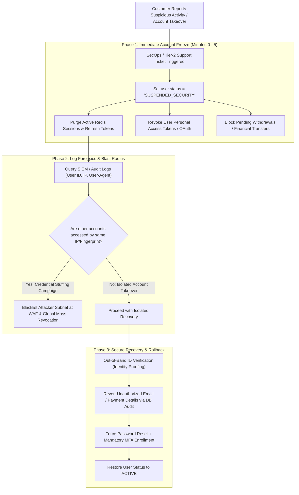

## Fast Revision (10-Second Recall)
When a user reports suspicious activity, prioritize fast account containment: immediately invalidate all active sessions and refresh tokens, revoke existing API keys, lock password reset workflows to verified channels, inspect authentication and audit logs for anomalous IPs and user agents, and guide the user through secure re-authentication with mandatory MFA enrollment.

## The 30-Second Spoken Script
> "When a customer reports unrecognized transactions, password reset emails, or logins from unknown locations, we trigger our Account Takeover (ATO) Incident Playbook. Phase one is immediate containment: we freeze the account from performing destructive or financial actions, terminate all active sessions and OAuth grants across all devices, and revoke active refresh tokens in Redis. Phase two is forensic investigation: we query SIEM logs to correlate the incident—identifying the exact IP address, ASN, User-Agent, and timestamp of the unauthorized session. We check whether other accounts were targeted from the same IP range to detect broader credential stuffing or brute-force campaigns. Phase three is verified remediation: we send an out-of-band identity verification challenge via verified SMS or email, mandate a password reset, require enrollment in Multi-Factor Authentication (MFA), and revert any unauthorized profile changes like email or bank account modifications made by the adversary."

## Scenario / Problem Context
A verified user contacted customer support reporting that their e-commerce account balance was drained and their primary notification email was altered without their consent. An adversary acquired the user's reused password from a third-party breach dump, bypassed naive rate limiting via rotating proxies, logged in, and updated the payout address. The engineering and security teams must contain the incident, recover the account, and investigate the attack blast radius.

## Architectural Workflow / Sequence


## Deep-Dive Analysis & Root Causes

### 1. Common Attack Vectors Behind Account Takeovers (ATO)
1. **Credential Stuffing**: Attackers use automated tools (e.g. OpenBullet, Sentry MBA) with millions of leaked username/password pairs from third-party breaches, banking on password reuse across services.
2. **Session Hijacking / Infostealer Malware**: Malware (e.g. RedLine, Lumma) running on a user's machine extracts browser cookies and session SQLite files, bypassing passwords and MFA completely.
3. **SIM Swapping / SMS Interception**: Adversary social engineers telecom carriers to port the victim's phone number and intercept SMS-based 2FA codes.
4. **Phishing (Reverse Proxy Attacks)**: Adversary uses tools like Evilginx2 to proxy real login traffic, capturing both user passwords and session cookies in real time.

### 2. Forensic Indicators of Compromise (IoCs)
When investigating suspicious user sessions, look for:
- **Impossible Travel**: Login from New York at 10:00 AM, followed by a login from Moscow at 10:45 AM.
- **Anomalous ASN**: Logins originating from hosting providers (DigitalOcean, AWS, Tor exit nodes) rather than residential internet service providers (Comcast, Verizon, Jio).
- **Abrupt Profile Mutability**: Immediate change of email address, phone number, and shipping address within 60 seconds of a first-time IP login.

### 3. Blast Radius Assessment
Never treat an ATO report as an isolated incident until verified:
- Query access logs:
  ```text
  SELECT COUNT(DISTINCT user_id) FROM login_audit WHERE client_ip = :attacker_ip;
  ```
- If the IP accessed 150 accounts, you are undergoing a distributed credential stuffing attack. You must immediately notify and lock all 150 accounts.

## Practical Debugging Commands & Code

#### Emergency Account Lockdown Endpoint (Admin / SecOps API)
```typescript
import { Request, Response } from 'express';
import { db } from '../database';
import Redis from 'ioredis';

const redis = new Redis();

export async function emergencyLockdownHandler(req: Request, res: Response) {
  const { targetUserId, reason } = req.body;
  const adminId = (req as any).user.id;

  // 1. Transactionally lock account and increment token_version
  const updatedUser = await db.$transaction(async (tx) => {
    const user = await tx.user.update({
      where: { id: targetUserId },
      data: {
        status: 'SUSPENDED_SECURITY',
        tokenVersion: { increment: 1 }, // Instantly invalidates all active JWTs
        securityLockReason: reason,
        lockedAt: new Date(),
      },
    });

    // Write to immutable security audit log
    await tx.securityAuditLog.create({
      data: {
        action: 'EMERGENCY_LOCKDOWN',
        actorId: adminId,
        targetUserId,
        details: { reason },
      },
    });

    return user;
  });

  // 2. Invalidate all Redis session records and refresh tokens
  const userSessionKeys = await redis.keys(`session:${targetUserId}:*`);
  const refreshKeys = await redis.keys(`refresh:${targetUserId}:*`);
  const keysToDelete = [...userSessionKeys, ...refreshKeys];

  if (keysToDelete.length > 0) {
    await redis.del(...keysToDelete);
  }

  return res.json({
    status: 'SUCCESS',
    message: `Account ${targetUserId} locked. Sessions terminated.`,
  });
}
```

#### SQL Forensics Query: Detecting Anomalous Session Activity
```sql
-- Identify all recent sessions for target user, highlighting geographic and IP variations
SELECT 
    session_id,
    created_at,
    client_ip,
    user_agent,
    country_code,
    isp_name,
    auth_method
FROM user_login_events
WHERE user_id = 'user_102938'
ORDER BY created_at DESC
LIMIT 20;

-- Check if attacker IP touched other accounts in the last 24 hours
SELECT 
    user_id, 
    MIN(created_at) as first_seen,
    MAX(created_at) as last_seen,
    COUNT(*) as total_attempts
FROM user_login_events
WHERE client_ip = '198.51.100.24' 
  AND created_at >= NOW() - INTERVAL '24 HOURS'
GROUP BY user_id;
```

## Prevention & Senior Best Practices

### 1. Architectural Guardrails
- **Device Fingerprinting & Re-Authentication**: Require password re-entry or WebAuthn biometric confirmation whenever a sensitive action (modifying email, bank account, password) occurs from an unrecognized device or IP.
- **FIDO2 / WebAuthn Hardware Keys**: Encourage or mandate phishing-resistant FIDO2 hardware tokens (YubiKeys) for high-value accounts, rendering credential stuffing and session proxying ineffective.

### 2. Operational Playbooks
- **Risk-Based Step-Up Authentication**: Integrate an adaptive risk engine that checks IP reputation, impossible travel, and device fingerprints. Automatically trigger CAPTCHA or step-up MFA if anomaly scores exceed thresholds.
- **Immediate Security Notification**: Send real-time transactional alerts (via SMS and email) immediately upon new device logins or security parameter updates.

