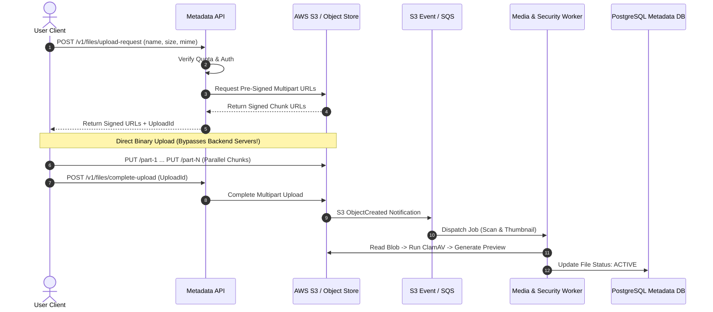

## Fast Revision (10-Second Recall)
- Core Anti-Pattern: Never stream large files through application backend servers; it saturates memory, CPU, and web server network sockets.
- Pre-Signed URLs: Application generates short-lived, cryptographically signed S3/GCS PUT/GET URLs; clients transfer directly to Object Storage.
- Large Files (>100MB): S3 Multipart Upload with client-side parallel chunking and resume capabilities.
- Downloads: CloudFront / CDN caching for hot public files; time-limited pre-signed GET URLs for private / authenticated assets.
- Post-Upload Processing: S3 Event Notification -> SQS -> Worker converts media formats, generates thumbnails, and triggers ClamAV virus scan.

## The 30-Second Spoken Script
"When designing a file upload and download system like Google Drive or Dropbox, the golden architectural rule is: Never proxy file bytes through your application web servers.

For uploads, the client requests an upload ticket from our Metadata API. The API verifies user authentication and storage quota, and generates an S3 Pre-Signed URL. The client then streams the binary payload directly from the browser or mobile device into S3 via HTTP PUT. For files larger than 100MB, we use S3 Multipart Upload, allowing clients to upload 10MB chunks in parallel and resume interrupted uploads without restarting.

Once S3 confirms upload completion, an S3 Event Notification is published to an SQS queue. Asynchronous background workers consume the event, run ClamAV antivirus scanning, extract metadata, generate image thumbnails or video transcodings, and update the PostgreSQL metadata database.

For downloads, public content is delivered through CloudFront edge CDNs. For private user files, the metadata service generates a 5-minute pre-signed GET URL that grants time-limited direct access to the encrypted S3 object."

## Scenario / Problem Context
Design a secure file storage service handling 10 million uploads daily, ranging from 1MB photos to 10GB video archives, with resume support, virus scanning, instant thumbnail generation, and global download acceleration.

## Architectural Workflow / Sequence


## Deep-Dive Analysis & Root Causes
### The Bandwidth and Socket Saturation Bottleneck
If an application server with a 1Gbps network card proxies 500MB uploads, just two concurrent uploads will saturate the entire interface, causing all standard JSON API requests to timeout. Direct-to-storage pre-signed transfers offload 100% of network I/O to AWS/GCP hyperscale edge infrastructure.

### S3 Multipart Upload Mechanics
Multipart upload splits large files into parts (5MB to 5GB each). Each part receives an ETag checksum upon successful upload. If part 47 of 100 drops due to a mobile network disconnect, the client only retries part 47. Once all parts finish, a single `CompleteMultipartUpload` call instructs S3 to stitch the chunks into a unified object atomically.

### Asynchronous Quarantine and Antivirus Pipeline
Never make uploaded files immediately downloadable. The file status in the database is initialized as `PENDING_SCAN`. Until the asynchronous worker successfully scans the payload against ClamAV/YARA signatures, all download requests return HTTP 423 Locked.

## Practical Debugging Commands & Code
### Generating S3 Pre-Signed Multipart Upload URL in Node.js
```typescript
// Generating S3 Pre-Signed Upload URL using AWS SDK v3
import { S3Client, PutObjectCommand } from '@aws-sdk/client-s3';
import { getSignedUrl } from '@aws-sdk/s3-request-presigner';

const s3 = new S3Client({ region: 'us-east-1' });

export async function createPreSignedUploadUrl(
  bucket: string, 
  fileKey: string, 
  contentType: string
): Promise<string> {
  const command = new PutObjectCommand({
    Bucket: bucket,
    Key: fileKey,
    ContentType: contentType
  });

  // URL expires in 300 seconds (5 minutes)
  return await getSignedUrl(s3, command, { expiresIn: 300 });
}
```

## Prevention & Senior Best Practices
- Strict File Size Assertions: Configure S3 bucket policies with `content-length-range` conditions to prevent malicious users from uploading 500GB files.
- Content-Type Spoofing Protection: Verify magic bytes (file signature headers) during worker processing rather than trusting client MIME headers.
- S3 Lifecycle Storage Tiering: Automatically transition objects older than 90 days to S3 Infrequent Access (IA) and Glacier to cut storage costs by 70%.
- Client-Side Checksums: Enforce SHA-256 or MD5 checksums during multipart upload to guarantee zero payload corruption during transit.
