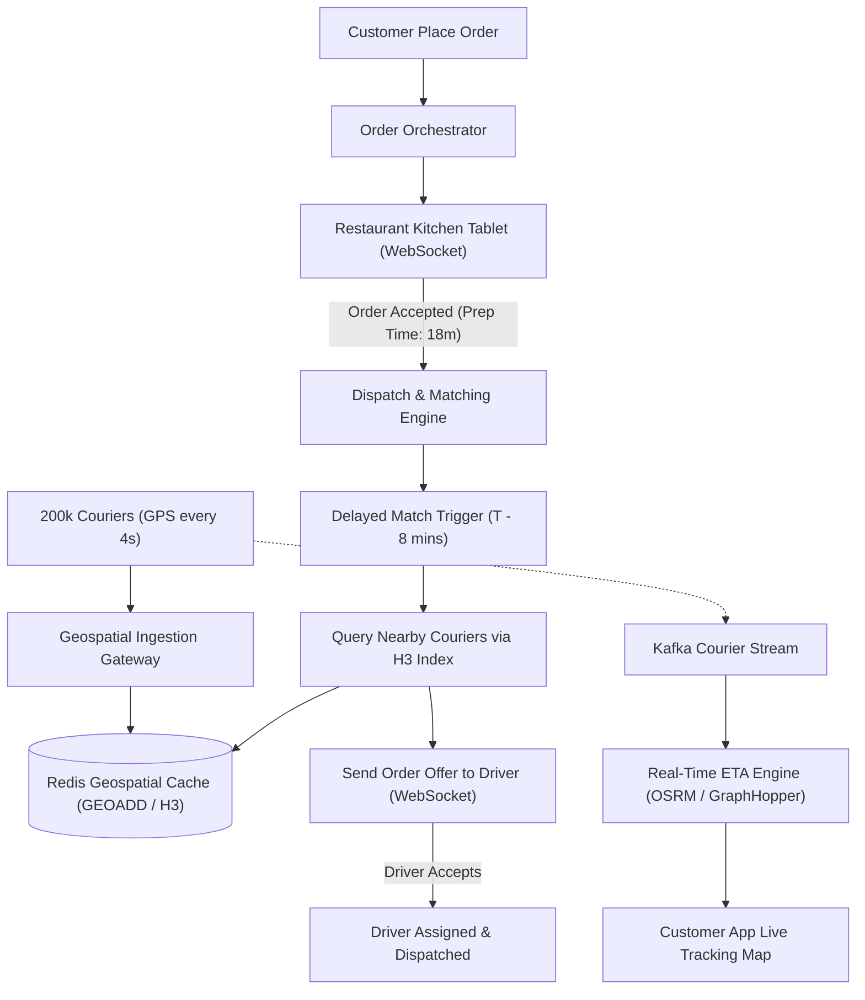

## Fast Revision (10-Second Recall)
- Core Actors: Customers (orders), Restaurants (order acceptance & prep), Drivers/Couriers (geospatial dispatch & delivery).
- Geospatial Indexing: Uber H3 (hexagonal hierarchical spatial index) or Google S2 geometry for sub-millisecond driver matching.
- Driver Location Tracking: Active couriers stream GPS coordinates every 4 seconds via WebSocket or UDP into Redis Geospatial (`GEOADD`).
- Driver Matching Algorithm: Match drivers based on proximity (H3 index), vehicle type, prep completion time, and current driver trajectory.
- Order Lifecycle: `CREATED -> ACCEPTED_BY_RESTAURANT -> PREPARING -> DRIVER_ASSIGNED -> PICKED_UP -> DELIVERED`.

## The 30-Second Spoken Script
"Designing a food delivery platform requires orchestrating a 3-sided marketplace across customers, restaurants, and couriers with high-frequency geospatial tracking.

The biggest technical challenge is real-time geospatial location indexing and driver dispatch. Active drivers stream GPS coordinates every 4 seconds. We index these positions using Uber H3, a hierarchical hexagonal spatial index.

When a customer orders, the Restaurant Service notifies the merchant dashboard via WebSockets. Once the restaurant accepts and estimates prep time (e.g., 20 minutes), the Dispatch Orchestrator calculates the pickup dispatch time.

Rather than dispatching a driver immediately and forcing them to wait unpaid outside the restaurant, the system delays driver dispatch so the courier arrives exactly when food prep finishes. The Dispatch Service queries nearby active drivers within the restaurant's H3 hexagon using Redis GEO commands, running a batch bipartite matching algorithm that balances distance, driver acceptance rate, and traffic conditions.

Throughout delivery, the customer's app subscribes to live courier updates via WebSockets, with the ETA dynamically recalculated using historical transit routing models."

## Scenario / Problem Context
Design a food delivery system operating across 50 cities with 200,000 active couriers transmitting GPS coordinates every 4 seconds, supporting dynamic restaurant dispatch, route optimization, and live tracking.

## Architectural Workflow / Sequence


## Deep-Dive Analysis & Root Causes
### Geospatial Indexing: Why Uber H3 Beats Lat/Long Coordinates
Calculating Euclidean or Haversine distance (`ST_DWithin` in PostGIS) across 200,000 drivers for every order requires massive trigonometric math on every dispatch cycle. Uber H3 divides the planet into discrete hexagonal cells. A driver's lat/long maps directly to a 64-bit integer H3 cell ID. Finding drivers within 2km is a simple $O(1)$ set intersection of neighboring cell IDs.

### The "Just-In-Time" Driver Dispatch Problem
A naive dispatch engine assigns the nearest driver the instant the customer clicks order. The driver arrives in 5 minutes, but food prep takes 25 minutes. The driver waits idle for 20 minutes, destroying courier earnings and platform throughput. Advanced engines schedule dispatch so Courier Arrival Time = Estimated Food Prep Completion Time.

### High-Frequency Location Ingestion Architecture
200,000 drivers sending location updates every 4 seconds generates 50,000 writes/second. Writing these to a relational database exhausts disk I/O. Ingestion nodes write ephemeral locations directly to Redis in-memory clusters (`GEOADD drivers <lon> <lat> <driverId>`), persisting only historical journey waypoints to Cassandra or ClickHouse asynchronously.

## Practical Debugging Commands & Code
### Redis Geospatial Commands for Courier Tracking & Proximity
```bash
# 1. Add courier location to spatial index (Longitude, Latitude, CourierID)
GEOADD active_couriers -122.4194 37.7749 "courier_8491"

# 2. Find all active couriers within 3 kilometers of restaurant
GEORADIUS active_couriers -122.4194 37.7749 3 km WITHDIST WITHCOORD ASC COUNT 10

# 3. Retrieve specific courier coordinates
GEOPOS active_couriers "courier_8491"
```

## Prevention & Senior Best Practices
- Dead Reckoning on Mobile Clients: If GPS drops in tunnels or urban canyons, client apps use dead reckoning (inertial sensors) to extrapolate smooth map animation.
- Batch Matching Over Greedy Dispatch: Group orders into 30-second batch windows to find global optimal courier assignments rather than greedy first-come-first-served.
- Driver Rejection Backoff: If a driver rejects an order, suppress re-offering the same order for 120 seconds.
- Geofenced Automatic Arrival: Trigger "Arrived at Restaurant" state transitions automatically using client-side geofencing instead of requiring manual driver taps.
