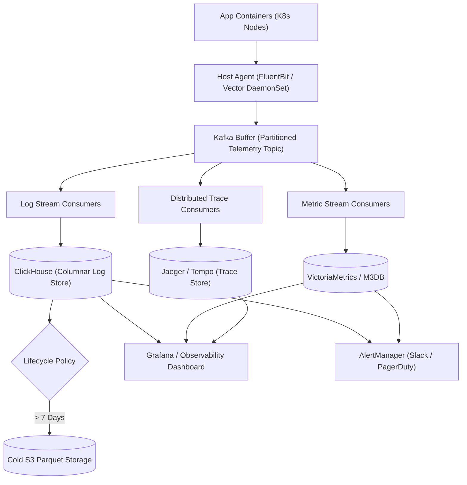

## Fast Revision (10-Second Recall)
- The 3 Pillars of Observability: Logs (discrete events), Metrics (aggregated numeric time-series), Traces (request journey across distributed spans).
- Ingestion Scale: 10TB+ logs/day, 50,000 events/sec peak, sub-second query latency.
- Ingestion Pipeline: FluentBit / Vector on nodes -> Kafka Buffering -> Logstash / Vector Transformer -> ClickHouse / ElasticSearch.
- Storage Choice: ClickHouse provides 5x to 10x better columnar compression and 100x faster analytical aggregation than ElasticSearch for structured logs.
- Hot vs Cold Tiering: Hot tier (SSD / RAM) retained for 7 days; Warm tier (HDD) for 30 days; Cold tier (ZSTD compressed S3) for 1 year.

## The 30-Second Spoken Script
"When designing an enterprise telemetry and observability platform like Datadog or an internal ELK/ClickHouse stack, the primary objective is handling massive write volume without dropping events or exhausting storage budgets.

At the host layer, a lightweight collector like Vector or FluentBit runs as a DaemonSet, scraping stdout logs, cgroup metrics, and OpenTelemetry spans with strict CPU/memory limits.

To protect storage engines from traffic spikes, all collectors ship events into a partitioned Kafka cluster. Kafka acts as an elastic buffer, ensuring that a sudden surge in application error logs does not crush our indexing cluster.

From Kafka, consumer workers enrich, parse, and structure JSON payloads before writing to our primary storage engine: ClickHouse for structured logs and columnar aggregations, and VictoriaMetrics or Prometheus for time-series metrics. ClickHouse offers exceptional columnar compression (up to 10:1 ratio), reducing infrastructure storage costs significantly compared to traditional Lucene indexes.

Finally, we implement strict automated lifecycle tiering: logs older than 7 days are compacted and transitioned to compressed Parquet files on Amazon S3 for long-term compliance retention."

## Scenario / Problem Context
Design a scalable logging and monitoring system for a microservices architecture of 500 services generating 50,000 log events per second and 10 million metric samples per minute, supporting real-time alerts and forensic queries.

## Architectural Workflow / Sequence


## Deep-Dive Analysis & Root Causes
### Why ClickHouse Outperforms ElasticSearch for Modern Logs
ElasticSearch builds an inverted index on every text field, requiring massive RAM and high disk overhead (often 1.5x the raw data size). ClickHouse stores data in compressed columnar format (ZSTD). Since log queries typically filter by specific dimensions (e.g., `service_name = "auth" AND level = "ERROR"`), ClickHouse only reads those specific columns from disk, executing analytical scans 50x faster with 70% lower disk usage.

### Sampling Strategies for Distributed Traces
Collecting 100% of distributed traces across 50,000 RPS generates petabytes of tracing data and saturates network interfaces. Observability platforms use Head-Based Sampling (sample 1% of all traces randomly) or Tail-Based Sampling (buffer traces in memory; retain 100% of traces that resulted in HTTP 5xx or latency > 2s, discard successful fast traces).

### Buffer Backpressure and Log Dropping Policy
When Kafka or storage degrades, host agents must not exhaust container RAM. If the local disk buffer fills to 95%, agents drop `DEBUG` and `INFO` events while retaining `WARN` and `ERROR` events to protect host system stability.

## Practical Debugging Commands & Code
### ClickHouse High-Performance Log Table Schema
```sql
-- High-throughput ClickHouse table for structured logs
CREATE TABLE logs.service_logs (
    timestamp DateTime64(3, 'UTC'),
    service_name LowCardinality(String),
    environment LowCardinality(String),
    log_level LowCardinality(String),
    trace_id String,
    message String,
    metadata Map(String, String)
) ENGINE = MergeTree()
PARTITION BY toYYYYMM(timestamp)
ORDER BY (service_name, log_level, timestamp)
TTL timestamp + INTERVAL 30 DAY DELETE;
```

## Prevention & Senior Best Practices
- Enforce JSON Structured Logging: Prohibit multi-line unformatted raw text logs; enforce JSON schemas with standardized `timestamp`, `level`, and `trace_id`.
- Client-Side Rate Limiting: Configure logging libraries with rate limiters (Logback BurstFilter) to drop repeated duplicate stack traces.
- Tail-Based Trace Sampling: Deploy OpenTelemetry Collector with tail-based sampling rules to capture 100% of errors while dropping mundane 200 OK spans.
- Automated Partition Eviction: Configure automated partition dropping policies in ClickHouse to guarantee storage disks never exceed 80% utilization.
