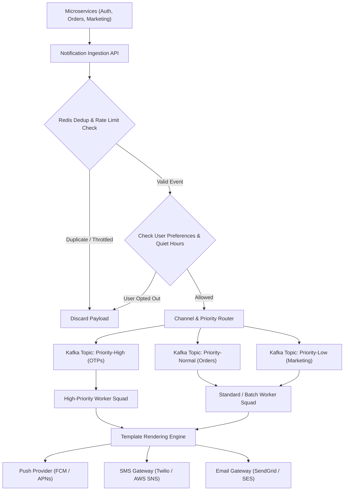

## Fast Revision (10-Second Recall)
- Channels: Push Notifications (APNs, FCM), SMS (Twilio, Sinch), Email (SendGrid, SES), In-App WebSockets.
- Priority Queuing: Critical (OTPs, password resets - 0 delay) vs Marketing (newsletters, digests - batch rate-limited).
- User Preferences & Quiet Hours: Check user opt-outs, channel preferences, and timezone-aware quiet hours before dispatch.
- Rate Limiting & Deduplication: Prevent spamming a user with 10 identical push notifications within 1 minute using sliding window cache.
- Third-Party Provider Fallback: Multi-vendor routing (e.g., if Twilio SMS fails, automatically failover to AWS SNS or Sinch).

## The 30-Second Spoken Script
"When designing a multi-channel notification platform, my focus is decoupling producers from downstream vendor latency while respecting user preferences.

The service exposes an internal gRPC and REST ingestion API. When a notification event arrives, the Ingestion Gateway immediately checks two things: first, a Redis Deduplication filter to prevent duplicate dispatches within a 60-second window; second, the User Preference and Quiet Hours service. If a user has disabled marketing push notifications or is currently in nighttime quiet hours, non-critical alerts are dropped or scheduled for morning delivery.

Next, notifications are classified into Priority Queues: Priority 1 for transactional OTPs and security alerts; Priority 2 for order updates; Priority 3 for marketing campaigns. High-priority queues have dedicated worker pools that guarantee sub-second dispatch.

Worker nodes pull events and execute template rendering using dynamic localized mustache templates. The rendered payload is sent to third-party providers (APNs, FCM, SendGrid, Twilio).

Every outbound provider client is protected by circuit breakers and smart failover: if our primary SMS provider degrades, traffic is automatically routed to our secondary provider within 3 seconds."

## Scenario / Problem Context
Design a notification platform serving 50 million active users, capable of sending 100 million notifications daily across Email, SMS, Push, and In-App channels, with strict SLA guarantees for OTP delivery under 5 seconds.

## Architectural Workflow / Sequence


## Deep-Dive Analysis & Root Causes
### Priority Inversion and Dedicated Queue Pools
If marketing batch jobs (5 million promotional emails) share the same queue as two-factor authentication (2FA) OTP codes, OTP delivery times will jump from 2 seconds to 45 minutes, causing total login paralysis across the entire company. Segregating into strictly isolated queues with dedicated worker deployments eliminates priority inversion.

### Sliding-Window Message Deduplication
Upstream services frequently retry events on network blips. Before enqueuing, the notification service computes an SHA-256 fingerprint of `userId + channel + templateId + payloadHash`. An atomic `SETNX fingerprint 1 EX 60` in Redis guarantees that identical notifications sent within 60 seconds are discarded safely.

### Timezone-Aware Quiet Hours Batching
Marketing notifications sent at 3:00 AM local time cause user uninstall surges. Workers inspect the recipient's IANA timezone. If the current time is between 22:00 and 08:00 local time, the event is held in a Redis sorted set with a delayed score matching 08:05 AM local time.

## Practical Debugging Commands & Code
### Deduplication & Rate-Limiting Implementation
```typescript
// Notification Deduplication Filter in Node.js
import crypto from 'crypto';
import Redis from 'ioredis';

const redis = new Redis();

export async function isDuplicateNotification(
  userId: string, 
  channel: string, 
  template: string, 
  data: object
): Promise<boolean> {
  const hash = crypto
    .createHash('sha256')
    .update(JSON.stringify(data))
    .digest('hex');
    
  const key = `dedup:${userId}:${channel}:${template}:${hash}`;
  
  // Returns 'OK' if key was set, null if key already existed
  const result = await redis.set(key, '1', 'EX', 60, 'NX');
  return result === null; // true = duplicate, discard!
}
```

## Prevention & Senior Best Practices
- Multi-Vendor Fallback Contracts: Contract with at least two SMS aggregators and two email relays with active automated health probes.
- Strict Ingestion Timeouts: Set timeout bounds on outbound vendor calls (max 2.5s for SMS, 3s for Email) to prevent worker pool starvation.
- Delivery Receipt Tracking: Ingest vendor delivery status webhooks (DLRs) into ClickHouse to track bounce rates and un-deliverability.
- Automatic Suppression Lists: Immediately add hard-bounced emails and STOP SMS replies to a global Redis suppression cache to prevent carrier fines.
