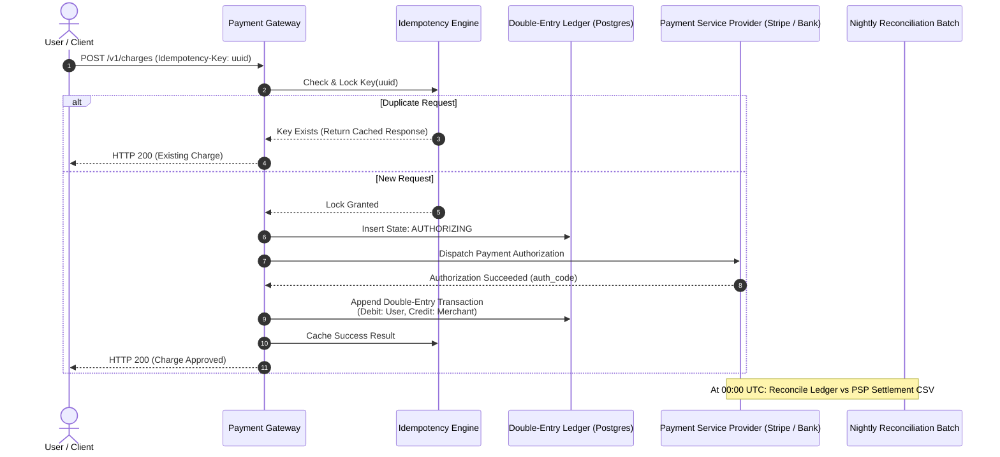

## Fast Revision (10-Second Recall)
- Core Mandate: Zero double-charges, zero lost transactions, immutable auditability, sub-second latency.
- Double-Entry Bookkeeping: Money is never created or destroyed. Every transaction has at least one Debit and one Credit where `SUM(debits) = SUM(credits)`.
- Idempotency Engine: Hash payload + Idempotency-Key. If key exists in Processing state -> reject HTTP 409; if Completed -> return cached response.
- State Machine: `INITIATED -> AUTHORIZING -> AUTHORIZED -> CAPTURED (or FAILED / VOIDED)`. Transitions must be strictly monotonic.
- Nightly Reconciliation Batch: Compare internal ledger records against external bank / card processor settlement settlement files.

## The 30-Second Spoken Script
"Designing a payment processing platform requires engineering for financial correctness, immutable auditability, and absolute idempotency.

At the core of the system is our Idempotency Service. When a client initiates a charge, they provide a unique Idempotency-Key. The payment gateway acquires an atomic distributed lock. If the transaction has already completed, it returns the stored result immediately. If currently in-flight, it rejects concurrent duplicates with HTTP 409 Conflict.

Next, payments transition through a strict, monotonic state machine: Initiated, Authorizing, Authorized, Captured, or Failed. State changes are recorded in an append-only, immutable database ledger using Double-Entry Bookkeeping. Every transfer creates paired debit and credit entries; mutable updates to account balances are strictly prohibited.

We integrate with external card networks and PSPs via asynchronous payment routing with tight connection timeouts and automated circuit breakers.

Finally, we run a daily automated Reconciliation Service. This service ingests end-of-day settlement files from banks and Stripe/Adyen, performing line-item matching against our internal ledger to catch discrepancies, dropped webhooks, or currency conversion variances."

## Scenario / Problem Context
Design a global payment processing engine handling $10 billion in annual transaction volume, supporting multiple currencies, card networks, asynchronous webhooks, immutable ledger accounting, and 100% audit compliance.

## Architectural Workflow / Sequence


## Deep-Dive Analysis & Root Causes
### Double-Entry Bookkeeping Principles in Software
Never store an account balance as a single mutable column (`UPDATE accounts SET balance = balance + 100`). Single-column updates lack audit history and suffer race conditions. In double-entry bookkeeping, balances are derived from an immutable stream of ledger postings. To check an account balance, you sum all completed ledger entries (or read from a snapshot ledger table updated via atomic triggers).

### Handling Two-Phase Payments (Auth & Capture)
E-commerce requires two distinct phases: Authorization (holding funds on the customer card at order placement) and Capture (actually moving money when goods ship). Authorizations expire after 7 days. The payment system must track authorization validity windows and handle re-authorizations if fulfillment is delayed.

### Three-Way Reconciliation
Discrepancies happen due to dropped network packets and time-boundary differences. Daily reconciliation runs a 3-way match across: 1) Internal Application Orders; 2) Internal Ledger Entries; 3) Bank Settlement Clearing Files. Any variance is automatically flagged for financial operations triage.

## Practical Debugging Commands & Code
### Double-Entry SQL Ledger Schema & Atomic Transfer
```sql
-- Immutable Double-Entry Ledger Schema in PostgreSQL
CREATE TABLE ledger_entries (
    id BIGSERIAL PRIMARY KEY,
    transaction_id UUID NOT NULL,
    account_id UUID NOT NULL,
    entry_type VARCHAR(10) NOT NULL CHECK (entry_type IN ('DEBIT', 'CREDIT')),
    amount NUMERIC(18, 4) NOT NULL CHECK (amount > 0),
    currency VARCHAR(3) NOT NULL,
    created_at TIMESTAMP WITH TIME ZONE DEFAULT CURRENT_TIMESTAMP
);

-- Compound assertion: Sum of debits must equal sum of credits for every transaction
CREATE OR REPLACE FUNCTION verify_transaction_balance() RETURNS TRIGGER AS $$
BEGIN
  IF (SELECT SUM(CASE WHEN entry_type = 'DEBIT' THEN amount ELSE -amount END) 
      FROM ledger_entries WHERE transaction_id = NEW.transaction_id) != 0 THEN
      RAISE EXCEPTION 'Ledger transaction % is unbalanced!', NEW.transaction_id;
  END IF;
  RETURN NEW;
END;
$$ LANGUAGE plpgsql;
```

## Prevention & Senior Best Practices
- PCI-DSS Compliance Isolation: Never ingest, log, or store raw Credit Card PANs or CVVs; use client-side tokenization (Stripe Elements / Hosted Fields).
- Immutable Audit Logs: Store financial ledger data on WORM (Write Once, Read Many) database partitions with cryptographic hash verification.
- Strict Idempotency Storage: Store idempotency locks in PostgreSQL or distributed Redis with transaction rollback hooks.
- Automated Outbox Pattern: Emit payment-completed events via the Transactional Outbox pattern to prevent data desynchronization with message brokers.
