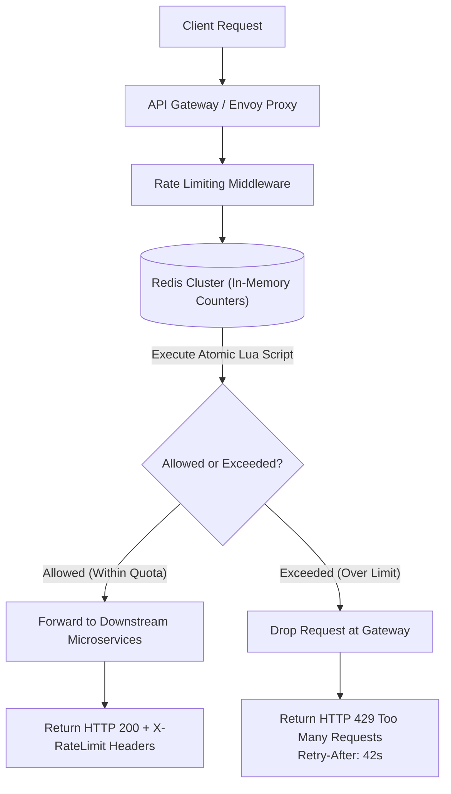

## Fast Revision (10-Second Recall)
- Algorithms: Token Bucket (bursts allowed), Leaky Bucket (smooth rate), Fixed Window (edge boundary burst vulnerability), Sliding Window Counter (most accurate).
- Latency Target: Rate check must execute in under 2ms; must never add perceptible overhead to incoming client requests.
- Storage: Redis Cluster using atomic Lua scripts or Redis Cell module to eliminate race conditions.
- Granularity: Per User ID, Per API Token, Per IP Address, or Per Endpoint tier.
- Headers Returned: `X-RateLimit-Limit`, `X-RateLimit-Remaining`, `Retry-After` (with HTTP 429 Too Many Requests).

## The 30-Second Spoken Script
"When designing a distributed rate limiter, the objective is to enforce API quotas with sub-2 millisecond latency and zero race conditions under concurrent traffic.

For our algorithm, I choose the Sliding Window Counter. Fixed Window algorithms suffer from a double-rate burst at boundary edges, while Token Bucket requires constant state writes. The Sliding Window Counter provides high accuracy with minimal memory footprint by weighting request counts from the previous window.

Architecturally, the rate limiter sits as a reverse-proxy middleware at our API Gateway (such as Kong, Envoy, or Cloudflare).

To execute the rate check atomically across a distributed fleet of gateway nodes, we use a Redis Cluster. A custom Redis Lua script checks current counter values, increments the counter, and sets the TTL atomically in a single network round-trip.

If the request exceeds quota, the gateway immediately terminates the connection, returning HTTP 429 Too Many Requests alongside standard RFC headers: X-RateLimit-Limit, X-RateLimit-Remaining, and Retry-After.

If Redis itself degrades, the rate limiter fails OPEN to ensure a cache failure does not cause a total outage of customer traffic."

## Scenario / Problem Context
Design a distributed rate-limiting service capable of evaluating 250,000 requests per second across 50 API endpoints, supporting tiered client limits (Free: 60 req/min, Premium: 10,000 req/min), with sub-2ms latency overhead.

## Architectural Workflow / Sequence


## Deep-Dive Analysis & Root Causes
### The Fixed Window Boundary Burst Vulnerability
In a Fixed Window rate limiter (e.g., 100 req/minute), if a client sends 100 requests at 00:59 and another 100 requests at 01:01, both batches pass because they belong to different calendar windows. However, within a 2-second sliding interval, the system absorbed 200 requests (2x the allowed capacity). Sliding window counters eliminate this flaw completely.

### Eliminating Distributed Race Conditions with Redis Lua
Executing `val = redis.get(key); if (val < limit) redis.incr(key);` from multiple API gateway nodes creates a classic check-then-act race condition. Two simultaneous requests can both read `99`, both increment to `100`, allowing 101 requests through. Encapsulating the logic in a Redis Lua script guarantees transactional atomicity because Redis executes Lua scripts sequentially on a single thread.

### Fail-Open vs Fail-Closed Policy
When Redis experiences a partition or network timeout, the rate limiter must decide: drop all customer traffic (fail-closed) or allow traffic through without rate checks (fail-open). For standard business APIs, failing open is standard because protecting revenue and user availability is more critical than quota enforcement.

## Practical Debugging Commands & Code
### Production Sliding Window Counter Lua Script for Redis
```sql
-- Sliding Window Counter implementation in Redis Lua
local key = KEYS[1]
local now = tonumber(ARGV[1])
local window = tonumber(ARGV[2])
local limit = tonumber(ARGV[3])

local clearBefore = now - window

-- Remove timestamps older than current window
redis.call('ZREMRANGEBYSCORE', key, 0, clearBefore)

-- Count current requests in window
local currentRequests = redis.call('ZCARD', key)

if currentRequests < limit then
    -- Add current timestamp as both score and member
    redis.call('ZADD', key, now, now)
    redis.call('EXPIRE', key, math.ceil(window / 1000))
    return {1, limit - currentRequests - 1} -- Allowed: true, remaining
else
    return {0, 0} -- Allowed: false, 0 remaining
end
```

## Prevention & Senior Best Practices
- Local In-Memory Token Caching: Cache hot rate limit thresholds in local process memory (Envoy memory) for 500ms to reduce Redis network hops.
- Tiered Client Tokens: Embed account tier (`tier: enterprise`) inside validated JWT claims to avoid querying account databases on every rate check.
- Graceful Degradation (Fail-Open): Wrap Redis rate check calls in a circuit breaker; if latency exceeds 5ms, bypass rate limiting and alert.
- DDoS Scrubbing at Edge: Offload volumetric layer-7 and layer-4 flood mitigation to Cloudflare or AWS Shield before traffic reaches the API Gateway.
