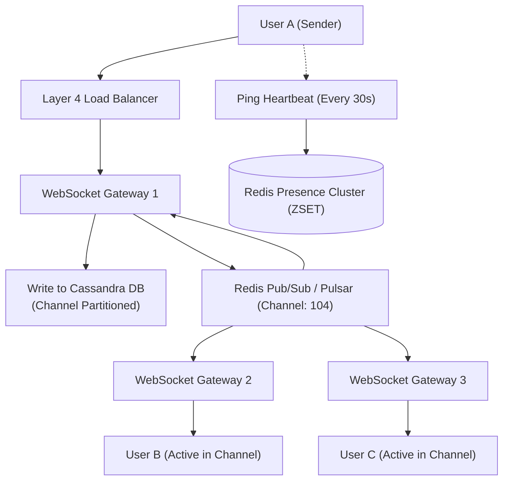

## Fast Revision (10-Second Recall)
- Scale: 50M concurrent connections, 500k channels, sub-100ms message delivery.
- Protocol: WebSocket for bidirectional real-time events; HTTP/2 or HTTP/3 for history retrieval and file uploads.
- WebSocket Scaling: Edge WebSocket servers maintain persistent TCP sockets; Redis Pub/Sub or Kafka routes messages across cluster nodes.
- Presence Engine: Ephemeral heartbeats via Redis sorted sets with 30s TTL; avoid broadcasting presence to 100k users (use lazy presence on view).
- Message History Storage: Cassandra or ScyllaDB partitioned by `channel_id` with clustering key `message_id DESC` for lightning-fast scrolling.

## The 30-Second Spoken Script
"When designing a large-scale real-time chat platform like Discord or Slack, the key engineering challenge is managing millions of stateful WebSocket connections and fanning out messages efficiently.

Clients establish persistent WebSockets through Layer 4 load balancers to our distributed Gateway Server fleet. Because WebSockets are stateful, User A and User B may be connected to completely different server instances.

When User A sends a message to Channel 10, Gateway Node 1 persists the message to an Apache Cassandra message store partitioned by channel_id. Simultaneously, Gateway Node 1 publishes the message payload to a distributed Pub/Sub layer, such as Redis Pub/Sub or Apache Pulsar.

All Gateway servers hosting active subscribers of Channel 10 receive the event from Pub/Sub and push the payload down the corresponding client WebSocket sockets.

For presence (online/away/offline), broadcasting every status change in a 10,000-person channel creates an $O(N^2)$ message amplification nightmare. Instead, we use a lazy presence architecture: presence is only fetched for users currently visible in the active viewport, and clients send lightweight heartbeats to a Redis cluster every 30 seconds."

## Scenario / Problem Context
Design a real-time messaging application supporting 10 million concurrent users across channels and direct messages, providing instant message delivery, typing indicators, read receipts, and channel message history.

## Architectural Workflow / Sequence


## Deep-Dive Analysis & Root Causes
### The Presence Amplification Problem ($O(N^2)$ Fanout)
If a Discord guild has 100,000 members and one member goes online, broadcasting that status change to all 100,000 members generates 100,000 outgoing messages. If 1,000 members change state at the same time, the server generates 100,000,000 messages, melting the network. Modern systems restrict presence broadcasts to small private channels or fetch presence lazily on-demand only for members visible on the client screen.

### Cassandra Data Modeling for Chat Channels
Relational databases degrade when querying message history across millions of rows. In Cassandra, data is modeled around access patterns: `CREATE TABLE messages (channel_id UUID, message_id TIMEUUID, sender_id UUID, content TEXT, PRIMARY KEY (channel_id, message_id)) WITH CLUSTERING ORDER BY (message_id DESC);`. This guarantees that retrieving the last 50 messages of any channel requires reading a single contiguous disk block.

### Handling WebSocket Reconnect Storms
When a network blip drops 500,000 connections, all 500,000 clients attempt to reconnect simultaneously within 1 second. This thundering herd crashes gateway servers. Clients must implement exponential backoff with full jitter, and load balancers must rate-limit TLS handshakes.

## Practical Debugging Commands & Code
### Cassandra CQL Schema for Sub-Millisecond Chat History
```sql
-- ScyllaDB / Cassandra Chat History Schema
CREATE KEYSPACE chat_system 
WITH replication = {'class': 'NetworkTopologyStrategy', 'us-east-1': 3};

CREATE TABLE chat_system.channel_messages (
    channel_id UUID,
    message_id TIMEUUID, -- Embedded timestamp ensures strict monotonic ordering
    user_id UUID,
    message_text TEXT,
    attachments LIST<TEXT>,
    PRIMARY KEY (channel_id, message_id)
) WITH CLUSTERING ORDER BY (message_id DESC);

-- Fetch the 50 most recent messages in Channel (sub-5ms!)
SELECT * FROM chat_system.channel_messages 
WHERE channel_id = 7c9e6679-7425-40de-944b-e07fc1f90ae7 
LIMIT 50;
```

## Prevention & Senior Best Practices
- Client-Side Exponential Backoff & Jitter: Enforce randomized reconnect timers on mobile and web clients to prevent connection thundering herds.
- Message Rate Limiting: Apply token-bucket rate limits per user socket (max 5 messages/sec) to prevent spam flooding across channels.
- Lazy Presence Queries: Never broadcast presence changes across large channels; query presence on demand when hovering or clicking user profiles.
- Ephemeral Typing Indicators: Route typing indicator events purely through in-memory Pub/Sub without ever persisting to the database.
