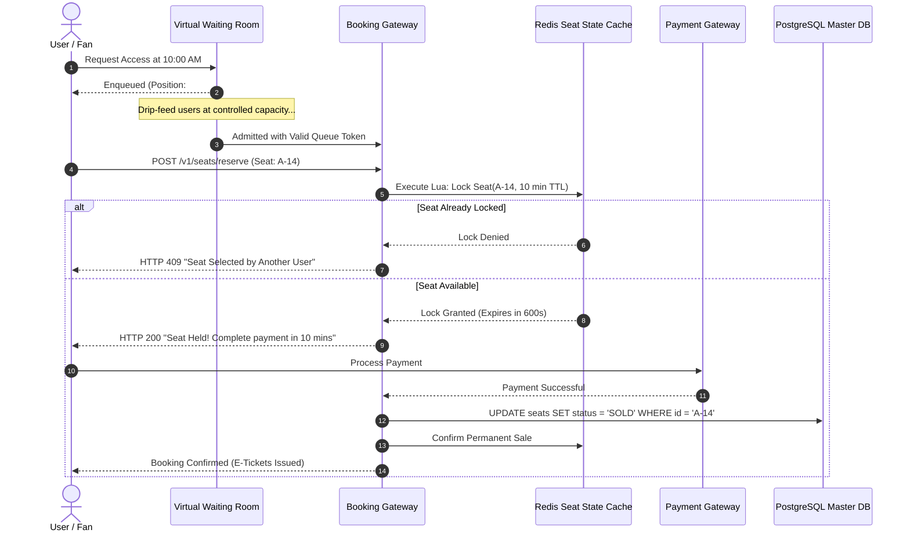

## Fast Revision (10-Second Recall)
- The Core Challenge: 100,000 users competing for 10,000 concert seats simultaneously within 60 seconds.
- Virtual Waiting Room: Cloudflare Waiting Room or Redis queue to smooth traffic spikes and admit users at a controlled rate.
- Two-Phase Seat Allocation: Temporary Hold (10-minute reservation in Redis with TTL) -> Confirmed Purchase (PostgreSQL commit).
- Concurrency Control: Pessimistic Row Lock (`SELECT FOR UPDATE`) vs Redis Lua Atomic Lock (preferred for speed).
- Fairness: FIFO queue processing using Kafka or SQS FIFO with partitioned event IDs.

## The 30-Second Spoken Script
"When designing a ticket booking platform like Ticketmaster, the primary objective is preventing double-booking while surviving the massive traffic surge when tickets go on sale.

First, we protect the core booking engine using a Virtual Waiting Room. When 500,000 fans arrive at 10:00 AM, an edge gateway places them into a token-based waiting room. We drip-feed users into the active seat selection funnel at a controlled rate of 500 users per second.

Second, we solve seat selection concurrency using a two-phase reservation pattern. When a user selects Seat 42, we execute an atomic Redis Lua script: SET seat:concert1:42 userId NX EX 600. This acquires an exclusive 10-minute hold. If another user attempts to select Seat 42, the atomic operation fails immediately with "Seat already reserved".

The user has 10 minutes to complete checkout. Once payment confirms, a database transaction updates the seat status from AVAILABLE to SOLD in PostgreSQL, and the temporary Redis key is converted to permanent.

If the user closes their browser or payment fails, the 10-minute Redis TTL expires automatically, releasing the seat back to the available pool without requiring manual clean-up jobs."

## Scenario / Problem Context
Design a ticketing system for high-demand concert tours where 50,000 seats sell out in 3 minutes. The system must guarantee zero double-bookings, strict 10-minute checkout holds, and fair queuing.

## Architectural Workflow / Sequence


## Deep-Dive Analysis & Root Causes
### Virtual Waiting Room (Traffic Smoothing)
Allowing 500,000 users to simultaneously hit a relational database crashes connection pools instantly. A Virtual Waiting Room (Cloudflare Waiting Room or AWS Virtual Waiting Room) intercepts traffic at the edge. Users receive a cryptographically signed ticket with a position number and poll via WebSocket. The edge gatekeeper allows only N users/second through to the reservation microservices.

### Pessimistic vs Distributed Cache Seat Locks
Using `SELECT ... FOR UPDATE` in a relational database locks rows at the storage level, which works well for low traffic but exhausts database connection pools during viral ticket drops. Managing temporary 10-minute holds in an in-memory Redis cluster with atomic Lua scripts achieves sub-millisecond lock acquisition while protecting the database.

### Handling Abandoned Holds with Redis Keyspace Notifications
When the 10-minute TTL expires, Redis automatically evicts the key. By subscribing to Redis Keyspace Notifications (`__keyevent@0__:expired`), an event worker listens for expired seat holds and broadcasts a WebSocket notification to users on the seat selection map: "Seat A-14 is available again".

## Practical Debugging Commands & Code
### Atomic Redis Lua Seat Hold Script
```sql
-- Redis Lua Script: reserve_seat.lua
local seat_key = KEYS[1]
local user_id = ARGV[1]
local ttl_seconds = tonumber(ARGV[2])

-- Check if seat is already locked or sold
local current_holder = redis.call('GET', seat_key)

if current_holder == nil then
    -- Seat is free: reserve it for user with 10-minute TTL
    redis.call('SET', seat_key, user_id, 'EX', ttl_seconds)
    return 1 -- Reservation success
else
    return 0 -- Seat already held or sold
end
```

## Prevention & Senior Best Practices
- Pre-Signed Queue Tokens: Digitally sign queue admission tokens with HMAC-SHA256 to prevent bots from bypassing the virtual waiting room.
- Strict Check-Then-Act Elimination: Never perform seat availability verification in application code; always enforce atomic Redis Lua or database unique constraints.
- Cap Max Tickets Per Customer: Enforce strict checkout rules (max 4 tickets per user/card) to mitigate scalper bot syndicates.
- Database Idempotent Commits: Wrap final seat purchase transactions in serializable database isolation levels to prevent edge-case race conditions.
