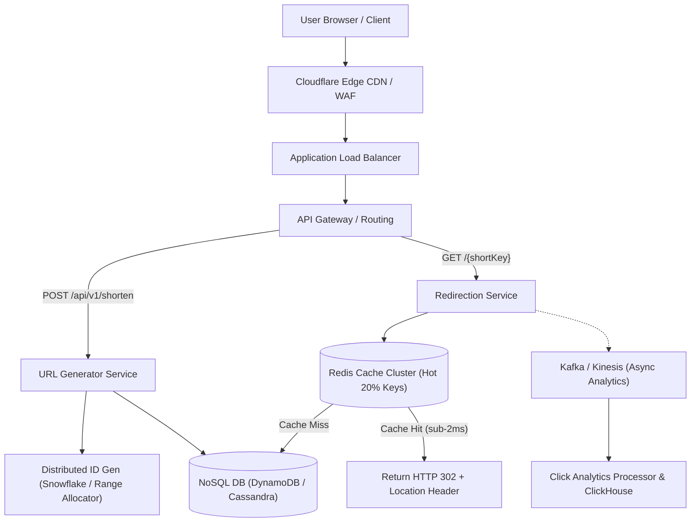

## Fast Revision (10-Second Recall)
- Scale: 100M URLs generated/month, 10:1 Read-to-Write ratio (approx 40 writes/sec, 400 reads/sec, peak 4,000 reads/sec).
- Short Key Math: 7 Base62 chars ([a-zA-Z0-9] = 62) yields 62^7 = ~3.5 trillion unique combinations.
- Hash vs Counter: MD5/SHA256 truncated has collisions; Distributed Counter (Snowflake / ZooKeeper range generator) + Base62 has ZERO collisions.
- Storage: NoSQL Key-Value (DynamoDB/Cassandra) or Partitioned PostgreSQL (`id`, `short_key`, `original_url`, `created_at`, `expires_at`).
- Redirection Status Code: HTTP 301 (Permanent - cached by browser, saves server load) vs HTTP 302/307 (Temporary - tracks analytics on every hit).

## The 30-Second Spoken Script
"When designing a URL shortener like Bitly, I clarify functional and scale requirements upfront:

Functionally, users submit a long URL and receive a unique short link; visiting the short link redirects to the original destination with sub-10ms latency. At 100M URLs created per month with a 10:1 read-to-write ratio, this is a heavily read-skewed service.

To avoid hash collision loops from MD5 truncation, I use a distributed ID generator (like Twitter Snowflake or centralized range allocation with Redis/ZooKeeper) and encode the 64-bit auto-incrementing integer into a 7-character Base62 string. 62 to the power of 7 gives us 3.5 trillion unique URLs, sufficient for decades.

For storage, a distributed key-value store like DynamoDB or Redis with Cassandra provides sub-millisecond primary key lookups. We place an edge CDN and distributed Redis cache cluster ahead of the database using LRU eviction, caching the top 20% of hot URLs to satisfy the 80/20 Pareto distribution.

For redirection, we return HTTP 302 or 307 if the business demands click tracking and telemetry, or HTTP 301 Permanent Redirect to offload repeated lookups directly to the browser cache."

## Scenario / Problem Context
You are tasked with designing a URL shortening platform like Bitly. The system must support generating short URLs, redirecting users in under 10ms, handling 10 billion clicks per month, custom vanity aliases, and URL expiration.

## Architectural Workflow / Sequence


## Deep-Dive Analysis & Root Causes
### Collision-Free Encoding: Base62 vs Cryptographic Hashing
Truncating MD5 or MurmurHash to 7 characters guarantees hash collisions at scale, requiring expensive database collision probes and salt appending. Generating a unique 64-bit integer ID and converting it to Base62 ($[a-zA-Z0-9]$) guarantees zero collisions with $O(1)$ encoding time.

### HTTP 301 Permanent vs HTTP 302 Found Trade-Off
HTTP 301 tells browsers to cache the destination indefinitely. Subsequent clicks bypass your servers completely, reducing server load by 90%. However, you lose all real-time analytics, geolocation data, and click counts. Commercial URL shorteners use HTTP 302 or HTTP 307 so every click passes through telemetry logging.

### Range-Based ID Allocation (Avoiding Central Bottlenecks)
Instead of having worker nodes query a single database auto-increment on every write, a coordinator service (ZooKeeper or Redis) assigns blocks of 100,000 IDs to each server node (e.g., Node 1 gets 1-100,000; Node 2 gets 100,001-200,000). Nodes generate IDs in local memory with zero network latency.

## Practical Debugging Commands & Code
### High-Performance Base62 Encoder Implementation
```typescript
// Base62 Converter in TypeScript / Node.js
const CHARS = '0123456789abcdefghijklmnopqrstuvwxyzABCDEFGHIJKLMNOPQRSTUVWXYZ';
const BASE = BigInt(62);

export function idToBase62(num: bigint): string {
  if (num === 0n) return CHARS[0];
  let result = '';
  let n = num;
  while (n > 0n) {
    const remainder = Number(n % BASE);
    result = CHARS[remainder] + result;
    n = n / BASE;
  }
  return result.padStart(7, '0');
}

export function base62ToId(str: string): bigint {
  let num = 0n;
  for (let i = 0; i < str.length; i++) {
    const index = BigInt(CHARS.indexOf(str[i]));
    num = num * BASE + index;
  }
  return num;
}
```

## Prevention & Senior Best Practices
- Rate Limiting & Abuse Prevention: Enforce token-bucket rate limits per IP/API token to prevent bot scrape exhaustion.
- Malicious URL Scanning: Integrate Google Safe Browsing API or VirusTotal async webhooks to reject phishing destinations.
- Cold Data Archival: Run TTL background eviction to move expired short URLs to cheap S3/Glacier object storage.
- Cache Warm-Up: Pre-populate regional Redis clusters with top viral URLs to prevent thundering herd database degradation.
