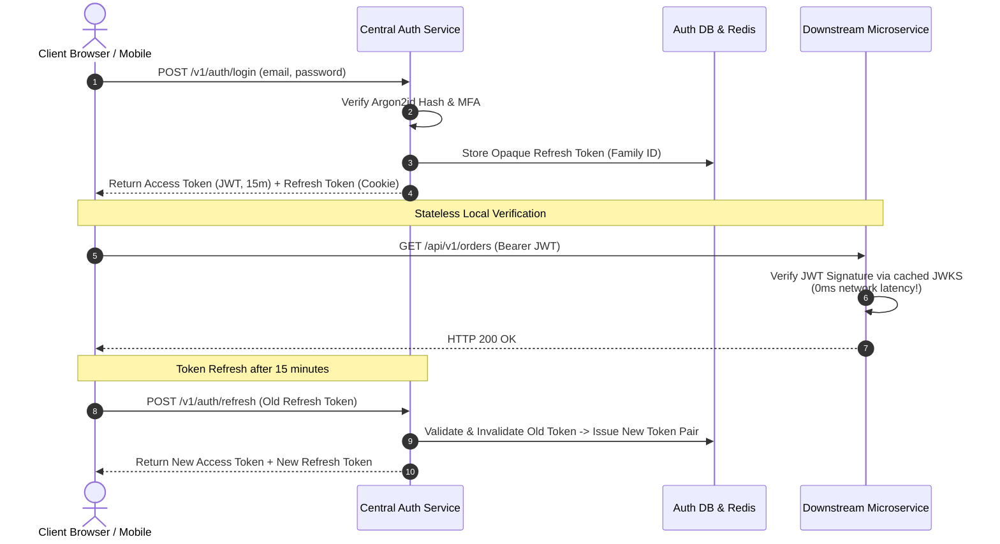

## Fast Revision (10-Second Recall)
- Protocols: OAuth 2.0 (Authorization), OpenID Connect / OIDC (Authentication / Identity), SAML (Enterprise SSO).
- Token Architecture: Short-lived Access Token (JWT, 15m lifetime, stateless verification) + Long-lived Refresh Token (Opaque string, 30d, stored in DB/Redis).
- Refresh Token Rotation (RTR): Every refresh issues a new access token AND a new refresh token; invalidates all child tokens if a reuse attack is detected.
- Password Security: Argon2id or bcrypt (cost factor >= 12); never SHA-256/MD5.
- Key Management (JWKS): Public keys published at `/.well-known/jwks.json` for independent microservice signature verification.

## The 30-Second Spoken Script
"When designing a centralized Authentication & Identity service, my goal is providing secure, sub-millisecond token verification while protecting against token theft and credential stuffing.

For token architecture, I implement the Short-Lived Access Token + Refresh Token Rotation pattern. The Access Token is a stateless JWT signed with asymmetric RS256 or Ed25519 keys, holding the user ID, tenant ID, and permissions with a 15-minute expiration. Downstream microservices verify access tokens locally using our public JWKS endpoint without calling the auth server.

The Refresh Token is a cryptographically secure opaque token stored in our database. When an access token expires, the client calls /v1/auth/refresh. The auth service rotates the refresh token: issuing a new access token and a brand-new refresh token while invalidating the old one. If an attacker attempts to replay an already-used refresh token, the service detects a token breach and immediately revokes all active sessions for that user.

For password storage, we use Argon2id with salted hashes. The service enforces Multi-Factor Authentication via TOTP and WebAuthn/Passkeys, and monitors login patterns with automated rate limiting to neutralize credential stuffing attacks."

## Scenario / Problem Context
Design a high-scale authentication and identity service supporting 100 million registered users, single sign-on (SSO) across 20 internal web and mobile apps, refresh token rotation, and sub-millisecond local token validation.

## Architectural Workflow / Sequence


## Deep-Dive Analysis & Root Causes
### Stateless JWT vs Centralized Database Sessions
Querying a central session database on every HTTP request across 100 microservices creates a massive database bottleneck. Using asymmetric signed JWTs allows microservices to verify authenticity, expiration, and role scopes in local memory ($O(1)$ CPU) without making any network calls. The short 15-minute lifespan mitigates the risk of delayed token revocation.

### Refresh Token Rotation and Theft Detection
When an attacker steals a refresh token, both the legitimate user and the attacker will eventually present it. Under Refresh Token Rotation, tokens belong to a `TokenFamily`. If Token A is submitted after it was already exchanged for Token B, the server detects token reuse, immediately invalidates the entire `TokenFamily`, and forces a full re-login.

### Immediate Token Revocation with Redis Denylist
If an employee is terminated or a password is reset, their 15-minute JWT is still technically valid. To revoke tokens immediately without reverting to centralized database sessions, the auth service publishes the revoked `jti` (JWT ID) to a shared in-memory Redis Bloom filter or denylist. Microservices check the local Bloom filter before accepting the token.

## Practical Debugging Commands & Code
### Secure JWT Verification with JWKS in Node.js
```typescript
// Local JWT signature verification using JWKS (Zero network call after cache)
import jwt from 'jsonwebtoken';
import jwksClient from 'jwks-rsa';

const client = jwksClient({
  jwksUri: 'https://auth.example.com/.well-known/jwks.json',
  cache: true,
  rateLimit: true,
  jwksRequestsPerMinute: 10
});

function getKey(header: any, callback: any) {
  client.getSigningKey(header.kid, (err, key) => {
    const signingKey = key?.getPublicKey();
    callback(null, signingKey);
  });
}

export function verifyUserToken(token: string): Promise<any> {
  return new Promise((resolve, reject) => {
    jwt.verify(token, getKey, { algorithms: ['RS256'] }, (err, decoded) => {
      if (err) return reject(err);
      resolve(decoded);
    });
  });
}
```

## Prevention & Senior Best Practices
- HttpOnly & Secure Cookie Flags: Store refresh tokens exclusively in `HttpOnly; Secure; SameSite=Strict` cookies to neutralize Cross-Site Scripting (XSS) token exfiltration.
- Asymmetric Key Rotation: Rotate JWKS private signing keys every 90 days, retaining the previous public key in the JWKS endpoint for 7 days to support in-flight tokens.
- Credential Stuffing Defense: Implement IP reputation scoring, CAPTCHA, and fail2ban rate limiters on `/v1/auth/login`.
- Clock Drift Tolerance: Configure JWT validation libraries with a 60-second leeway buffer to accommodate minor server clock drift.
