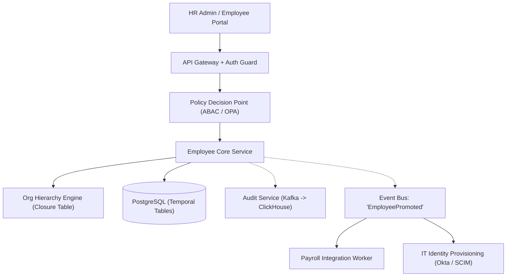

## Fast Revision (10-Second Recall)
- Core Complexities: Recursive hierarchical reporting structures, temporal data (salary changes effective in future), granular Role-Based Access Control (RBAC).
- Hierarchical Org Chart Storage: Adjacency List (simple `manager_id`), Materialized Path (`/1/4/12/`), or Closure Tables (fastest recursive queries).
- Temporal / Effective Dating: Every record has `effective_start_date` and `effective_end_date` to support past and scheduled future organizational shifts.
- Authorization: RBAC (Roles: Admin, HR, Manager, Employee) + Attribute-Based Access Control (ABAC: Managers can only view compensation of direct reports).
- Audit Logging: Immutable event stream tracking every view and mutation of Sensitive Personally Identifiable Information (PII).

## The 30-Second Spoken Script
"When designing an enterprise Employee Management System, the primary engineering challenges are hierarchical organization structures, temporal data management, and granular permission boundaries.

For the organizational chart, querying deep reporting chains with basic adjacency lists causes expensive recursive database loops. I implement either a Closure Table or Materialized Path structure in PostgreSQL, allowing instant $O(1)$ lookups of an employee's entire management chain or subtree of subordinates.

Second, corporate HR operations require temporal effective dating. An employee promotion or compensation change is often entered today but becomes effective on the first of next month. Every employee record contains effective_start and effective_end timestamps, ensuring historical snapshots remain accurate for compliance while future shifts take effect automatically.

Third, for authorization, we combine RBAC with Attribute-Based Access Control (ABAC). While a user may have the role of Manager, ABAC policies restrict them from viewing salary details for anyone outside their organizational subtree.

Finally, all PII mutations and profile views are dispatched asynchronously to an append-only audit log database for compliance auditing."

## Scenario / Problem Context
Design an enterprise HR system for a company with 250,000 employees across 40 countries, supporting complex reporting lines, future-dated job transitions, granular role-based permissions, and payroll integration.

## Architectural Workflow / Sequence


## Deep-Dive Analysis & Root Causes
### Org Chart Querying: Adjacency List vs Closure Table
An Adjacency List (`manager_id FK`) requires recursive CTEs to find all subordinates under a VP, degrading under high concurrency. A Closure Table stores every ancestor-descendant pair with depth: `(ancestor_id, descendant_id, depth)`. Finding all reports under a manager is a single indexed `SELECT descendant_id FROM org_closure WHERE ancestor_id = :id;`.

### Temporal Data and Bi-Temporal Tables
Enterprise HR systems require bi-temporal modeling: 1) Valid Time (the real-world period the salary is in effect); 2) Transaction Time (the timestamp the record was written into the database). This allows retroactive corrections without corrupting historical payroll audit trails.

### SCIM Protocol for Enterprise Identity Sync
Modern employee platforms must integrate with corporate identity providers via SCIM (System for Cross-domain Identity Management). When an employee is terminated in HR, a SCIM event automatically de-provisions their Google Workspace, Slack, and AWS credentials instantly.

## Practical Debugging Commands & Code
### Closure Table Schema for Instant Subtree Hierarchy Queries
```sql
-- PostgreSQL Closure Table Schema for Enterprise Org Chart
CREATE TABLE org_closure (
    ancestor_id BIGINT NOT NULL REFERENCES employees(id),
    descendant_id BIGINT NOT NULL REFERENCES employees(id),
    depth INT NOT NULL,
    PRIMARY KEY (ancestor_id, descendant_id)
);

-- Find all direct and indirect reports under VP (ancestor_id = 100)
SELECT e.id, e.full_name, e.title, oc.depth
FROM org_closure oc
JOIN employees e ON oc.descendant_id = e.id
WHERE oc.ancestor_id = 100 AND oc.depth > 0
ORDER BY oc.depth ASC;
```

## Prevention & Senior Best Practices
- Encrypted PII at Rest: Encrypt sensitive fields (Social Security Numbers, bank details) using column-level envelope encryption with AWS KMS.
- Field-Level Data Masking: Mask compensation and tax fields at the API gateway layer unless the requesting user possesses specific HR clearance.
- Idempotent SCIM Webhooks: Guarantee identity provisioning actions can be safely retried without creating duplicate user accounts.
- Automated Audit Trail Immutability: Replicate audit log events to S3 Object Lock in WORM compliance mode.
