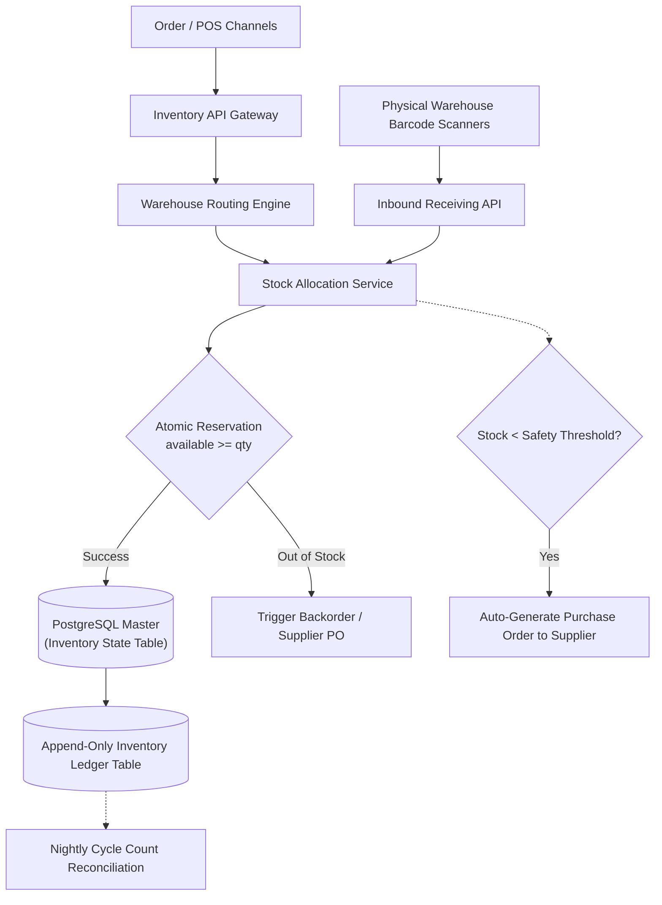

## Fast Revision (10-Second Recall)
- Core Entities: SKU (Stock Keeping Unit), Warehouse, Stock Level (Available, Reserved, Damaged, In-Transit), Bin Location.
- Multi-Warehouse Fulfillment Routing: Route orders to the closest warehouse with sufficient stock to minimize shipping cost and delivery SLA.
- Concurrency Protection: Optimistic locking with version counters or atomic database updates to prevent negative stock allocations.
- Audit Trail: Immutable stock ledger table recording every adjustment, return, picking event, and cycle count reconciliation.
- Low Stock & Reorder Triggers: Automated webhook alerts when Available Stock falls below the minimum Safety Stock threshold.

## The 30-Second Spoken Script
"When designing an enterprise multi-warehouse inventory management system, the primary engineering requirements are preventing stock discrepancies, handling concurrent reservations, and optimizing multi-warehouse fulfillment.

First, we model inventory states explicitly: Total Physical Stock = Available Stock + Reserved Stock + Damaged Stock. When a customer adds an item to checkout, stock is not deducted from physical warehouse shelves; rather, it moves from Available to Reserved.

Second, to handle concurrent reservations without race conditions, we enforce atomic database mutations: UPDATE inventory SET available = available - :qty, reserved = reserved + :qty WHERE sku = :sku AND available >= :qty. This guarantees that stock can never drop below zero even under massive concurrent surges.

Third, our Fulfillment Routing Service determines which physical warehouse ships the goods. It calculates the optimal warehouse based on proximity to the customer, current stock levels, and warehouse packing capacity, avoiding split shipments whenever possible.

Finally, all physical adjustments from warehouse barcode scans, return receipts, or cycle counts are written to an append-only Inventory Ledger. Physical stock is reconciled daily against the ledger to identify shrinkage or misplacement."

## Scenario / Problem Context
Design an inventory management platform for a retail giant with 50 regional warehouses, 1,000,000 unique SKUs, supporting real-time stock reservations across online and physical retail channels with zero phantom stock errors.

## Architectural Workflow / Sequence


## Deep-Dive Analysis & Root Causes
### The Multi-Warehouse Allocation Problem
If an order has 3 items, shipping from 3 different warehouses triples logistics costs. The Warehouse Routing Engine runs a knapsack/graph optimization algorithm: 1) Try to find a single warehouse containing all 3 items; 2) If none exists, find the minimal combination of warehouses closest to the customer's destination postal code.

### Optimistic vs Pessimistic Stock Locking
Pessimistic locking (`SELECT FOR UPDATE`) holds database locks while calling warehouse routing services, crippling database throughput. Optimistic locking or atomic conditional updates (`WHERE available >= qty`) allow the database to process thousands of stock checks per second with zero locking deadlocks.

### Phantom Stock and Cycle Counting Reconciliation
Phantom stock occurs when the database believes 5 items are on the shelf, but physical items were damaged, stolen, or misplaced. Warehouse workers perform continuous cycle counting using handheld barcode scanners. The system compares physical scans against the digital ledger, generating adjustment transactions automatically.

## Practical Debugging Commands & Code
### Atomic Inventory Allocation & Audit Ledger Schema
```sql
-- PostgreSQL Atomic Stock Reservation Query
UPDATE warehouse_inventory 
SET available_quantity = available_quantity - 2,
    reserved_quantity = reserved_quantity + 2,
    updated_at = CURRENT_TIMESTAMP
WHERE warehouse_id = 4 
  AND sku = 'TECH-LAPTOP-M3' 
  AND available_quantity >= 2;

-- Immutable Inventory Ledger Entry
INSERT INTO inventory_audit_ledger (
    transaction_id, warehouse_id, sku, change_amount, reason_code, created_at
) VALUES (
    gen_random_uuid(), 4, 'TECH-LAPTOP-M3', -2, 'ONLINE_ORDER_RESERVATION', CURRENT_TIMESTAMP
);
```

## Prevention & Senior Best Practices
- Safety Stock Buffers: Maintain a configurable Safety Stock buffer (e.g., mark as out-of-stock when remaining inventory reaches 3 units) to prevent overselling due to physical shrinkage.
- Automated Reservation Expiration: Automatically expire and release abandoned reservations back to Available Stock after 15 minutes using scheduled worker sweeps.
- Strict Checksum on Stock Levels: Enforce a database check constraint: `CHECK (available_quantity >= 0 AND reserved_quantity >= 0)`.
- Continuous Cycle Count Audits: Schedule rotating daily cycle count tasks for warehouse staff to audit 5% of SKUs daily, covering 100% of catalog monthly.
