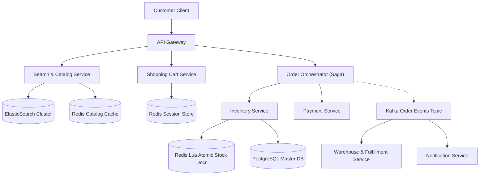

## Fast Revision (10-Second Recall)
- Subsystems: Catalog Browsing (Read-heavy, 99%), Shopping Cart (Session/Cache), Inventory (High Concurrency, ACID), Payment/Checkout (Idempotent).
- Catalog Scaling: ElasticSearch for full-text product search, Redis for product details, CDN for product media assets.
- Flash Sale Inventory Overselling: Never check-then-act. Use Redis Lua script atomic decr or database `UPDATE stock = stock - 1 WHERE id = ? AND stock > 0`.
- Cart Storage: Local browser state + Redis with persistent Cassandra backup for cross-device synchronization.
- Event-Driven Checkout: Saga Pattern (Choreography/Orchestration) to coordinate Order Creation -> Payment -> Inventory Reservation -> Shipping.

## The 30-Second Spoken Script
"When designing an online shopping system like Amazon, I decouple the read-heavy catalog pipeline from the write-intensive, consistency-critical order engine.

For product browsing, which accounts for 99% of total traffic, we use ElasticSearch for faceted search and filtering, with Redis caching individual product metadata. Product images and media are cached at Cloudflare edge CDNs with high TTLs.

The critical challenge is inventory reservation during flash sales. We cannot afford overselling or slow database locks. I use Redis with an atomic Lua script to decrement stock counts. If Redis confirms availability, an inventory hold is placed for 15 minutes. If checkout completes, the reservation commits to PostgreSQL; if the timer expires, the hold is released back into the pool.

For checkout, we implement the Saga Orchestration pattern. The Order Orchestrator manages a two-phase transaction across Payment, Inventory, and Notification services using durable Kafka events. If payment fails, compensating transactions release the inventory reservation.

Every mutation endpoint enforces strict idempotency using unique checkout tokens to ensure users are never double-billed on network retries."

## Scenario / Problem Context
Design an e-commerce platform handling 50,000 product queries per second, 5,000 concurrent checkouts during flash sales, zero overselling of limited inventory, and resilient order fulfillment across distributed microservices.

## Architectural Workflow / Sequence


## Deep-Dive Analysis & Root Causes
### Atomic Inventory Decrement (Preventing Overselling)
Executing `SELECT stock FROM products WHERE id=1; if (stock > 0) UPDATE products SET stock = stock - 1` fails under concurrent load due to race conditions. Using atomic SQL: `UPDATE products SET stock = stock - :qty WHERE id = :id AND stock >= :qty RETURNING id;` guarantees atomicity at the row level. During extreme flash sales, offloading this atomic decrement to Redis Lua eliminates relational database CPU exhaustion.

### Saga Pattern for Distributed Checkout
In microservices, two-phase commit (2PC) creates blocking dependencies. The Saga Orchestrator manages the workflow: Step 1: Reserve Inventory; Step 2: Charge Payment; Step 3: Create Order. If Step 2 fails, the Orchestrator emits a compensating event to Release Inventory Reservation, ensuring eventual consistency.

### Cart Abandonment and Inventory TTL
Holding inventory indefinitely when a user adds items to a cart causes inventory hoarding attacks. Modern systems reserve stock only when the user enters the active checkout funnel, backed by a strict 10-to-15 minute TTL timer managed via Redis keyspace notifications or message delays.

## Practical Debugging Commands & Code
### Atomic Redis Lua Script for Flash Sale Inventory Lock
```sql
-- Redis Lua Script: atomic_reserve_stock.lua
local item_key = KEYS[1]
local quantity = tonumber(ARGV[1])

local current_stock = tonumber(redis.call('GET', item_key) or "0")

if current_stock >= quantity then
    redis.call('DECRBY', item_key, quantity)
    return 1 -- Stock successfully reserved
else
    return 0 -- Insufficient stock (Sold out)
end
```

## Prevention & Senior Best Practices
- Strict Check-Out Idempotency: Bind every order submission to a client-generated UUID checkout token stored with a 5-minute atomic Redis lock.
- Asynchronous Payment Confirmation: Handle payment processing via asynchronous webhooks rather than blocking customer HTTP request threads.
- Read Replica Segregation: Route all catalog and review read queries to read-replicas, preserving primary master IOPS exclusively for order transactions.
- Dead-Letter Compensation Queues: Monitor Saga compensation failures in a high-priority DLQ with automated alerting for manual reconciliation.
