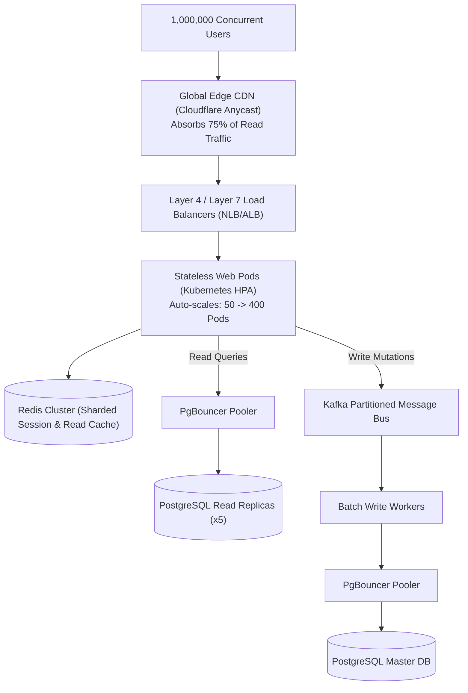

## Fast Revision (10-Second Recall)
- Scale Math: 1M concurrent users at 1 request/10s = 100,000 Requests Per Second (RPS).
- Stateless Compute: Zero in-memory session state on web pods; sessions in Redis Cluster or signed JWTs.
- Edge Offloading: CDN caches 70-80% of static/semi-static requests (Cloudflare / Fastly), shielding origin servers.
- Database Scaling: Read replicas for queries, horizontal sharding (by tenant or user ID) for writes, PgBouncer / ProxySQL for pooling.
- Asynchronous Write Decoupling: Ingest writes into Kafka / RabbitMQ to flatten peak traffic spikes.

## The 30-Second Spoken Script
"Scaling an application to support 1 million concurrent users is primarily an exercise in eliminating state, maximizing cache efficiency, and decoupling write paths.

Assuming each active user issues a request every 10 seconds, the platform must sustain 100,000 requests per second.

At the edge, we deploy a global Anycast CDN. By aggressively caching static assets, public catalog data, and user profile metadata using stale-while-revalidate headers, we offload 75% of traffic before it ever touches our cloud origins.

For the remaining 25,000 RPS reaching our origin, our API services are completely stateless and containerized on Kubernetes across multiple availability zones, autoscaling horizontally based on request concurrency metrics.

At the data tier, a single relational database cannot handle 25,000 concurrent connections. We implement connection poolers like PgBouncer, place a multi-node Redis cluster ahead of the database, and route all read queries to auto-scaling read replicas.

For heavy mutations, we decouple the write path: requests write to a distributed Kafka log in under 5 milliseconds and return HTTP 202 Accepted, allowing downstream workers to batch-insert into our database at a sustainable pace."

## Scenario / Problem Context
Design the end-to-end architecture for a live gaming and event platform that must seamlessly accommodate 1,000,000 concurrent connected users during global championship broadcasts without latency degradation or system crashes.

## Architectural Workflow / Sequence


## Deep-Dive Analysis & Root Causes
### Connection Pool Math at 100,000 RPS
If an application has 200 pod replicas and each opens 50 database connections, the database sees 10,000 open TCP connections. PostgreSQL allocates ~10MB of RAM per connection, meaning 100GB of RAM is wasted purely on connection overhead. Inserting PgBouncer or AWS RDS Proxy reduces thousands of server connections to a compact pool of 100 high-throughput pooled connections.

### The Thundering Herd Problem at Scale
When a popular cache key expires in an environment serving 50,000 RPS, hundreds of concurrent threads simultaneously discover the cache miss and hammer the primary database with identical queries. Implementing probabilistic early expiration (XFetch algorithm) or distributed mutex locks (`setnx`) ensures only 1 worker regenerates the cache while others read stale data.

### Kernel Socket & File Descriptor Tuning
At 1M concurrent connections, default Linux defaults fail immediately (`ulimit -n 1024`). Host OS parameters must be configured: `fs.file-max = 2097152`, `net.ipv4.tcp_max_syn_backlog = 65535`, and `net.ipv4.ip_local_port_range = 1024 65535`.

## Practical Debugging Commands & Code
### Redis Distributed Mutex to Prevent Cache Stampede
```typescript
// Preventing Cache Thundering Herd using Redis Mutex Lock
async function getWithCacheLock<T>(
  key: string, 
  fetchFn: () => Promise<T>, 
  ttlSeconds: number
): Promise<T> {
  const cached = await redis.get(key);
  if (cached) return JSON.parse(cached);

  const lockKey = `lock:${key}`;
  const acquired = await redis.set(lockKey, '1', 'EX', 5, 'NX');

  if (acquired) {
    try {
      const freshData = await fetchFn();
      await redis.set(key, JSON.stringify(freshData), 'EX', ttlSeconds);
      return freshData;
    } finally {
      await redis.del(lockKey);
    }
  } else {
    // Wait 100ms and retry reading cache
    await new Promise(res => setTimeout(res, 100));
    return getWithCacheLock(key, fetchFn, ttlSeconds);
  }
}
```

## Prevention & Senior Best Practices
- Proactive Load Shedding: Configure Envoy or Nginx to reject non-essential requests with HTTP 429 when CPU exceeds 85%.
- Asymmetric Regional Headroom: Pre-warm cluster capacity to 30% above expected peak load 1 hour before scheduled major events.
- Circuit Breakers on All Egress Calls: Enforce Resilience4j / Envoy circuit breakers with strict 2-second timeouts on all dependencies.
- End-to-End Synthetic Soak Testing: Run automated continuous load tests with k6 or Locust in staging simulating 1M virtual users for 4 hours.
