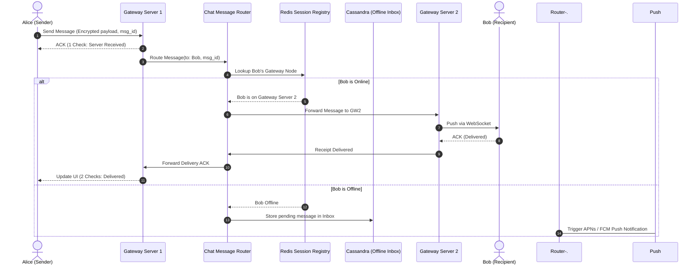

## Fast Revision (10-Second Recall)
- Scale: 2B users, 100B messages/day, ~1.2M messages/sec peak, sub-100ms delivery latency.
- Protocols: Persistent WebSocket or custom TCP/XMPP connection over TLS for bidirectional real-time push.
- Message Lifecycle: Sent (single check) -> Stored on Server -> Delivered to Device (double check) -> Read by Recipient (blue double check).
- Ephemeral Storage on Server: WhatsApp does not keep messages on server once delivered. Undelivered messages sit in queue/Cassandra until ack.
- Presence & Connection Management: Ephemeral gateway servers maintain connection tables in Redis Cluster with heartbeat pings every 30s.

## The 30-Second Spoken Script
"Designing a WhatsApp-scale messaging system requires separating the bidirectional real-time communication pipeline from media storage and user profile services.

For active messaging, clients maintain a persistent lightweight connection via WebSocket or multiplexed TCP/TLS to an edge Connection Gateway. Each gateway server manages tens of thousands of active sockets. When User A sends a message to User B, the client generates a local message ID and transmits it over the socket.

The Gateway writes the message to an ingestion queue like Kafka. The Chat Router inspects User B's presence in a distributed Redis session cache. If User B is currently connected to Gateway Node 4, the router pushes the payload to Gateway 4, which transmits it down User B's active socket. User B's client immediately sends an ACK back, updating the receipt status to double-check.

If User B is offline, the message is persisted to an inbox store like Apache Cassandra or ScyllaDB, and an Apple Push Notification (APNs) or Firebase Cloud Messaging (FCM) push notification is triggered. Once User B reconnects, their device pulls pending messages and confirms receipt, allowing the server to delete the transient payload.

Media files are never sent directly through chat sockets; clients upload encrypted blobs directly to Object Storage (S3/GCS) via pre-signed URLs and send only the 32-byte thumbnail and decryption key inside the chat stream."

## Scenario / Problem Context
Design a messaging system supporting 1 billion daily active users, 1-on-1 chats, group chats, delivery receipts (sent, delivered, read), user presence status (online/offline), and end-to-end encrypted media sharing.

## Architectural Workflow / Sequence


## Deep-Dive Analysis & Root Causes
### Connection Gateway Architecture (C10K to C1000K)
Maintaining 500 million concurrent connections requires event-driven non-blocking I/O (epoll on Linux, Netty in Java, or Erlang/Go goroutines). A single modern 64GB Linux host tuned with appropriate socket buffer memory (`sysctl net.ipv4.tcp_rmem`) can comfortably maintain 500,000 to 1,000,000 idle TCP connections.

### Group Chat Fanout: Client-Side vs Server-Side
In small groups (under 100 members), client-side fanout or server-side message replication can be used. At scale, server-side fanout decouples sender bandwidth. When Alice posts to a group of 500 members, Alice transmits once. The Group Service expands the membership list and fans out 500 discrete message deliveries asynchronously via Kafka worker pools.

### End-to-End Encryption (Signal Protocol)
WhatsApp uses the Signal Protocol with Double Ratchet key management. The application server acts purely as a dumb relay for encrypted ciphertexts. The server cannot inspect message contents, meaning spam detection must operate on user-reported hashes and metadata patterns rather than message inspection.

## Practical Debugging Commands & Code
### Linux Kernel Tuning for 1 Million TCP Sockets
```bash
# 1. Expand maximum open file descriptors
sysctl -w fs.file-max=2097152

# 2. Tune local port range and TCP memory
sysctl -w net.ipv4.ip_local_port_range="1024 65535"
sysctl -w net.ipv4.tcp_mem="786432 1048576 1572864"
sysctl -w net.ipv4.tcp_rmem="4096 87380 4194304"
sysctl -w net.ipv4.tcp_wmem="4096 16384 4194304"

# 3. Increase max socket listen backlog
sysctl -w net.core.somaxconn=65535
```

## Prevention & Senior Best Practices
- Heartbeat and Zombie Pruning: Send ping/pong frames every 30 seconds to clean up silently dropped mobile carrier TCP connections.
- Message Ordering Guarantees: Utilize Lamport timestamps or client-generated monotonic sequence numbers to resolve out-of-order network arrival.
- Offline Storage TTLs: Enforce a strict 30-day retention on offline queues; purge stale undelivered payloads to prevent database bloat.
- Circuit Breakers on Push Providers: Throttle APNs/FCM delivery workers with token bucket limits to prevent IP blacklisting.
