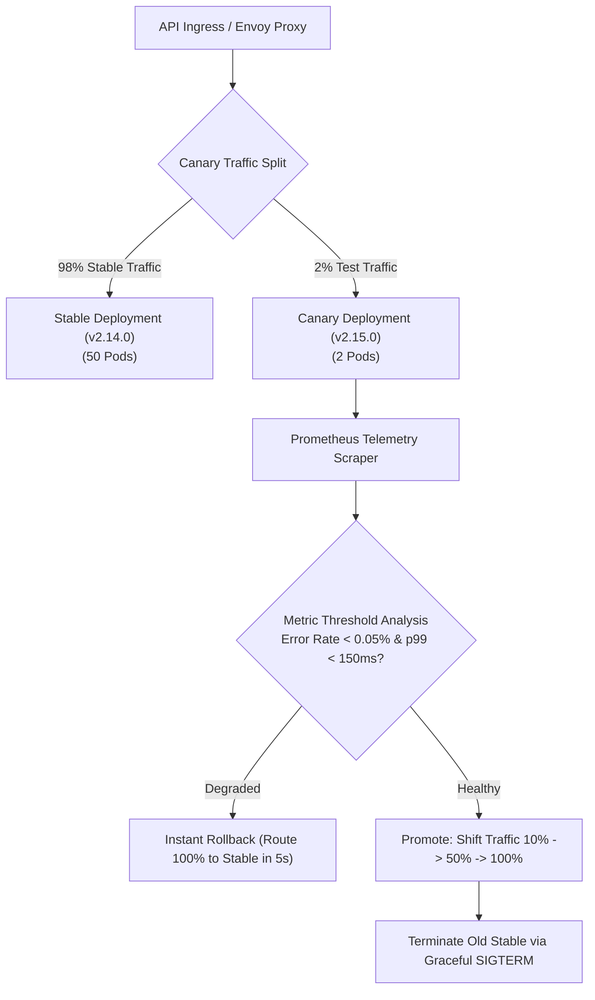

## Fast Revision (10-Second Recall)
- The 3 Modern Strategies: Rolling Update (standard K8s), Blue-Green (instant traffic switch between identical environments), Canary (progressive traffic shift 1% -> 10% -> 100%).
- The Hardest Challenge: Database Schema Migrations. Must use Expand and Contract (Parallel Run) pattern to support both old and new code simultaneously.
- Connection Draining (Graceful Shutdown): Pods catch SIGTERM, complete in-flight HTTP requests, and deregister from Load Balancer before exiting.
- Automated Rollback: Argo Rollouts / Flagger monitors Prometheus error rates and automatically aborts canary if 5xx errors increase by >0.1%.
- PreStop Hook: Delay pod termination by 5-10 seconds in Kubernetes to allow kube-proxy and Ingress to remove the pod IP from iptables.

## The 30-Second Spoken Script
"Achieving zero-downtime deployments requires synchronizing application lifecycle termination with edge proxy routing, alongside backward-compatible database migrations.

I recommend Canary Deployments with Progressive Delivery using Argo Rollouts.

When a new version ships, the pipeline deploys a Canary replica receiving exactly 2% of live production traffic. While 98% of users interact with the stable version, automated analysis monitors the canary against key SLIs: p99 latency and HTTP 5xx error percentage. If metrics remain healthy over 10 minutes, traffic progressively scales to 25%, 50%, and 100%. If error thresholds breach, Argo Rollouts automatically reverts routing within 10 seconds.

To prevent dropped requests during pod termination, we configure Kubernetes PreStop hooks and Graceful Shutdown. On SIGTERM, the pod stops accepting new connections, waits 10 seconds for iptables routing updates to propagate, and finishes all in-flight HTTP transactions before shutting down.

For the database, zero-downtime mandates the Expand-and-Contract migration pattern: database schema changes must be backward-compatible with both the old and new code versions simultaneously."

## Scenario / Problem Context
Design a continuous deployment pipeline for a high-traffic fintech platform processing 25,000 requests/second that deploys code 10 times daily with zero dropped connections, zero 502 errors, and automated rollback.

## Architectural Workflow / Sequence


## Deep-Dive Analysis & Root Causes
### The Expand and Contract Pattern for Database Migrations
You can never rename a column or delete a column in a single migration during zero-downtime deployments. Phase 1 (Expand): Add the new column `full_name` while keeping `first_name` and `last_name`; code writes to both columns. Phase 2: Deploy code reading from `full_name`. Phase 3: Backfill historical rows. Phase 4 (Contract): Drop the deprecated columns in a subsequent release.

### The Kubernetes Pod Termination Race Condition
When `kubectl delete pod` runs, two events happen in parallel: Kubelet sends SIGTERM to the container, and the Endpoints controller removes the pod IP from the Service. Because iptables updates take 2-5 seconds to propagate across all cluster nodes, ingress proxies will continue routing new requests to the dying pod, generating 502 Bad Gateway errors. Adding a `preStop: exec: command: ["sleep", "10"]` gives iptables time to drain before the process stops listening.

### Blue-Green vs Canary Cost Trade-Off
Blue-Green requires provisioning 2x the entire production infrastructure (Blue and Green environments running simultaneously), which doubles infrastructure hosting costs. Canary deployments run within the existing cluster footprint, scaling canary pods up while scaling stable pods down, achieving zero-downtime at 0% additional infrastructure cost.

## Practical Debugging Commands & Code
### Kubernetes Pod Spec with Graceful Shutdown & PreStop Hook
```bash
# Kubernetes Deployment Spec for Zero-Downtime Graceful Drain
apiVersion: apps/v1
kind: Deployment
metadata:
  name: order-service
spec:
  replicas: 20
  strategy:
    rollingUpdate:
      maxSurge: 25%
      maxUnavailable: 0 # Never allow capacity to drop below 100%!
  template:
    spec:
      terminationGracePeriodSeconds: 45
      containers:
        - name: app
          image: order-service:v2.15.0
          lifecycle:
            preStop:
              exec:
                command: ["/bin/sh", "-c", "sleep 10"] # Wait for iptables drain
          readinessProbe:
            httpGet:
              path: /healthz
              port: 8080
            initialDelaySeconds: 5
            periodSeconds: 3
```

## Prevention & Senior Best Practices
- Never Allow maxUnavailable > 0: Configure rolling updates with `maxUnavailable: 0` to ensure peak traffic capacity is never degraded during deployments.
- Mandatory preStop Sleep Hook: Always add a 5-to-10 second preStop sleep to allow kube-proxy and load balancer endpoint propagation.
- Backward-Compatible API Versioning: Support previous API schemas (`/v1` and `/v2`) concurrently to prevent breaking older mobile clients.
- Automated Synthetic Smoke Probes: Run automated end-to-end integration tests against canary pods before directing customer traffic.
