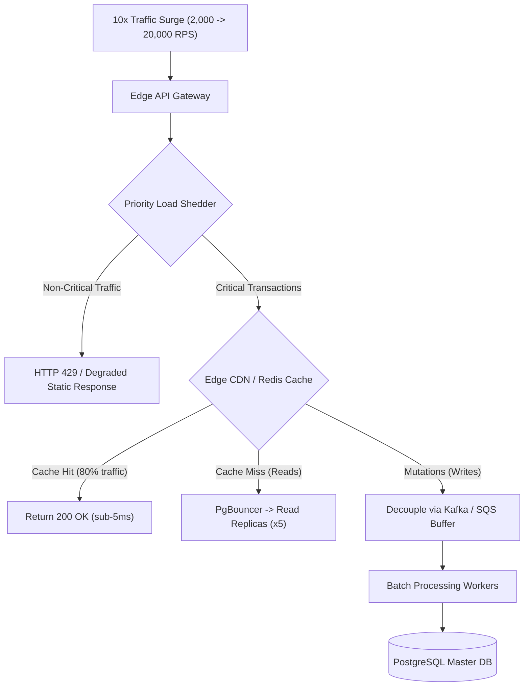

## Fast Revision (10-Second Recall)
- Immediate Triaging (First 15 mins): Identify bottleneck layer (Edge, App Compute, DB Connections, Disk I/O).
- Edge Load Shedding: Drop non-critical traffic (recommendations, analytics) with HTTP 429 at API Gateway to protect checkout/core API.
- Aggressive Cache Offloading: Introduce Stale-While-Revalidate caching at CDN and Redis to absorb 80% of read traffic.
- Database Emergency Relief: Add read replicas immediately, configure PgBouncer / RDS Proxy, and kill long-running analytical queries.
- Asynchronous Write Buffering: Wrap write-heavy endpoints in message queues (Kafka / SQS) and return HTTP 202 Accepted.

## The 30-Second Spoken Script
"When traffic surges by 10x unexpectedly, my objective is to protect system availability through disciplined triage, aggressive edge caching, and database shielding.

First, I stabilize the core system by enabling load shedding at the API Gateway: we prioritize revenue-critical requests (like logins and payments) and shed non-essential background traffic (like reviews or recommendations) using HTTP 429 and rate limiters.

Second, I offload the read path: In 90% of web systems, 80% of traffic is read-only. We configure our CDN with aggressive cache-control and stale-while-revalidate headers, and scale up our Redis cache clusters. For queries that must hit the database, we spin up additional read replicas and route read traffic through connection poolers like PgBouncer.

Third, for the compute layer, we increase Kubernetes HPA limits and expand the underlying cloud node pool. Because our services are stateless, scaling from 20 to 200 pods takes minutes.

Fourth, to protect the primary database master from write saturation, we decouple synchronous write operations: instead of executing heavy inserts inline, we enqueue write payloads into Kafka or SQS, returning HTTP 202 Accepted to clients and allowing background workers to process transactions smoothly."

## Scenario / Problem Context
Following a viral television feature and global marketing campaign, traffic to your SaaS platform jumps from 2,000 requests/second to 20,000 requests/second within 30 minutes. Database CPU is at 98%, response times have jumped to 8 seconds, and 504 Gateway Timeouts are spiking.

## Architectural Workflow / Sequence


## Deep-Dive Analysis & Root Causes
### Priority Load Shedding vs Complete System Outage
When incoming demand exceeds server capacity by 500%, attempting to serve every request guarantees that all requests fail due to timeout cascades. Load shedding at the edge drops low-priority endpoints (e.g., social feeds, avatar updates) with HTTP 429, reserving 100% of thread pool and database capacity for critical transactions (logins, checkout).

### Database Connection Multiplication Trap
If you scale Kubernetes compute pods by 10x (from 20 to 200 pods) and each pod opens 30 database connections, the database instantly faces 6,000 open connections. The database will crash from connection management overhead alone. Deploying PgBouncer or AWS RDS Proxy between the application and database is mandatory before scaling compute pods.

### Stale-While-Revalidate Caching
During extreme load, setting `Cache-Control: public, max-age=60, stale-while-revalidate=300` allows the CDN to serve slightly stale content instantly while a single background request refreshes the cache from the origin, reducing origin hits by 98%.

## Practical Debugging Commands & Code
### Emergency Kubernetes Autoscaling & Node Pool Expansion
```bash
# 1. Emergency scale out deployment replicas immediately
kubectl scale deployment/api-service --replicas=100 -n prod

# 2. Update HPA maximum threshold
kubectl patch hpa api-service-hpa -n prod --type='json' -p='[
  {"op": "replace", "path": "/spec/maxReplicas", "value": 250}
]'

# 3. Kill blocking / slow queries on PostgreSQL primary
SELECT pg_terminate_backend(pid)
FROM pg_stat_activity
WHERE state != 'idle' 
  AND query_start < NOW() - INTERVAL '10 seconds'
  AND pid <> pg_backend_pid();
```

## Prevention & Senior Best Practices
- Pre-Configured Load Shedding Rules: Maintain pre-tested gateway rate-limiting configurations ready to activate with a single feature flag toggle.
- Elastic Compute Node Groups: Configure cloud autoscaling groups (ASGs) with multiple instance types across multiple AZs to prevent EC2 capacity shortages.
- Read/Write Splitting at ORM Layer: Configure data access libraries (Prisma, TypeORM, Hibernate) with dedicated read-replica endpoints from day one.
- Regular 10x Load Testing: Run automated chaos and stress tests quarterly in staging to identify the next architectural bottleneck before it happens in production.
