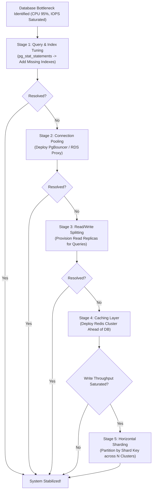

## Fast Revision (10-Second Recall)
- The 5 Escalation Stages: 1) Query & Index Optimization; 2) Connection Pooling (PgBouncer); 3) Read Replicas & CQRS; 4) In-Memory Caching (Redis); 5) Horizontal Sharding / Partitioning.
- Stage 1 (Indexes): Identify slow queries using `pg_stat_statements`; add composite, covering, or partial indexes.
- Stage 2 (Connection Pooling): Eliminate connection churn and context-switching overhead using proxy poolers.
- Stage 3 (Read Replicas): Offload analytical and read queries to streaming replicas; master only handles writes.
- Stage 4 (Caching): Cache-Aside pattern in Redis with strict TTLs and change-data-capture (CDC) invalidation.
- Stage 5 (Sharding): Partition data across multiple physical database instances by Shard Key (e.g., `tenant_id` or `user_id`).

## The 30-Second Spoken Script
"When a relational database becomes the primary system bottleneck, jumping straight to complex distributed sharding is an expensive mistake. I follow a disciplined 5-stage optimization hierarchy:

Stage 1 is Query and Index Optimization: We inspect pg_stat_statements to identify the top 5 queries consuming the most total execution time. In over 60% of production incidents, adding a covering composite index or eliminating an unindexed sequential scan instantly resolves the bottleneck.

Stage 2 is Connection Management: We install PgBouncer or AWS RDS Proxy to decouple client threads from physical database connections, preventing connection pool exhaustion and memory bloat.

Stage 3 is Read/Write Segregation: We provision read replicas and update our data access layer to direct all search and read queries to replicas, reserving 100% of master CPU for write transactions.

Stage 4 is Caching: We introduce a distributed Redis cluster using the Cache-Aside pattern, caching frequently read entities and absorbing 80% of database read traffic.

Stage 5, if write volume saturates the master, is Horizontal Sharding: We partition data across multiple independent database clusters using a consistent hash of the tenant_id or user_id."

## Scenario / Problem Context
Your application has scaled to 5 million users. The primary PostgreSQL database CPU is pinned at 95%, disk I/O latency has climbed from 2ms to 65ms, and database deadlocks are causing customer transactions to fail.

## Architectural Workflow / Sequence


## Deep-Dive Analysis & Root Causes
### The Danger of Premature Sharding
Sharding introduces massive operational complexity: cross-shard joins become impossible, distributed transactions require two-phase commit, and schema migrations become operational nightmares. 95% of database bottlenecks can be resolved through indexing, connection pooling, read replicas, and caching without ever needing to shard.

### Covering Indexes and Index-Only Scans
When an index contains all columns requested by a query (`CREATE INDEX idx_orders ON orders(user_id) INCLUDE (status, total_amount);`), PostgreSQL performs an Index-Only Scan. The database satisfies the entire query directly from the RAM index without reading the underlying table heap pages from disk, cutting I/O by 90%.

### Choosing a Shard Key
When sharding becomes inevitable, choosing the wrong Shard Key creates unbalanced hot shards. Good shard keys have high cardinality and uniform distribution (e.g., `tenant_id` for B2B SaaS, or `user_id` for consumer apps). Never shard by monotonic timestamps, as 100% of write traffic will hit the newest shard.

## Practical Debugging Commands & Code
### PostgreSQL Top Bottleneck Query Identification
```bash
# Identify top 5 queries consuming the most total execution time
SELECT round(total_exec_time::numeric, 2) AS total_time_ms,
       calls,
       round(mean_exec_time::numeric, 2) AS mean_time_ms,
       round((100 * total_exec_time / sum(total_exec_time) OVER ())::numeric, 2) AS percentage_cpu,
       query
FROM pg_stat_statements
ORDER BY total_exec_time DESC
LIMIT 5;
```

## Prevention & Senior Best Practices
- Automated Query Explain Gates in CI: Run EXPLAIN ANALYZE on new pull request queries to catch sequential table scans before merging.
- Strict Statement Timeouts: Configure `statement_timeout = 3000` (3 seconds) to automatically terminate runaway unindexed queries.
- Proactive IOPS Provisioning: Provision GP3 or io2 storage with sufficient IOPS headroom to prevent storage queue thrashing.
- Read Replica Lag Monitoring: Alert when replica replication lag exceeds 5 seconds to prevent stale data reads.
