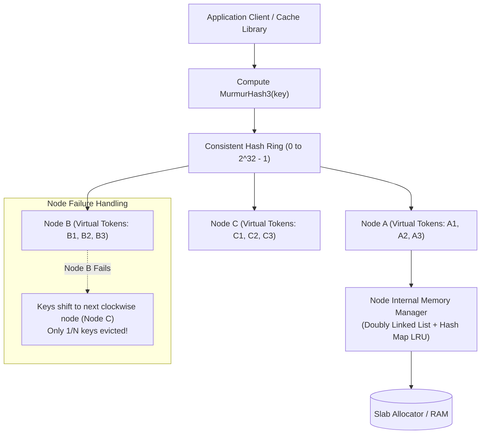

## Fast Revision (10-Second Recall)
- Core Problem: Distributing gigabytes of key-value pairs across N cache nodes without re-hashing all keys when nodes join or leave.
- Consistent Hashing: Maps keys and nodes onto a circular hash ring (0 to 2^32 - 1). Adding/removing a node only relocates `k / N` keys.
- Virtual Nodes (Replicas): Each physical node maps to 100-250 virtual nodes on the ring to prevent unbalanced load hotspots.
- Eviction Algorithms: LRU (Least Recently Used - linked hash map), LFU (Least Frequently Used - min-heap), FIFO, and Random.
- Cache Topologies: Cache-Aside (Lazy loading), Write-Through, Write-Behind (Write-Back), Refresh-Ahead.

## The 30-Second Spoken Script
"When designing a distributed caching system like Redis Cluster or distributed Memcached, the primary challenge is achieving uniform data distribution and sub-millisecond retrieval while gracefully handling node additions and failures.

To distribute keys without a single centralized coordinator bottleneck, we use Consistent Hashing with Virtual Nodes.

Instead of traditional modular hashing?where adding a server invalidates 90% of cached keys?Consistent Hashing maps both cache nodes and keys onto a circular hash ring using MurmurHash3. A key is assigned to the first node encountered clockwise on the ring.

To ensure uniform load and prevent data skew, each physical server is represented by 150 virtual nodes scattered across the ring. When a node is added or fails, only a fraction of keys (k/N) need to be reassigned, leaving the rest of the cache intact.

At the node level, memory is managed via an optimized Least Recently Used (LRU) eviction algorithm backed by a hash map and doubly-linked list.

For write operations, we implement the Cache-Aside pattern with a distributed delete-on-update strategy, complemented by a short TTL to ensure eventual consistency with the primary database."

## Scenario / Problem Context
Design a distributed in-memory cache capable of storing 500 million keys (2TB total RAM), sustaining 1,000,000 read operations per second with sub-2ms latency, dynamic node autoscaling, and zero single points of failure.

## Architectural Workflow / Sequence


## Deep-Dive Analysis & Root Causes
### Consistent Hashing vs Modulo Hashing Math
With traditional hashing (`hash(key) % N`), changing `N` from 10 to 11 changes the target node for ~91% of all keys, causing a catastrophic cache stampede that knocks over the underlying database. With Consistent Hashing, adding a node only relocates $1 / (N+1)$ of the total keys, preserving 90%+ of the warm cache.

### Virtual Nodes (Preventing Non-Uniform Key Clustering)
Randomly placing 5 physical nodes on a hash ring results in uneven segment sizes, causing one node to absorb 60% of total traffic (the hot node problem). Mapping each physical node to 200 virtual points on the ring guarantees that keys are distributed evenly with standard deviation under 5%.

### Slab Allocation (Eliminating RAM Fragmentation)
Continuously allocating and freeing arbitrary memory chunks causes severe operating system memory fragmentation, leading to premature OOM crashes. Distributed caching systems like Memcached pre-allocate memory into fixed-size "Slabs" (e.g., 64 bytes, 128 bytes, 256 bytes), achieving zero memory allocation overhead during runtime.

## Practical Debugging Commands & Code
### Consistent Hashing Ring Implementation in TypeScript
```typescript
// Consistent Hashing with Virtual Nodes
import crypto from 'crypto';

export class ConsistentHashRing {
  private ring: Map<number, string> = new Map();
  private sortedKeys: number[] = [];

  constructor(private virtualNodes: number = 100) {}

  private hash(val: string): number {
    return crypto.createHash('md5').update(val).digest().readUInt32BE(0);
  }

  public addNode(node: string): void {
    for (let i = 0; i < this.virtualNodes; i++) {
      const vNodeKey = `${node}#vnode${i}`;
      const hashVal = this.hash(vNodeKey);
      this.ring.set(hashVal, node);
      this.sortedKeys.push(hashVal);
    }
    this.sortedKeys.sort((a, b) => a - b);
  }

  public getNode(key: string): string | undefined {
    if (this.ring.size === 0) return undefined;
    const hashVal = this.hash(key);
    for (const token of this.sortedKeys) {
      if (hashVal <= token) return this.ring.get(token);
    }
    return this.ring.get(this.sortedKeys[0]); // Wrap around ring
  }
}
```

## Prevention & Senior Best Practices
- Cache Stampede Protection: Use probabilistic early expiration (XFetch algorithm) so background threads recompute cache before TTL expiry.
- Hot Key Splitting: Detect viral keys and replicate them across multiple sub-keys (`key#1`, `key#2`... `key#10`) to distribute network socket bandwidth.
- Circuit Breaker on Cache Misses: If the database is under pressure, rate-limit cache-miss queries to protect the primary database.
- Sufficient Memory Headroom: Configure `maxmemory` at 75% of physical RAM to allow headroom for background memory compaction and replication buffers.
