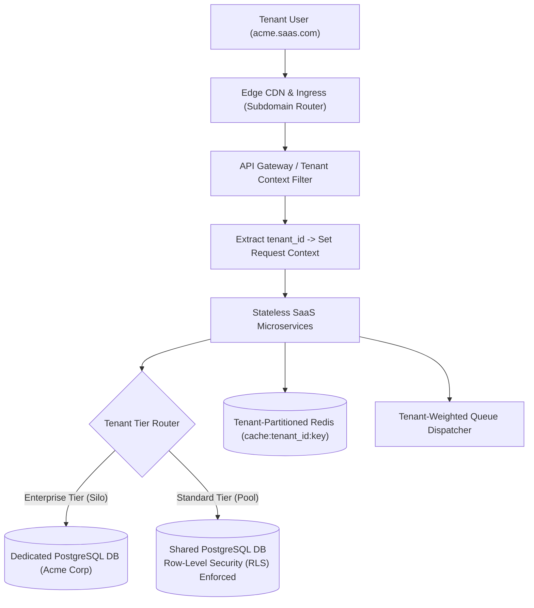

## Fast Revision (10-Second Recall)
- Tenant Isolation Models: Silo (separate DB per tenant - high isolation, high cost), Pool (shared DB with `tenant_id` column - low cost, noisy neighbor risk), Hybrid / Bridge (shared for SMBs, isolated DB for Enterprise).
- Noisy Neighbor Problem: One heavy tenant monopolizing shared database CPU and connection pools; solved via per-tenant rate limits and dynamic queue priority.
- Data Leakage Prevention: PostgreSQL Row-Level Security (RLS) automatically enforces `tenant_id = current_setting('app.current_tenant')` on all queries.
- Custom Domains & SSL: Automated SSL provisioning at the edge via Cloudflare for SaaS or AWS ACM with wildcard CNAME routing.
- Tenant Context Propagation: Extract tenant from JWT or subdomain (`tenant.saas.com`) and inject into thread-local / async storage context on every request.

## The 30-Second Spoken Script
"When designing a multi-tenant B2B SaaS application, the primary engineering challenges are guaranteeing strict data isolation, preventing noisy neighbor degradation, and scaling database infrastructure cost-effectively.

For our database architecture, I adopt a Hybrid Isolation Model. For standard SMB tenants, we use a shared database with PostgreSQL Row-Level Security (RLS), where every table contains a tenant_id column and the database engine automatically restricts queries to the active tenant session. For top-tier enterprise clients with strict compliance mandates, we provision dedicated database instances (the Silo model).

To prevent the Noisy Neighbor problem?where one large tenant running bulk CSV exports saturates shared database connection pools?we implement two guardrails: First, per-tenant rate limits at the API Gateway; second, isolated tenant worker queues so heavy batch jobs from Tenant A never delay real-time jobs from Tenant B.

At the application layer, tenant identification occurs at the gateway via subdomain routing (tenant.saas.com) or verified JWT claims. A global interceptor injects the tenant context into request-scoped storage, ensuring all downstream database queries, cache keys, and audit logs are scoped automatically."

## Scenario / Problem Context
Design an enterprise SaaS platform serving 10,000 business tenants, ranging from 5-person startups to Fortune 500 enterprises with 50,000 seats, with strict data privacy guarantees, customizable subdomains, and zero cross-tenant data leakage.

## Architectural Workflow / Sequence


## Deep-Dive Analysis & Root Causes
### PostgreSQL Row-Level Security (RLS) as a Failsafe
Relying on application developers to remember `WHERE tenant_id = :tenant_id` on every SQL query is dangerous?a single omitted clause causes a catastrophic cross-tenant data breach. Enabling PostgreSQL RLS enforces isolation at the database kernel level: `CREATE POLICY tenant_isolation_policy ON orders USING (tenant_id = current_setting('app.current_tenant_id')::uuid);`. If a query omits the clause, the database filters automatically.

### The Noisy Neighbor Defense Matrix
A massive tenant querying 500,000 records can exhaust the database connection pool, starving all other tenants. Mitigations include: 1) Connection pool quotas per tenant; 2) Fair-share queue workers (round-robin dequeue by tenant); 3) Read replica offloading for reporting queries.

### Tenant-Aware Caching Key Hygiene
In shared Redis clusters, forgetting the tenant prefix causes one tenant to read another tenant's cached sensitive data. All cache keys must follow an immutable namespaced template: `${tenant_id}:${entity}:${id}`.

## Practical Debugging Commands & Code
### PostgreSQL Row-Level Security (RLS) Configuration
```sql
-- 1. Enable RLS on the table
ALTER TABLE accounts ENABLE ROW LEVEL SECURITY;

-- 2. Create the tenant isolation policy
CREATE POLICY tenant_isolation_policy ON accounts
    FOR ALL
    USING (tenant_id = current_setting('app.current_tenant_id')::UUID);

-- 3. Application sets the session variable on acquiring connection
SET LOCAL app.current_tenant_id = 'a1b2c3d4-e5f6-7a8b-9c0d-1e2f3a4b5c6d';

-- 4. Query executes with automatic tenant filtering
SELECT * FROM accounts; -- Only returns rows matching current_tenant_id!
```

## Prevention & Senior Best Practices
- Automated Multi-Tenant Isolation Tests: Run automated security suites in CI that explicitly attempt cross-tenant ID access and verify HTTP 403 / empty results.
- Per-Tenant Resource Budgets: Enforce per-tenant concurrency limits on background queues and report generation jobs.
- Automated Custom Domain SSL: Use Let's Encrypt / Cloudflare for SaaS to automate TLS certificate issuance and renewal for custom tenant domains.
- Independent Encryption Keys: Provide enterprise tenants with Bring Your Own Key (BYOK) envelope encryption via AWS KMS.
