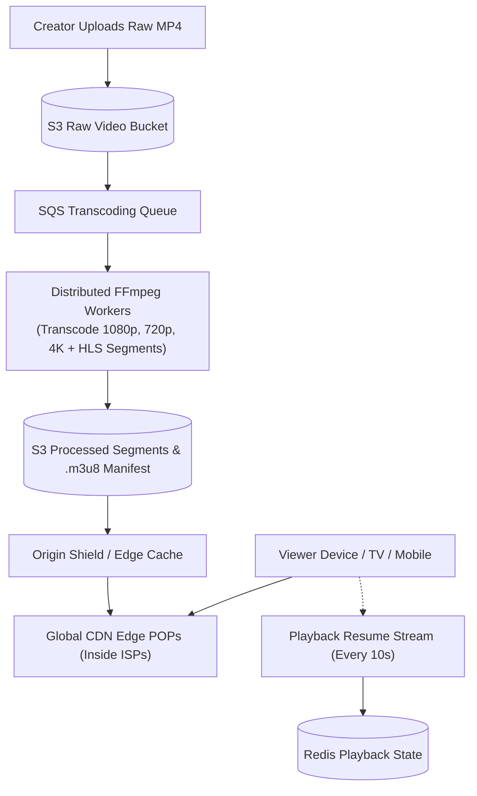

## Fast Revision (10-Second Recall)
- Core Protocols: HLS (HTTP Live Streaming) and MPEG-DASH split video into 2-to-6 second `.ts`/`.m4s` chunks with an `.m3u8` master manifest playlist.
- Adaptive Bitrate (ABR): Client player dynamically switches video resolution (360p, 720p, 1080p, 4K) based on measured network bandwidth.
- Transcoding Pipeline: Upload raw MP4 -> S3 -> SQS -> FFmpeg Distributed Transcoder cluster (split chunks and encode in parallel) -> S3.
- CDN Edge Delivery: 95%+ of video bytes are served directly from edge CDN Points of Presence (POPs) located inside ISP networks (Open Connect / Cloudflare).
- Metadata & Resume State: Store video metadata in Cassandra/DynamoDB; store current playback timestamp in Redis with periodic 10-second sync.

## The 30-Second Spoken Script
"When designing a video streaming platform like Netflix or YouTube, the primary architectural challenge is ingesting and transcoding massive video files and serving billions of hours of streaming data with zero buffering.

The system is split into two major pipelines: Ingestion & Transcoding, and Streaming Delivery.

In the ingestion pipeline, the creator uploads a raw video file directly to S3 via pre-signed multipart URLs. An S3 upload event queues a job in Kafka. Distributed worker nodes running FFmpeg split the video into parallel chunks, transcoding each chunk into multiple bitrates (360p up to 4K) and codecs (H.264, HEVC, AV1). The workers generate an HLS master manifest playlist (.m3u8) linking to 4-second .ts video segments.

For streaming delivery, clients never stream directly from origin servers. When a user hits play, the player fetches the master manifest. Based on the viewer's network bandwidth, the player requests the optimal bitrate chunk.

Over 95% of video chunks are delivered via a global CDN or custom edge appliance network (like Netflix Open Connect), deployed directly within regional Internet Service Provider networks.

User resume timestamps and view counts are streamed asynchronously into Redis and ClickHouse to avoid overloading relational databases."

## Scenario / Problem Context
Design a video streaming platform supporting 100 million daily active users, 1 billion daily video views, multi-device adaptive bitrate streaming, sub-second playback start times, and high upload throughput.

## Architectural Workflow / Sequence


## Deep-Dive Analysis & Root Causes
### Adaptive Bitrate Streaming (ABR) Mechanics
Streaming a single monolithic 4GB MP4 file fails on mobile networks because any bandwidth dip freezes playback. HLS breaks video into 4-second `.ts` chunks. The `.m3u8` playlist file lists chunk URLs for various bitrates. The client player measures chunk download speed: if download speed drops, the player seamlessly fetches the next 4-second chunk from the 480p stream instead of 1080p, preventing playback stalls.

### Distributed Video Transcoding at Scale
Transcoding a 2-hour 4K movie sequentially on a single node takes 4 hours. Modern systems split raw video files at keyframe (I-frame) boundaries into 30-second segments. 50 parallel FFmpeg worker containers process the segments concurrently in 3 minutes, after which a stitcher node generates the master playlist.

### CDN Edge Caching and ISP Peering (Netflix Open Connect)
Transporting petabytes of video over public transit backbones is prohibitively expensive and introduces latency. Major streaming services install proprietary storage and caching appliances directly inside ISP data centers. When an ISP customer watches a movie, data travels across the local metropolitan fiber loop rather than the public internet.

## Practical Debugging Commands & Code
### FFmpeg HLS Chunking & Manifest Generation Command
```bash
# Transcode input video into multi-bitrate HLS with 4-second chunks
ffmpeg -i input.mp4 \
  -filter_complex \
  "[0:v]split=2[v1][v2]; \
   [v1]scale=w=1280:h=720[v1out]; \
   [v2]scale=w=1920:h=1080[v2out]" \
  -map "[v1out]" -c:v:0 libx264 -b:v:0 2500k -maxrate:v:0 2675k -bufsize:v:0 3750k \
  -map "[v2out]" -c:v:1 libx264 -b:v:1 5000k -maxrate:v:1 5350k -bufsize:v:1 7500k \
  -map a:0 -c:a aac -b:a 128k \
  -f hls -hls_time 4 -hls_playlist_type vod \
  -master_pl_name master.m3u8 \
  -hls_segment_filename "stream_%v/data%03d.ts" stream_%v/playlist.m3u8
```

## Prevention & Senior Best Practices
- Origin Shielding: Place an intermediate Origin Shield layer between regional edge CDNs and S3 origins to eliminate thundering herd egress costs.
- DRM and Token Authentication: Sign chunk requests with short-lived HMAC tokens to prevent hotlinking and unauthorized stream leeching.
- Pre-Fetching First Chunks: Pre-load the first 2 chunks (8 seconds) of video in low resolution when a user hovers over a thumbnail to achieve 0ms perceived latency.
- S3 Intelligent-Tiering: Automatically archive non-viral, long-tail video catalogs to S3 Glacier Flexible Recovery.
