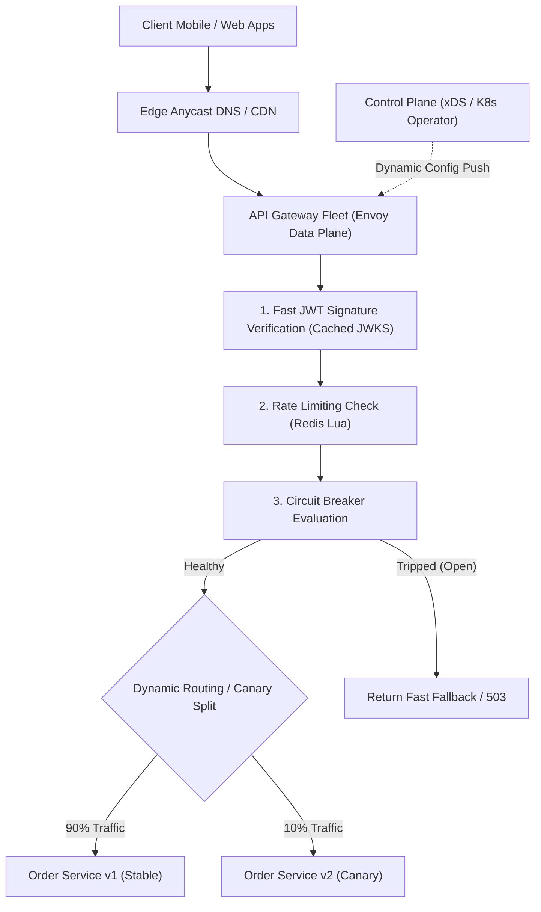

## Fast Revision (10-Second Recall)
- Primary Responsibilities: Reverse proxy, SSL/TLS termination, Authentication verification, Rate limiting, Load balancing, Circuit breaking, Observability injection.
- Architecture Engine: Non-blocking asynchronous event loop (Envoy C++, Nginx/OpenResty, or Netty); never thread-per-request.
- Configuration Plane vs Data Plane: Control Plane (watches Kubernetes Service Discovery, pushes dynamic routing via xDS API) vs Data Plane (Envoy proxies traffic with 0 downtime).
- Latency Overhead: Gateway must add under 2ms of processing overhead per request.
- Security: WAF inspection (OWASP Top 10), CORS headers, API key validation, and mTLS to upstream internal services.

## The 30-Second Spoken Script
"When designing an enterprise API Gateway like Kong, Zuul, or an Envoy-based control plane, the primary requirement is providing centralized cross-cutting concerns with sub-2 millisecond latency overhead.

I decouple the gateway into two architectural layers: the Control Plane and the Data Plane.

The Data Plane consists of stateless Envoy or OpenResty proxy instances. Using an asynchronous, non-blocking event-driven architecture, each proxy node handles tens of thousands of concurrent connections with minimal memory footprint.

The Control Plane monitors Kubernetes API server endpoints and service discovery registries. Whenever a microservice scales or deploys, the control plane dynamically pushes updated routing tables, SSL certificates, and rate limit rules down to the data plane using Envoy's dynamic xDS streaming APIs without requiring process restarts.

As requests enter, the gateway terminates TLS, inspects headers for DDoS/WAF protection, checks JWT signatures in local memory using a cached JWKS key, evaluates rate limiting quotas against a Redis Cluster, and injects W3C distributed trace headers.

If an upstream service slows down, gateway-level circuit breakers trip open immediately, returning cached fallbacks or fast 503 errors to prevent connection exhaustion."

## Scenario / Problem Context
Design a unified API Gateway capable of routing 500,000 requests per second across 200 backend microservices, handling TLS termination, token authentication, rate limiting, and dynamic canary traffic splitting.

## Architectural Workflow / Sequence


## Deep-Dive Analysis & Root Causes
### The Control Plane vs Data Plane Separation (Envoy xDS)
Traditional reverse proxies required editing a config file and running `nginx -s reload`, which drops long-lived WebSockets and spikes CPU. Modern gateways use Envoy's xDS API (LDS, RDS, CDS, EDS). The control plane streams configuration updates over gRPC. The data plane updates its in-memory routing tables atomically with zero packet drops or connection resets.

### Local JWT Verification vs Auth Sub-Requests
Routing every incoming API request to an internal `/auth/verify` endpoint doubles internal network traffic and creates a massive single point of failure. Modern gateways verify RS256/Ed25519 JWT signatures directly in the gateway worker process using cached public keys, achieving sub-millisecond authentication with zero downstream network calls.

### Dynamic Canary Traffic Shifting
The gateway supports weighted routing at the route level: `v1: 95%, v2: 5%`. By inspecting headers (e.g., `x-user-tier: beta`), the gateway routes specific beta cohorts to experimental service deployments without requiring application-level logic.

## Practical Debugging Commands & Code
### Envoy Gateway Dynamic Route Configuration (YAML)
```yaml
# Envoy Route Configuration with Weighted Cluster Canary Split
route_config:
  name: dynamic_api_routes
  virtual_hosts:
    - name: api_service
      domains: ["api.example.com"]
      routes:
        - match: { prefix: "/api/v1/orders" }
          route:
            weighted_clusters:
              clusters:
                - name: orders_service_v1
                  weight: 90
                - name: orders_service_v2_canary
                  weight: 10
            timeout: 2.5s
            retry_policy:
              retry_on: "5xx,connect-failure,refused-stream"
              num_retries: 2
```

## Prevention & Senior Best Practices
- Bounded Request Buffer Sizes: Set strict `client_max_body_size` (e.g., max 2MB) to prevent memory exhaustion from large payload floods.
- mTLS to Upstream Services: Terminate public TLS at the gateway and use mutual TLS (mTLS) via Istio/Linkerd to secure traffic within the internal VPC.
- Timeout Harmonization: Ensure Gateway client timeouts are strictly shorter than upstream cloud load balancer timeouts to avoid dangling socket leaks.
- Graceful Drain on Termination: Configure a 30-second connection drain grace period before shutting down gateway pods during deployments.
