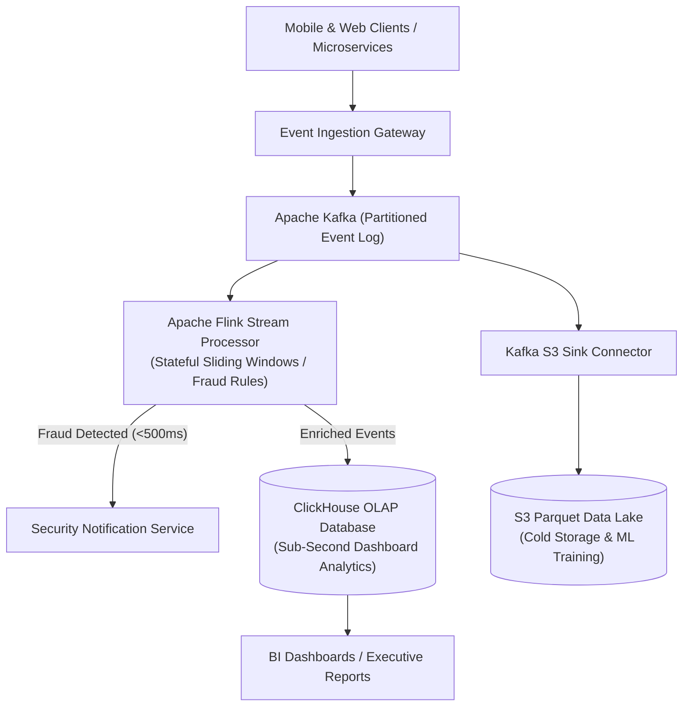

## Fast Revision (10-Second Recall)
- Scale: 100M events/day = ~1,200 events/sec average, peak 10,000-20,000 events/sec.
- Core Architectural Patterns: Kappa Architecture (single stream processing engine like Flink) vs Lambda Architecture (separate batch + speed layer).
- Ingestion Buffer: Apache Kafka or AWS Kinesis partitioned by `entity_id` to guarantee in-order delivery per entity.
- Stream Processing: Apache Flink or Kafka Streams for stateful tumbling / sliding window aggregations.
- Serving Store: Columnar OLAP database (ClickHouse / Pinot / Snowflake) optimized for sub-second analytical queries.

## The 30-Second Spoken Script
"When designing a system to process hundreds of millions of events per day, the primary objective is decoupling high-throughput ingestion from real-time stream aggregation and cold analytical storage.

I employ the Kappa Architecture, which uses a unified stream processing pipeline for both real-time alerts and historical replay.

Events enter through a lightweight Ingestion Gateway which performs schema validation using Apache Avro and publishes messages to Apache Kafka. The Kafka topic is partitioned by entity ID (e.g., user_id or device_id) to guarantee strict message ordering per entity while enabling parallel horizontal scaling across consumer partitions.

For stream processing, Apache Flink consumes the Kafka stream, maintaining stateful sliding window aggregations (such as detecting 5 failed payment attempts within a 2-minute window for fraud detection).

Aggregated and raw events are sinked in micro-batches to ClickHouse, a high-performance columnar database, allowing our business intelligence and security teams to execute analytical SQL queries over billions of rows in under 200 milliseconds.

Finally, raw event streams are archived to compressed Parquet files on Amazon S3 for long-term audit compliance and machine learning model training."

## Scenario / Problem Context
Design a financial fraud and user analytics event engine ingesting 200 million user events per day, providing real-time anomaly detection under 500ms, and sub-second SQL dashboard queries over 1 year of history.

## Architectural Workflow / Sequence


## Deep-Dive Analysis & Root Causes
### Kafka Partitioning and In-Order Guarantees
Kafka guarantees strict message ordering ONLY within a single partition. If events from the same customer account are distributed randomly across 32 partitions, an "Account Closed" event can be processed before an "Account Funded" event. Setting `partition_key = customer_id` guarantees that all events for a given customer arrive on the same partition sequentially.

### Kappa Architecture vs Lambda Architecture
Lambda architecture requires maintaining two distinct codebases: a batch layer (Hadoop/Spark) for correctness, and a speed layer (Storm/Flink) for low latency. In Kappa Architecture, everything is treated as a stream using a modern stream processor (Apache Flink). Historical reprocessing is simply done by resetting the Kafka consumer offset to zero.

### Columnar Storage Optimization (ClickHouse vs PostgreSQL)
Executing `SELECT avg(transaction_amount) FROM events WHERE date = today` on PostgreSQL requires scanning every row and column, taking minutes. ClickHouse is columnar: it physically reads ONLY the `transaction_amount` column from disk, utilizing SIMD vector instructions to aggregate 100 million rows in 40 milliseconds.

## Practical Debugging Commands & Code
### Kafka Producer with Avro Schema Validation in Node.js
```typescript
// High-throughput Kafka producer with idempotent delivery
import { Kafka, CompressionTypes } from 'kafkajs';

const kafka = new Kafka({ clientId: 'analytics-producer', brokers: ['kafka:9092'] });
const producer = kafka.producer({ idempotent: true, maxInFlightRequests: 5 });

export async function sendAnalyticsEvent(userId: string, eventType: string, payload: object) {
  await producer.send({
    topic: 'user-behavior-events',
    compression: CompressionTypes.GZIP,
    messages: [
      {
        key: userId, // Ensures in-order processing per user
        value: JSON.stringify({
          eventType,
          timestamp: Date.now(),
          payload
        })
      }
    ]
  });
}
```

## Prevention & Senior Best Practices
- Idempotent Event Producers: Enable `enable.idempotence=true` in Kafka producers to eliminate duplicate messages caused by network reconnects.
- Avro / Protobuf Schema Registry: Use Confluent Schema Registry to enforce backward and forward schema compatibility, preventing malformed events from breaking consumers.
- Micro-Batching Sinks: Never insert events row-by-row into ClickHouse; buffer events and write in batches of 10,000 to avoid file-system part explosion.
- Dead-Letter Processing: Route corrupted or un-parseable event payloads to a dedicated DLQ topic with automated alerting for engineering triage.
