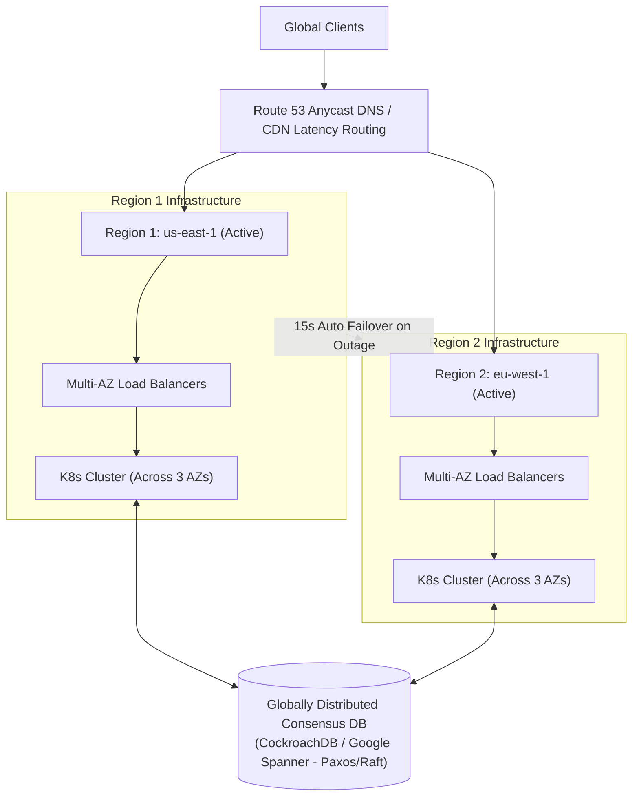

## Fast Revision (10-Second Recall)
- Downtime Math: 99.9% (Three Nines) = 8.76 hours/yr; 99.99% (Four Nines) = 52.6 minutes/yr; 99.999% (Five Nines) = 5.26 minutes/yr.
- Active-Active Multi-Region: Deploy identical independent stacks across at least 2 geographically separated cloud regions with Anycast DNS routing.
- Zero Single Points of Failure (SPOF): Redundant load balancers, multi-AZ database clustering, multi-master or globally replicated data stores (Spanner / CockroachDB).
- Immutable Infrastructure & Canary Deploys: Never deploy in-place; use Argo Rollouts with automated rollback if synthetic error rates exceed 0.01%.
- Chaos Engineering: Continuous production fault injection (GameDays, Chaos Monkey) to prove self-healing resilience.

## The 30-Second Spoken Script
"Achieving 99.999% availability?known as Five Nines?means your system can experience no more than 5 minutes and 15 seconds of downtime in an entire calendar year.

At this level of reliability, human manual intervention is far too slow; every recovery action must be automated.

First, we eliminate all Single Points of Failure by deploying an Active-Active Multi-Region architecture across at least two independent cloud regions. Public traffic is routed via Anycast DNS and Cloudflare edge steering. If Region A suffers a total datacenter blackout, health probes automatically drain traffic to Region B within 15 seconds.

Second, at the data layer, we utilize globally distributed, consensus-based databases like Google Cloud Spanner or CockroachDB, which execute multi-region synchronous replication using the Raft or Paxos consensus protocols with sub-second automatic leader election.

Third, software updates represent the single greatest cause of outages. We enforce progressive canary rollouts: code is deployed to 1% of traffic, monitored for 10 minutes against automated Prometheus SLO metrics, and rolled back automatically in under 30 seconds if any error budget is burned.

Finally, we practice continuous Chaos Engineering in production to validate that node terminations, network partitions, and zone outages self-heal without human paging."

## Scenario / Problem Context
Design a mission-critical global banking and wire-transfer clearing system requiring 99.999% uptime, where any outage exceeding 60 seconds triggers millions in regulatory fines.

## Architectural Workflow / Sequence


## Deep-Dive Analysis & Root Causes
### The Math of High Availability (Error Budgets)
To achieve 99.999% availability, your system has an annual error budget of only 315 seconds. A single manual rollback that takes an engineer 15 minutes to diagnose and execute burns 3 years worth of error budget instantly. Hence, progressive delivery with automated rollbacks driven by metric thresholds is the only way to attain five nines.

### CAP Theorem and Consensus in Five Nines
In multi-region setups, the CAP theorem dictates that during a network partition, you must choose Consistency or Availability. Systems like Google Spanner achieve perceived high availability and strict serializability using TrueTime (atomic clocks and GPS receivers in datacenters) to synchronize transaction timestamps without blocking read transactions.

### Cell-Based Architecture (Limiting Blast Radius)
Companies like AWS and Slack isolate systems into "Cells"?independent, self-contained instances of the entire application servicing a small subset of customers (e.g., Cell 1 serves 100,000 users). If a fatal bug ships to Cell 1, the maximum blast radius is capped at that one cell, preserving 99% global uptime.

## Practical Debugging Commands & Code
### AWS Route 53 Health Check with Automated DNS Failover CLI
```bash
# Create Route 53 Health Check with fast 10-second interval
aws route53 create-health-check \
  --caller-reference "prod-region1-hc-$(date +%s)" \
  --health-check-config '{
    "IPAddress": "52.95.245.1",
    "Port": 443,
    "Type": "HTTPS",
    "ResourcePath": "/healthz",
    "RequestInterval": 10,
    "FailureThreshold": 2,
    "MeasureLatency": true
  }'
```

## Prevention & Senior Best Practices
- Multi-AZ Compute Deployment: Run all application services across a minimum of 3 availability zones with pod anti-affinity.
- Automated Canary Analysis (ACA): Use Flagger or Argo Rollouts to evaluate metrics at 1%, 10%, 50% canary increments.
- Zero In-Place Upgrades: Enforce immutable infrastructure where nodes and containers are replaced rather than modified.
- Regular Chaos GameDays: Run simulated datacenter failover drills monthly during business hours to verify automated failovers.
