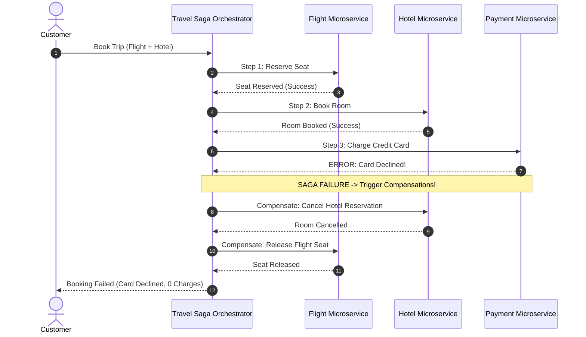

## Fast Revision (10-Second Recall)
- The Core Dilemma: Each microservice owns its private database. A business transaction spans 3 databases (Order, Payment, Inventory).
- Two-Phase Commit (2PC): Coordinator sends Prepare -> Commit. Heavy blocking locks, single point of failure coordinator, poor scalability.
- Saga Pattern (Preferred): A sequence of local transactions where each step updates its local DB and publishes an event to trigger the next step.
- Compensating Transactions: If step 3 fails, the Saga runs compensating actions in reverse order (e.g., Refund Payment, Cancel Order).
- Orchestration vs Choreography: Orchestration (central stateful controller) is easier to track and debug; Choreography (pure pub/sub) is decentralized.

## The 30-Second Spoken Script
"When executing transactions across multiple microservices, traditional ACID transactions across distributed databases fail to scale.

Two-Phase Commit (2PC) relies on a central coordinator locking database rows across all services during the prepare phase. If a network partition occurs or a node hangs, database connections remain locked indefinitely, creating severe performance bottlenecks.

In modern cloud architectures, we implement the Saga Pattern. A Saga breaks a distributed transaction into a series of independent local database transactions.

I strongly prefer Saga Orchestration using an engine like Temporal or a dedicated stateful Orchestrator microservice.

When a customer checks out, the Orchestrator initiates Step 1: Reserve Inventory in the Inventory Service. Once confirmed, it initiates Step 2: Charge Payment in the Payment Service.

If Step 2 fails?for example, the credit card is declined?the Orchestrator executes Compensating Transactions in reverse order: it instructs the Inventory Service to release the reserved items and marks the order as cancelled.

To guarantee that events are never lost between local database updates and message publishing, every microservice implements the Transactional Outbox pattern."

## Scenario / Problem Context
Design a distributed booking transaction across Flight Reservation, Hotel Booking, and Car Rental microservices. The user must either successfully book all three components or receive a full rollback with zero orphaned reservations.

## Architectural Workflow / Sequence


## Deep-Dive Analysis & Root Causes
### The Semantic Lock Problem in Sagas
Unlike ACID database transactions that hide uncommitted changes from other threads, Saga local transactions commit immediately. This introduces dirty reads (e.g., another user might see an inventory item as reserved before payment is completed). To prevent inconsistencies, systems use Semantic Locks: marking records as `PENDING_RESERVATION` so other transactions know a Saga is currently in flight.

### Compensating Actions Must Never Fail
A compensating transaction (like refunding money or releasing stock) cannot simply return an error and give up; otherwise, the system is left in a corrupted state. Compensating transactions must be engineered to be strictly idempotent and retried indefinitely until they succeed, with dead-letter queue escalation to human operators.

### The Transactional Outbox Pattern
When a microservice commits a database change and sends a message to Kafka, network failures between the DB commit and the Kafka publish cause data desynchronization. In the Outbox pattern, the event is saved in an `outbox` table in the SAME local database transaction. A separate Debezium CDC worker tails the database write-ahead log (WAL) and publishes events to Kafka with guaranteed delivery.

## Practical Debugging Commands & Code
### Transactional Outbox SQL Schema & Trigger
```sql
-- Transactional Outbox Pattern in PostgreSQL
CREATE TABLE outbox_events (
    id UUID PRIMARY KEY DEFAULT gen_random_uuid(),
    aggregate_type VARCHAR(50) NOT NULL,
    aggregate_id VARCHAR(50) NOT NULL,
    event_type VARCHAR(50) NOT NULL,
    payload JSONB NOT NULL,
    created_at TIMESTAMP WITH TIME ZONE DEFAULT CURRENT_TIMESTAMP,
    processed BOOLEAN DEFAULT FALSE
);

-- Atomic business transaction commits BOTH business data and outbox event
BEGIN;
  UPDATE inventory SET available = available - 1 WHERE sku = 'FLIGHT-102';
  INSERT INTO outbox_events (aggregate_type, aggregate_id, event_type, payload)
  VALUES ('Inventory', 'FLIGHT-102', 'InventoryReserved', '{"sku": "FLIGHT-102", "qty": 1}');
COMMIT;
```

## Prevention & Senior Best Practices
- Transactional Outbox with Debezium: Guarantee at-least-once message delivery between local database transactions and Kafka brokers.
- Mandatory Idempotency on Sagas: Ensure all forward and compensating Saga actions are strictly idempotent using deduplication tokens.
- Saga Timeout Deadlines: Configure maximum completion deadlines on Sagas; automatically trigger compensating rollbacks if steps hang.
- Avoid 2PC Across Network Boundaries: Limit Two-Phase Commit to tightly coupled co-located databases within the same local cluster.
