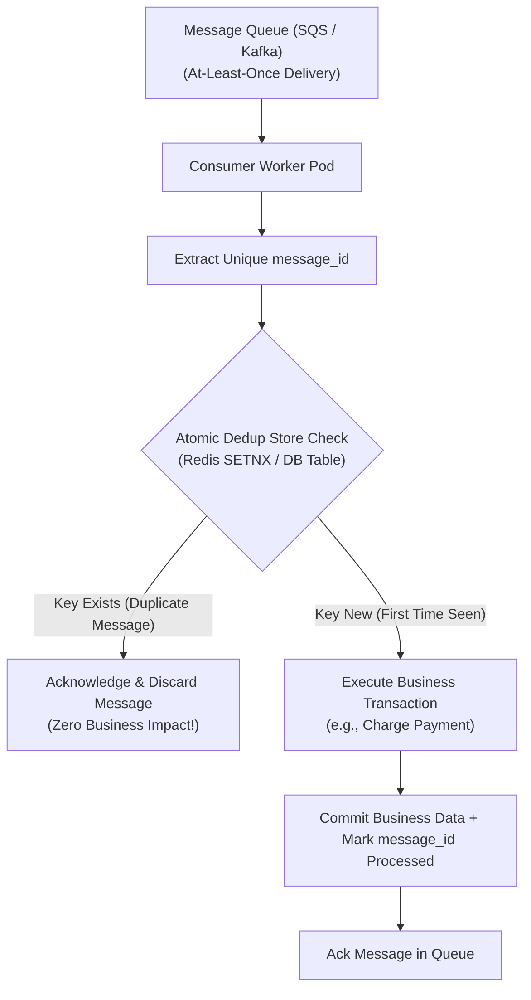

## Fast Revision (10-Second Recall)
- The Core Reality: True "Exactly-Once Delivery" across a network is mathematically impossible (Two Generals' Problem). Queues provide At-Least-Once Delivery.
- Responsibility on Consumer: The consumer must guarantee Exactly-Once Processing Semantics through Idempotency.
- Message Deduplication Techniques: 1) Natural Unique Constraints in DB; 2) Distributed Deduplication Cache (Redis `SETNX`); 3) Processed Message Ledger.
- Idempotency Key Anatomy: Deterministic hash of `business_entity_id + event_type + event_timestamp` or producer-supplied UUID.
- Visibility Timeout Hazards: If consumer processing takes 35s on a 30s queue visibility timeout, duplicate messages are generated automatically.

## The 30-Second Spoken Script
"When working with distributed message queues like Kafka, RabbitMQ, or AWS SQS, network partitions and consumer crashes make duplicate deliveries inevitable. The golden rule is: Queues guarantee at-least-once delivery; the consumer must guarantee exactly-once processing through idempotency.

I implement idempotent message consumption using a three-tier strategy:

First, Message Fingerprinting: Every message must carry a unique, deterministic message_id or idempotency key generated by the producer.

Second, Atomic Deduplication Check: Before processing, the worker attempts an atomic write in Redis or PostgreSQL: INSERT INTO processed_messages (message_id) VALUES (:id) ON CONFLICT DO NOTHING. If the insert affects 0 rows, the worker knows this message is a duplicate and acknowledges it immediately without reprocessing.

Third, Database Upserts & Natural Constraints: In our business logic, we prefer idempotent operations: using INSERT ... ON CONFLICT UPDATE (UPSERT) or atomic state changes (SET status = 'SHIPPED' WHERE status = 'PROCESSING') rather than blind increments.

Finally, we ensure our queue visibility timeouts are configured to at least 3x our p99 consumer processing duration to prevent premature redeliveries while a worker is still busy."

## Scenario / Problem Context
An payment confirmation worker consumes messages from an SQS queue. Due to sporadic network latency, SQS delivers duplicate messages, causing 300 customers to be charged twice in a single weekend.

## Architectural Workflow / Sequence


## Deep-Dive Analysis & Root Causes
### Why Exactly-Once Network Delivery is Impossible
When a consumer processes a message and sends an ACK over the network, that ACK packet can be dropped by a router. The queue server never receives the ACK, assumes the consumer died, and redelivers the message. A consumer that relies on the queue never redelivering messages will inevitably process duplicates.

### The SQS Visibility Timeout Trap
If an SQS queue has a `VisibilityTimeout` of 30 seconds and downstream processing takes 32 seconds, SQS makes the message visible to another worker at second 30. Worker B begins processing the exact same order while Worker A is still completing its transaction, creating duplicate records.

### Transactional Deduplication within Business DB
If you check Redis for deduplication and then commit to PostgreSQL, a crash between Redis and PostgreSQL leads to lost messages. The cleanest pattern is recording the `message_id` directly inside the primary database transaction: `INSERT INTO processed_events (message_id, created_at) VALUES ($1, NOW())`. If the transaction rolls back, the deduplication record rolls back with it.

## Practical Debugging Commands & Code
### PostgreSQL Idempotent Consumer Transaction
```sql
-- Idempotent consumer transaction with deduplication ledger
BEGIN;

-- 1. Attempt to insert message_id into deduplication table
INSERT INTO processed_messages (message_id, processed_at)
VALUES ('msg-ord-9821-uuid', CURRENT_TIMESTAMP)
ON CONFLICT (message_id) DO NOTHING;

-- 2. If the message was already processed, abort early
DO $$
BEGIN
  IF NOT FOUND THEN
    RAISE NOTICE 'Message already processed! Skipping...';
    RETURN;
  END IF;
END $$;

-- 3. Execute business logic atomically
UPDATE orders 
SET status = 'PAID', updated_at = CURRENT_TIMESTAMP
WHERE id = 9821 AND status = 'PENDING';

COMMIT;
```

## Prevention & Senior Best Practices
- Mandatory Idempotency Keys on Producers: Enforce UUID message IDs generated at producer origination; never let workers invent random IDs on receipt.
- Dynamic Queue Heartbeats: If message processing runs long, call `ChangeMessageVisibility` to extend the lease before the queue times out.
- Idempotent API Designs: Design endpoints using `PUT` with absolute state rather than `POST` with relative delta increments.
- Dead-Letter Queues for Repeated Failures: Set max receive count to 3; move failing messages to a DLQ to prevent infinite reprocessing loops.
