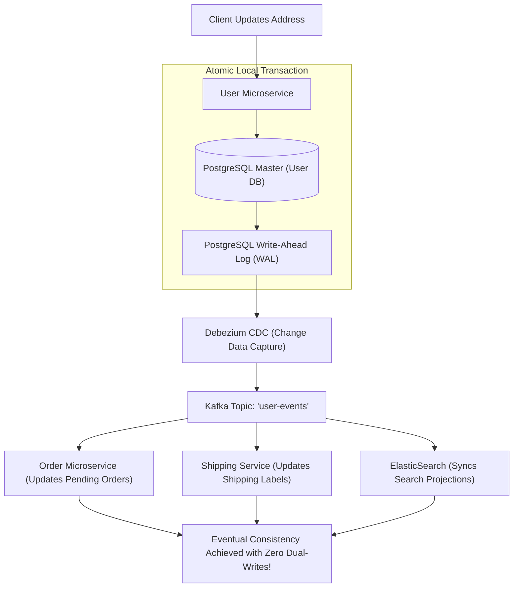

## Fast Revision (10-Second Recall)
- The Core Rule: In microservices, consistency is Eventual Consistency (BASE: Basically Available, Soft state, Eventual consistency), not immediate ACID.
- Dual-Write Anti-Pattern: Never write to Database A and then make an HTTP call to Service B; network drops leave systems permanently out of sync.
- Change Data Capture (CDC): Debezium tails the primary database Write-Ahead Log (WAL) to emit real-time change events without application overhead.
- CQRS (Command Query Responsibility Segregation): Writes go to normalized transactional DB (Postgres); reads query de-normalized read models (ElasticSearch).
- Event Sourcing: Store state as an immutable append-only sequence of domain events rather than mutating current-state records.

## The 30-Second Spoken Script
"Maintaining data consistency across microservices requires accepting eventual consistency and eliminating the catastrophic 'Dual-Write' anti-pattern.

When an application writes to its local database and then makes an HTTP call to update another microservice, network timeouts guarantee data corruption over time.

To maintain perfect consistency without distributed locks, we implement Change Data Capture (CDC) with Debezium and Apache Kafka.

When the User Service updates an account address, it commits purely to its local PostgreSQL database. Debezium reads the PostgreSQL Write-Ahead Log (WAL) asynchronously and publishes an immutable 'UserAddressUpdated' event to a partitioned Kafka topic.

Downstream consumers?such as the Order Service, Shipping Service, and Search Indexer?consume this event, updating their local representations asynchronously.

For high-scale query performance, we combine this with CQRS: transactional commands write to PostgreSQL, while read-optimized projections in ElasticSearch or Redis are updated via event listeners, delivering sub-millisecond search performance while maintaining verifiable eventual consistency."

## Scenario / Problem Context
In an e-commerce platform, when a customer updates their shipping address, the change reflects on their profile, but pending shipments frequently ship to their old address because microservices maintain out-of-sync copies of user profile data.

## Architectural Workflow / Sequence


## Deep-Dive Analysis & Root Causes
### The Dual-Write Problem Explained
Writing code like: `db.save(user); kafkaProducer.send(event);` is fundamentally broken. If the database commit succeeds but the app crashes or the network drops before Kafka acknowledges, the event is never published. If you flip the order (`kafka.send(); db.save();`), a DB constraint violation means Kafka sent an event for data that does not exist.

### Change Data Capture (CDC) with Debezium
CDC bypasses application code entirely. Databases write all commits to a Write-Ahead Log (WAL in Postgres, binlog in MySQL) before touching tables. Debezium reads the WAL stream directly, guaranteeing that 100% of committed transactions produce an event in Kafka in the exact order they occurred.

### Read-Your-Own-Writes Consistency
In eventually consistent systems, a user might update their profile, refresh the page, and still see old data because the read projection hasn't caught up. Mitigate by passing the event version token in the response: if the read replica is behind the token, the client reads from the master or uses optimistic client-side caching.

## Practical Debugging Commands & Code
### Debezium PostgreSQL CDC Connector Configuration
```bash
# Debezium Kafka Connect Configuration for PostgreSQL WAL Capture
{
  "name": "user-db-connector",
  "config": {
    "connector.class": "io.debezium.connector.postgresql.PostgresConnector",
    "tasks.max": "1",
    "plugin.name": "pgoutput",
    "database.hostname": "postgres-prod.internal",
    "database.port": "5432",
    "database.user": "debezium",
    "database.password": "secret",
    "database.dbname": "users_db",
    "database.server.name": "user_service",
    "table.include.list": "public.users,public.addresses"
  }
}
```

## Prevention & Senior Best Practices
- Never Implement Dual-Writes: Strictly enforce the Transactional Outbox pattern or Change Data Capture (CDC) across all services.
- Monotonic Event Versioning: Include an incrementing `version` integer on domain events so consumers ignore stale, out-of-order messages.
- Idempotent Event Consumers: Ensure all event handlers can safely process the same message multiple times without corrupting state.
- Automated Reconciliation Sweeps: Run nightly batch reconciliation scripts to compare source-of-truth databases against read models.
