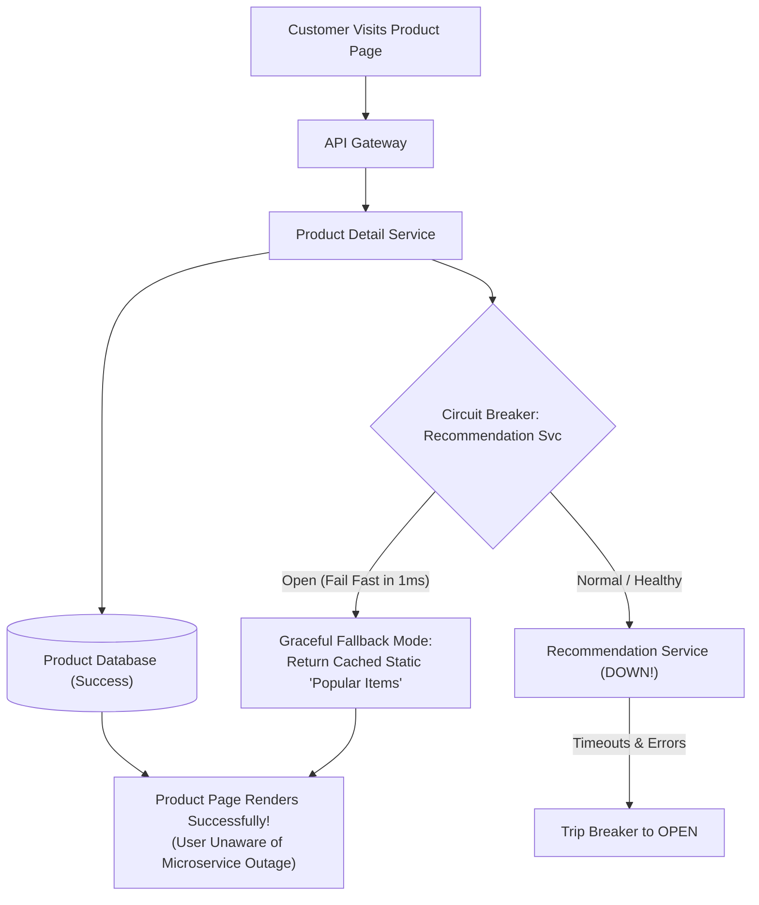

## Fast Revision (10-Second Recall)
- The Core Rule: A failure in a non-critical dependency must NEVER take down the primary user transaction funnel.
- Circuit Breaker Pattern: Trips open after threshold failures (50% errors over 10s); returns fallback immediately without blocking worker threads.
- Bulkhead Pattern: Isolate thread pools and connection pools per dependency so a slow service cannot starve the rest of the application.
- Graceful Degradation: If Recommendation Service is down, render product page with static popular items; if Reviews are down, hide the review widget.
- Asynchronous Eventual Consistency: If Notification Service is down, orders still succeed; notification events queue in durable Kafka topics.

## The 30-Second Spoken Script
"When a microservice crashes in a distributed architecture, the critical question is: Does the entire system collapse, or does it degrade gracefully?

To ensure resilience, we categorize services into Tier-1 Critical Path (such as Authentication, Cart, and Payments) and Tier-2 Non-Critical Services (such as Recommendations, User Reviews, and Analytics).

For Tier-2 dependencies, every outbound network call is wrapped in a Circuit Breaker (like Resilience4j or Envoy) and isolated using the Bulkhead pattern.

If the Recommendation Service crashes or times out, the circuit breaker trips open within 5 failed attempts. Instead of hanging for 30 seconds and exhausting our web server thread pool, the call fails fast in 1 millisecond and returns a cached fallback?such as static top-selling items. The customer completes their purchase with zero disruption.

For asynchronous operations?like loyalty points or confirmation emails?we decouple communication through durable Kafka message queues. If the Email Service is down for 2 hours, orders continue processing normally, and confirmation emails are dispatched automatically once the service recovers."

## Scenario / Problem Context
During a peak shopping event, the third-party Recommendation Microservice crashes and begins timing out on all requests. Within 2 minutes, the main product page and checkout flow freeze and return 504 Gateway Timeouts to all customers.

## Architectural Workflow / Sequence


## Deep-Dive Analysis & Root Causes
### The Bulkhead Pattern (Thread Pool Isolation)
If an application has a shared pool of 100 worker threads, and 100 concurrent requests make synchronous calls to a hung Recommendation Service, all 100 threads become blocked waiting for socket reads. The application can no longer serve login or checkout requests. Bulkheads allocate dedicated thread pools (e.g., max 10 threads for recommendations), ensuring a failing dependency cannot starve the core system.

### Circuit Breaker State Machine
A circuit breaker has 3 states: 1) Closed (normal operation); 2) Open (failure threshold exceeded, all calls fail fast immediately without hitting network); 3) Half-Open (after a reset timeout, a trial request is sent to check if the downstream has recovered; if successful, the breaker resets to Closed).

### Graceful Degradation Design in the UI
Frontend applications must be designed for partial UI rendering. If an API returns `{ product: {...}, recommendations: null }`, the frontend gracefully hides the recommendation component rather than crashing with an unhandled TypeError.

## Practical Debugging Commands & Code
### Resilience4j Circuit Breaker & Bulkhead Configuration in Java
```typescript
// Resilience4j Circuit Breaker & Thread Pool Bulkhead Configuration
CircuitBreakerConfig circuitBreakerConfig = CircuitBreakerConfig.custom()
    .failureRateThreshold(50) // Trip open if 50% of calls fail
    .waitDurationInOpenState(Duration.ofSeconds(20)) // Wait 20s before half-open probe
    .slowCallDurationThreshold(Duration.ofMillis(1500)) // Calls > 1.5s counted as slow
    .build();

ThreadPoolBulkheadConfig bulkheadConfig = ThreadPoolBulkheadConfig.custom()
    .maxThreadPoolSize(10) // Max 10 threads dedicated to this dependency
    .coreThreadPoolSize(5)
    .queueCapacity(20)
    .build();
```

## Prevention & Senior Best Practices
- Mandatory HTTP Client Timeouts: Set strict 1-second connect and read timeouts on all internal microservice RPC calls.
- Chaos Engineering Verification: Run regular Chaos Monkey or Chaos Mesh tests in staging that terminate random microservices to prove system degradation remains graceful.
- Durable Queue Decoupling: Use message queues for all non-synchronous side effects (emails, notifications, analytics).
- Defensive UI Frameworks: Implement React Error Boundaries around independent widgets so a single component failure cannot crash the whole page.
