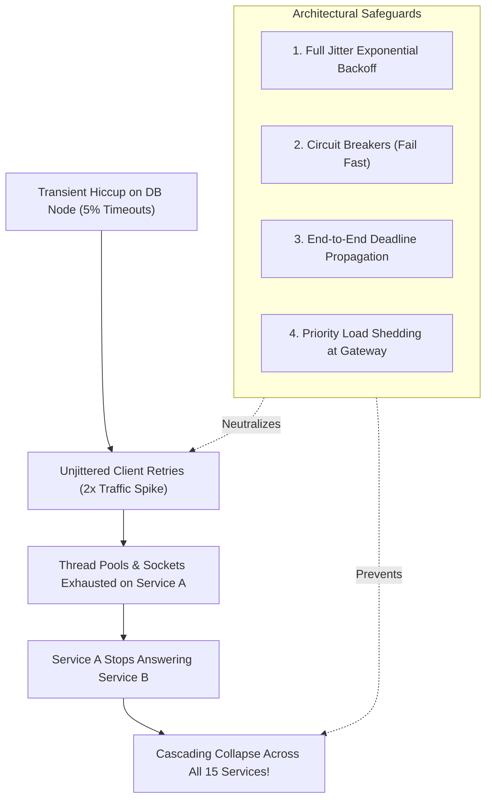

## Fast Revision (10-Second Recall)
- The Nature of Cascading Failure: A small localized failure (1 pod crashing) triggers load shifts or retry storms that knock down healthy downstream services one by one.
- Retry Storm Prevention: Always use Exponential Backoff with Full Jitter: `sleep = rand(0, min(cap, base * 2^attempt))`.
- Circuit Breakers: Stop callers from flooding degraded dependencies with doomed requests.
- Load Shedding at Gateway: Drop low-priority traffic based on CPU or latency cues before queues overflow.
- Deadlines & Context Propagation: Propagate timeout deadlines (gRPC / W3C Baggage) across all microservice hops; terminate execution early if deadline expired.

## The 30-Second Spoken Script
"A cascading failure occurs when a minor, localized disruption triggers an amplification loop that destroys the entire distributed system.

The most common trigger is a Retry Storm. When a downstream database experiences a 1-second hiccup, upstream callers fail. If 1,000 callers immediately retry with zero backoff, they hit the recovering database with double the traffic, knocking it down permanently.

To eliminate cascading failures, we implement five foundational guardrails:

First, Full-Jitter Exponential Backoff on all network retries. Adding randomness prevents thousands of clients from synchronizing their retries into catastrophic resonant traffic waves.

Second, Circuit Breakers that trip open when failure thresholds are breached, failing fast in 1 millisecond rather than holding sockets open.

Third, End-to-End Deadline Propagation. We pass deadline timestamps across all gRPC and HTTP hops. If a gateway sets a 3-second deadline and Service B spends 2.8 seconds processing, downstream Service C checks the remaining budget (200ms) and aborts immediately rather than executing expensive database queries for a client that has already hung up.

Fourth, Aggressive Load Shedding at the API Gateway to drop non-critical traffic when utilization crosses 85%."

## Scenario / Problem Context
A transient network blip on a single payment database node causes 5% of checkout requests to timeout. Within 3 minutes, client retry storms overwhelm the API gateway, exhausts connection pools across 15 microservices, and knocks the entire platform offline.

## Architectural Workflow / Sequence


## Deep-Dive Analysis & Root Causes
### Full Jitter vs Equal Jitter in Retry Storms
Standard exponential backoff (`sleep = 2^attempt`) spreads retries over time, but clients that failed at the same instant retry at identical future intervals, creating synchronized spikes. AWS research proved that Full Jitter (`sleep = random(0, min(cap, base * 2^attempt))`) flattens traffic spikes into a smooth, uniform distribution, reducing peak load on recovering servers by up to 80%.

### Deadline Propagation (Preventing Zombie Work)
If an edge API Gateway has a 2-second timeout and passes a request to Service A, which calls Service B, which queries the database: if Service A takes 2.1 seconds, the gateway has already returned HTTP 504 to the user. Continuing to execute queries in Service B and the database is "zombie work" that wastes server resources for an abandoned response. Propagating context deadlines ensures downstream hops terminate immediately.

### Concurrency Limits Over Queue Buffers
Unbounded in-memory queues (like default Java `LinkedBlockingQueue`) disguise server saturation until the process crashes with OOM. Bounded queues with strict drop-tail policies reject excess load with immediate HTTP 503, protecting existing in-flight transactions.

## Practical Debugging Commands & Code
### Full Jitter Exponential Backoff Implementation in TypeScript
```typescript
// Full Jitter Exponential Backoff Implementation
export async function retryWithFullJitter<T>(
  fn: () => Promise<T>,
  maxRetries: number = 3,
  baseMs: number = 100,
  capMs: number = 2000
): Promise<T> {
  let attempt = 0;
  while (true) {
    try {
      return await fn();
    } catch (err) {
      attempt++;
      if (attempt > maxRetries) throw err;
      
      // Full Jitter Formula: sleep = rand(0, min(cap, base * 2^attempt))
      const maxSleep = Math.min(capMs, baseMs * Math.pow(2, attempt));
      const sleepDuration = Math.random() * maxSleep;
      
      console.warn(`Attempt ${attempt} failed. Retrying in ${sleepDuration.toFixed(0)}ms...`);
      await new Promise(res => setTimeout(res, sleepDuration));
    }
  }
}
```

## Prevention & Senior Best Practices
- Bounded Retries: Never retry non-idempotent operations; cap retries at max 2 attempts for idempotent operations.
- W3C Context Propagation: Propagate `traceparent` and `request-deadline` headers across all HTTP and gRPC microservice clients.
- Circuit Breakers on All Remote Clients: Mandate circuit breakers across every internal and external network integration.
- Fail-Fast Health Checks: Ensure liveness probes check local process health rather than deep downstream dependencies to avoid liveness restart cascades.
