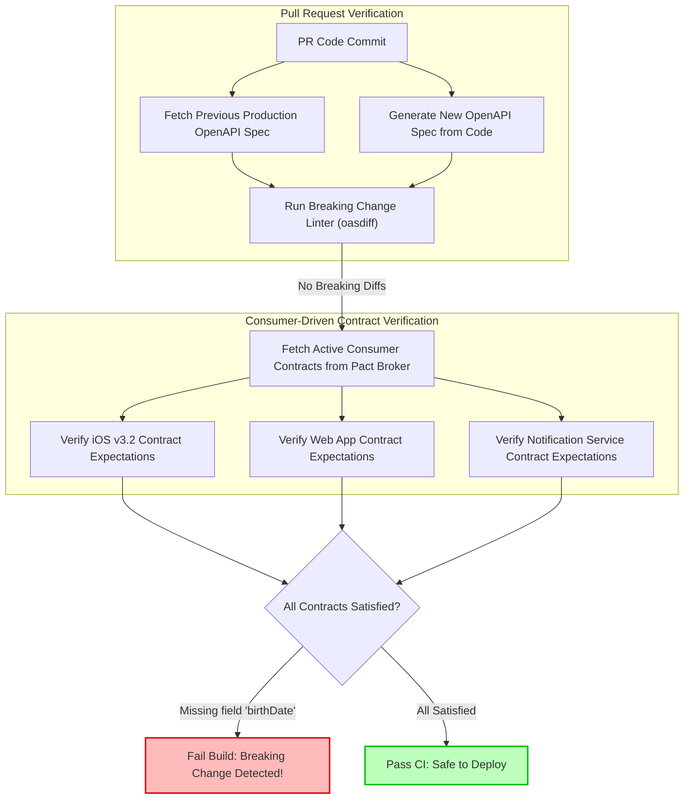

## Fast Revision (10-Second Recall)
- **Backward Compatibility Definition:** A newer version of a system or API can accept and correctly process requests from older, existing clients without requiring client updates.
- **Breaking vs Non-Breaking Changes:**
  - *Non-Breaking (Safe):* Adding new optional fields, adding new endpoints, adding optional query parameters.
  - *Breaking (Dangerous):* Renaming fields, removing fields, changing data types (e.g. integer to string), making optional fields required, changing HTTP status codes.
- **Postel's Law (Robustness Principle):** *"Be conservative in what you send, be liberal in what you accept."*
- **Primary Tooling:** Consumer-Driven Contract Testing (Pact), OpenAPI Breaking Change Linters (`oasdiff`, `openapi-diff`), and Protobuf/Avro Schema Registry compatibility rules.
- **Mobile & External Clients:** Unlike web apps that refresh immediately, mobile apps (iOS/Android) and enterprise API clients run legacy versions in production for months or years.

## The 30-Second Spoken Script
> "Testing backward compatibility is essential whenever you operate distributed microservices, public developer APIs, or mobile backends. Web frontend bundles can be force-refreshed, but native mobile apps, IoT devices, and external API partners may run older versions for years.
>
> We test backward compatibility at two foundational levels:
> First, **Automated Schema Diffing in CI**: For REST and GraphQL APIs, we run tools like `oasdiff` or GraphQL Inspector against the previous production schema. If a pull request renames a field, deletes a property, or makes an existing field mandatory, the pull request build fails immediately with a breaking change error.
> Second, **Consumer-Driven Contract Testing with Pact**: Instead of guessing what our clients need, consumers (like mobile apps or downstream microservices) publish contracts specifying the exact fields and response shapes they rely on. When the backend builds, the Pact broker verifies that the new code satisfies all existing consumer contracts.
>
> For event-driven architectures using Kafka and Protobuf or Avro, we enforce strict `BACKWARD` or `FULL` compatibility rules in the Confluent Schema Registry to prevent serializing messages that older consumer services cannot deserialize."

## Scenario / Problem Context
A banking platform updated its user profile API. The backend engineering team changed the user's date of birth field from:
`"birthDate": "1990-05-15"`
to a nested object:
`"dateOfBirth": { "year": 1990, "month": 5, "day": 15 }`

The team tested the web application and confirmed everything worked smoothly. However, they forgot that 40% of their banking customers used the iOS native app, which had not been updated in 6 months.

When the iOS app called the profile endpoint, the Swift `Codable` JSON decoder crashed with a fatal DecodingError:
`KeyNotFound: No value associated with key CodingKeys(stringValue: "birthDate")`
Over 300,000 mobile users were completely locked out of their banking accounts upon launching the app. The team had to execute an emergency server-side rollback within 30 minutes.

The engineering department mandates automated backward compatibility testing to ensure no API change ever breaks an existing client again.

## Architectural Workflow / Sequence


## Deep-Dive Analysis & Root Causes

### 1. Breaking API Changes Checklist

| Change Type | Status | Impact / Consequence |
| :--- | :--- | :--- |
| **Add optional response field** | Safe | Old clients ignore unrecognized JSON properties. |
| **Add optional request parameter** | Safe | Old clients don't send it; server defaults it. |
| **Remove response field** | BREAKING | Clients fail JSON decoding / throw undefined errors. |
| **Rename response field** | BREAKING | Equivalent to removing old field and adding new one. |
| **Change field data type** | BREAKING | Client expecting integer crashes receiving string or object. |
| **Make optional request field required**| BREAKING | Existing clients sending valid requests now receive HTTP 400. |
| **Change error response shape** | BREAKING | Client exception parsers fail to extract error codes. |

### 2. Dual-Write and Deprecation Windows
To change an API field safely:
1. **Never rename directly.** Keep the old field (`birthDate`) populated.
2. Add the new field (`dateOfBirth`) alongside it.
3. Mark `birthDate` as `deprecated: true` in the OpenAPI specification.
4. Announce a sunset date and monitor telemetry until traffic using the old field drops to zero.
5. Only remove the old field in a major API version release (`v2`).

### 3. Protobuf & Avro Schema Evolution Rules
In event-driven architectures:
- Never change the numeric field tag numbers in `.proto` files.
- If a field is removed, mark its tag number as `reserved` to prevent reuse:
  `reserved 4, 8 to 12;`
- Confluent Schema Registry must be configured to `BACKWARD_TRANSITIVE` compatibility.

## Practical Debugging Commands & Code

### Step 1: Automated Breaking Change Detection with `oasdiff` in CI
Run `oasdiff` in your PR pipeline to detect any breaking schema modifications against the production baseline:

```bash
# Compare local OpenAPI spec against the production baseline spec
docker run --rm -v $(pwd):/specs tufin/oasdiff \
  -base /specs/docs/openapi-prod-baseline.yaml \
  -revision /specs/docs/openapi-pr-branch.yaml \
  -breaking

# Exit code 1 indicates a breaking change (fails CI pipeline)
```

Sample output when a field is deleted:
```text
1 breaking change detected:
- endpoint: GET /api/v1/users/{id}
  response: 200
  property 'birthDate' was removed from response body schema
```

### Step 2: Consumer-Driven Contract Test with Pact (Consumer Side)
The iOS / Frontend consumer defines what fields it requires:

```typescript
// consumer-tests/userProfileConsumer.spec.ts
import { PactV3, MatchersV3 } from '@pact-foundation/pact';

const provider = new PactV3({
  consumer: 'iOS_Mobile_App',
  provider: 'UserService',
});

describe('User Profile API Contract', () => {
  it('requires birthDate string format to prevent decoding crashes', async () => {
    provider
      .given('User usr_100 exists')
      .uponReceiving('A request for user profile')
      .withRequest({
        method: 'GET',
        path: '/api/v1/users/usr_100',
        headers: { 'Accept': 'application/json' },
      })
      .willRespondWith({
        status: 200,
        headers: { 'Content-Type': 'application/json' },
        body: {
          id: MatchersV3.string('usr_100'),
          name: MatchersV3.string('Alex Doe'),
          // Crucial contract expectation: must be string, not object!
          birthDate: MatchersV3.regex(/\d{4}-\d{2}-\d{2}/, '1990-05-15'),
        },
      });

    await provider.executeTest(async (mockServer) => {
      const res = await fetch(`${mockServer.url}/api/v1/users/usr_100`, {
        headers: { 'Accept': 'application/json' },
      });
      const data = await res.json();
      expect(data.birthDate).toBeDefined();
    });
  });
});
```

### Step 3: Provider Verification Test
When the backend service runs in CI, it automatically verifies that its responses satisfy all published consumer contracts:

```typescript
// provider-tests/verifyContracts.spec.ts
import { Verifier } from '@pact-foundation/pact';
import { describe, it } from 'vitest';

describe('Pact Provider Verification', () => {
  it('verifies compatibility with all registered consumer contracts', async () => {
    const verifier = new Verifier({
      provider: 'UserService',
      providerBaseUrl: 'http://localhost:3000',
      pactBrokerUrl: 'https://pact-broker.company.internal',
      pactBrokerToken: process.env.PACT_BROKER_TOKEN,
      publishVerificationResult: true,
      providerVersion: process.env.GIT_COMMIT,
    });

    // Fails build if any consumer contract is violated!
    await verifier.verifyProvider();
  });
});
```

## Prevention & Senior Best Practices
1. **Automate Schema Diffing on Every PR:** Run `oasdiff` or `graphql-inspector` as a mandatory blocking gate in your continuous integration pipeline.
2. **Never Remove Fields Directly:** Support both old and new fields simultaneously during an explicit deprecation window before removing deprecated attributes.
3. **Pact Contract Testing for Microservices:** Use Pact to decouple independent microservice release cycles, preventing cross-service breaking changes without needing brittle end-to-end environments.
4. **Enforce Schema Registry Compatibility Rules:** In event architectures (Kafka, EventBridge), configure Confluent Schema Registry to `BACKWARD` or `FULL` compatibility to reject breaking Protobuf/Avro schemas at compile time.
5. **Always Version APIs Explicitly:** Use URL path versioning (`/v1/users`) or header versioning (`Accept: application/vnd.company.v2+json`) for major structural redesigns.

