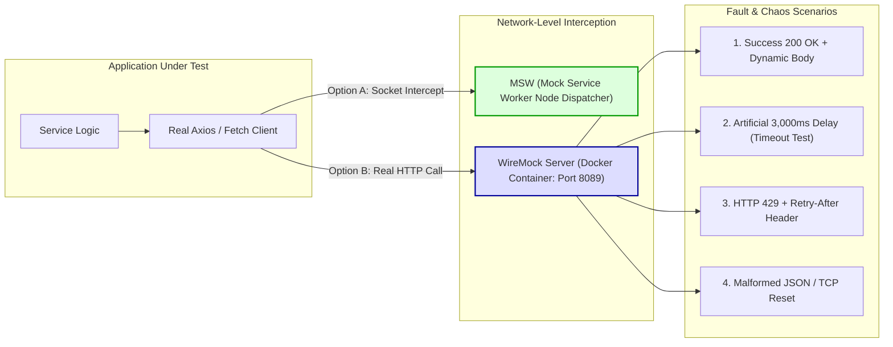

## Fast Revision (10-Second Recall)
- **The Mocking Spectrum:** In-Memory Language Mocks (`jest.fn()`) $\rightarrow$ Network Interceptors (MSW / Nock) $\rightarrow$ Ephemeral Out-of-Process Mock Servers (WireMock / Prism) $\rightarrow$ Sandbox Providers.
- **Why In-Memory Mocks Fail:** Mocking the HTTP client library (`axios.get = jest.fn()`) bypasses serialization, headers, status code parsing, and interceptor middleware.
- **Network-Level Mocking (MSW / Nock):** Intercepts real HTTP requests at the Node.js socket / fetch layer, preserving the real HTTP client stack.
- **WireMock / Out-of-Process Mocking:** Runs an independent HTTP server (Docker or local process) that works across any language, simulating latency, packet drops, and TLS handshakes.
- **Chaos & Fault Injection:** Mocking must not just test the 200 OK happy path; it must simulate rate limits (429), gateway timeouts (504), connection resets, and malformed JSON payloads.

## The 30-Second Spoken Script
> "Mocking external APIs requires balancing fidelity with isolation. In unit tests, mocking out the HTTP client method using in-memory stubs is common, but it fails to test critical serialization logic, request headers, and error handling interceptors.
>
> In production-grade engineering, we mock at the **network level** using one of two strategies:
> For frontend and fast Node.js microservices, we use **Mock Service Worker (MSW)**. MSW intercepts requests at the network layer via Service Workers in the browser or Node's `fetch`/socket dispatcher, allowing the real application HTTP client to execute normally without changing base URLs.
> For polyglot integration and chaos testing, we use **WireMock** or containerized mock servers. WireMock spins up a real HTTP daemon where we can configure deterministic responses, dynamic response templating, artificial latency, and chaotic failure modes like TCP reset or HTTP 429 rate limits.
>
> To avoid the classic trap of **mock drift**, we validate our mock response definitions directly against the external provider's OpenAPI or Pact contract schema in CI."

## Scenario / Problem Context
A logistics platform connects to a third-party shipping carrier API (FedEx/DHL) to calculate live rates. During a release, the shipping carrier altered their error response format from:
`{ "error": "Invalid postal code" }`
to:
`{ "errors": [{ "code": "ERR_ZIP_INVALID", "detail": "Postal code is unroutable" }] }`

The team's unit tests continued to pass with 100% green status because their tests used an in-memory Jest stub:
```typescript
jest.spyOn(shippingClient, 'calculateRates').mockRejectedValue({ error: 'Invalid postal code' });
```

When deployed to production, unexpected address errors were not recognized by the error handler, resulting in unhandled exceptions that crashed the checkout flow for thousands of international customers.

The team needs an external API mocking architecture that exercises the real HTTP client stack and simulates complex third-party failure modes accurately.

## Architectural Workflow / Sequence


## Deep-Dive Analysis & Root Causes

### 1. The Pitfalls of In-Memory Function Mocking
When you mock `httpClient.post = jest.fn()`:
- You do NOT test request payload serialization (e.g., date formatting, query param encoding).
- You do NOT test HTTP headers (e.g., missing `Authorization: Bearer <key>` or `Content-Type: application/json`).
- You do NOT test custom Axios/Fetch retry interceptors or timeout handling.
- Solution: Always execute the real HTTP client, intercepting at the network boundary.

### 2. Mock Service Worker (MSW) vs WireMock
- **MSW:** Best for JavaScript/TypeScript environments. Uses native Service Worker in browsers or intercepts Node.js `http`/`undici` requests. Zero ports to manage, instant startup.
- **WireMock:** Best for multi-language microservices, CI pipelines, and advanced fault injection. Runs as a Java/Docker service that accepts stub mappings via REST API. Supports stateful scenarios (e.g., first call returns 500, second call returns 200 to test retry logic).

### 3. Preventing Mock Drift
Mocks inevitably drift over time as third-party APIs update. Prevent drift by:
- Storing mock response templates generated from actual recorded traffic (`wiremock --record-spec`).
- Validating mock fixtures against the third party's official OpenAPI specification in a nightly CI job.

## Practical Debugging Commands & Code

### Step 1: Mocking with MSW (Mock Service Worker) in Node.js
```typescript
// tests/mocks/handlers.ts
import { http, HttpResponse, delay } from 'msw';

export const handlers = [
  // 1. Happy path mock
  http.get('https://api.carrier.com/v1/rates', ({ request }) => {
    const url = new URL(request.url);
    const zip = url.searchParams.get('zip');

    if (zip === '90210') {
      return HttpResponse.json({
        carrier: 'FAST_SHIP',
        rateCents: 1599,
        estimatedDays: 2,
      });
    }

    // 2. Realistic error payload matching latest provider spec
    return HttpResponse.json(
      {
        errors: [{ code: 'ERR_ZIP_INVALID', detail: 'Postal code is unroutable' }],
      },
      { status: 400 }
    );
  }),

  // 3. Chaos / Timeout simulation
  http.get('https://api.carrier.com/v1/rates/slow', async () => {
    await delay(5000); // Deliberate 5-second lag to trigger client timeout
    return HttpResponse.json({ rateCents: 2000 });
  }),

  // 4. Rate-limit simulation with Retry-After
  http.get('https://api.carrier.com/v1/rates/rate-limited', () => {
    return new HttpResponse(null, {
      status: 429,
      headers: { 'Retry-After': '5' },
    });
  }),
];
```

Test implementation asserting real client behavior:
```typescript
// tests/integration/shippingClient.spec.ts
import { setupServer } from 'msw/node';
import { handlers } from '../mocks/handlers';
import { ShippingService } from '../../src/services/ShippingService';

const server = setupServer(...handlers);

beforeAll(() => server.listen({ onUnhandledRequest: 'error' }));
afterEach(() => server.resetHandlers());
afterAll(() => server.close());

describe('ShippingService (Network-Level Mocking)', () => {
  const service = new ShippingService({ baseUrl: 'https://api.carrier.com' });

  it('calculates rates successfully using real fetch client', async () => {
    const rate = await service.getRateForZip('90210');
    expect(rate.rateCents).toBe(1599);
  });

  it('parses carrier error envelope and throws typed CarrierValidationError', async () => {
    await expect(service.getRateForZip('00000')).rejects.toThrow(
      /Postal code is unroutable/
    );
  });

  it('handles HTTP 429 rate limit by awaiting backoff or throwing RateLimitExceeded', async () => {
    server.use(
      http.get('https://api.carrier.com/v1/rates', () => {
        return new HttpResponse(null, { status: 429, headers: { 'Retry-After': '1' } });
      })
    );

    await expect(service.getRateForZip('90210')).rejects.toThrow(/Rate limit exceeded/);
  });
});
```

### Step 2: Running WireMock via Docker for Polyglot Testing
```bash
# Spin up WireMock in Docker
docker run -d --name wiremock-service -p 8089:8080 wiremock/wiremock:3.5.2

# Post a dynamic mock mapping with artificial latency
curl -X POST http://localhost:8089/__admin/mappings -H "Content-Type: application/json" -d '{
  "request": {
    "method": "POST",
    "url": "/v1/charges"
  },
  "response": {
    "status": 200,
    "fixedDelayMilliseconds": 1200,
    "jsonBody": {
      "id": "ch_mock_999",
      "status": "succeeded"
    },
    "headers": {
      "Content-Type": "application/json"
    }
  }
}'
```

## Prevention & Senior Best Practices
1. **Never Mock In-Memory HTTP Libraries:** Eliminate `jest.spyOn(axios, 'get')`. Intercept requests at the network layer using MSW or WireMock to preserve the full HTTP pipeline.
2. **Flag Unhandled Network Requests:** Configure MSW with `onUnhandledRequest: 'error'` to immediately fail tests when un-mocked external HTTP calls are accidentally triggered.
3. **Simulate the Unhappy Paths:** Every external integration suite must include tests for HTTP 429 (rate limits), HTTP 500/503/504 (upstream outages), and network timeouts.
4. **Automate Mock Contract Audits:** Run a scheduled nightly job that compares mock response fixtures against the live vendor sandbox or public OpenAPI specification to catch schema changes early.
5. **Simulate Transient Retries:** Use WireMock's stateful scenarios to verify that your service's exponential backoff and retry mechanism correctly handles transient 503 errors and succeeds on the second try.

